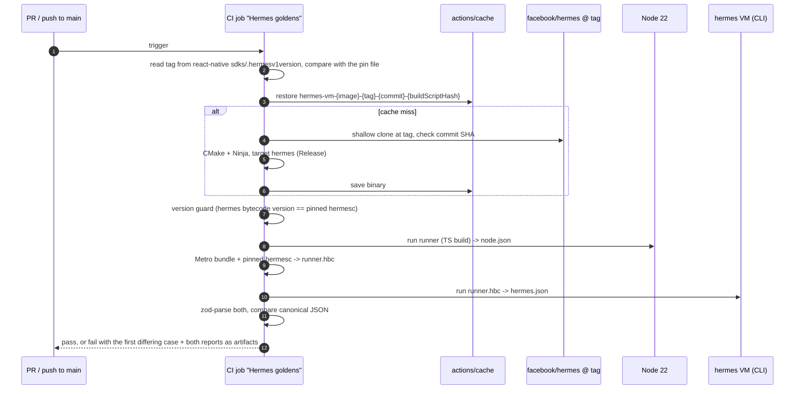

# 0016 — Hermes golden runner: a source-built `hermes` VM in CI and one runner for CI and device

- Status: Proposed
- Date: 2026-10-07
- Deciders: product owner (human), solution-architect, devops-sre, mobile-engineer, game-engine-engineer,
  ai-engineer; security-engineer review requested (supply chain of the CI build, §D2.4)
- Reversibility: **Two-way door.** Everything here is CI tooling and a preview-only screen. The only part that
  gets sticky is the runner report format once device reports are collected; it carries `runnerFormat` and changes
  through a version bump (§D3). Making the job a required check is an owner setting and can be undone.
- Relation to ADR-0013: **implements ADR-0013 §D8.2; supersedes nothing.** §D8.2 already decides that the golden
  runner runs on "the `hermes` CLI of the exact Hermes version shipped by the pinned Expo SDK" and that a diff fails
  CI. Its implementation note says that adding a runnable `hermes` VM "needs a dependency decision". This ADR is
  that decision. ADR-0013 (accepted) is not edited and its status line does not change. §D8.3 (device replay check)
  is complemented, not replaced, by the on-device runner (§D4).

> **Numbering.** ADR-0015 is earmarked by `docs/architecture/notes/bots-off-ui-thread.md` §5 (risk P5-R3), §6 and
> §8 for "bots on a worker runtime (option B, Worklets Bundle Mode)", to be written only if H1 data fires the §6
> switch rule. **That earmark is kept, so this ADR is 0016.** Reasons: (1) H1 runs in this sprint, so the
> conditional ADR may be needed within weeks; (2) closed, historical documents already use "ADR-0015" with that
> meaning (sprint 3 plan rows P5 and the Q5 exit check: "no ADR-0015"), and re-using the number would make them
> read wrongly; (3) gaps are already the convention here (ADR-0011 is reserved for protocol/event versioning).
> If H1 does not fire the switch rule by the Q6 exit check, the owner of the note may release 0015 there; it is then
> left unused, never re-assigned to an unrelated decision. The earmark text in the note now says the number is
> reserved. `docs/adr/` has no index or README (as ADR-0014 recorded); none is added here.

## Context

Sprint task A1 in `docs/sprints/2026-10-07-phase1-dogfood-readiness.md`. It comes before A2 (runner and
Diagnostics report schemas), P3 (CI Hermes golden job), A3 and DG1 (preview-only Diagnostics screen) and H1
(device timings).

- **Why it matters.** The app trusts Hermes and Node to give bit-identical engine and bot results (ADR-0013
  P-GLOBAL-02). Resume on the device compares state hashes (E-1.5 S3), and "Send match log" exports are replayed on
  Node during triage. A divergence breaks resume and the replay contract on device. The Q5 exit check
  (`docs/sprints/2026-10-06-phase1-playtest-gates-exit-check.md`) rated this S2, marked P3 as partial and made
  "Hermes golden job green and required" a condition for distributing a playtest build.
- **Why P3 stopped.** The pinned dependency tree has no runnable Hermes VM:

  | Fact (verified 2026-10-07)                                                                                                                                                                                              | Source                                                                                                                 |
  | ----------------------------------------------------------------------------------------------------------------------------------------------------------------------------------------------------------------------- | ---------------------------------------------------------------------------------------------------------------------- |
  | `expo` 57.0.26, `react-native` 0.86.3                                                                                                                                                                                   | `apps/mobile/package.json`                                                                                             |
  | `react-native@0.86.3` depends on `hermes-compiler` 250829098.0.17 (the only version in the lockfile)                                                                                                                    | `pnpm-lock.yaml`                                                                                                       |
  | `hermes-compiler` 250829098.0.17 ships only `hermesc` binaries (linux64, osx, win64) and `index.js`                                                                                                                     | npm tarball listing                                                                                                    |
  | Its npm `gitHead` is `3477757eb2475555cf8d8df24bfb1deb0613880d`                                                                                                                                                         | `npm view hermes-compiler@250829098.0.17`                                                                              |
  | Git tag `hermes-v250829098.0.17` in `facebook/hermes` points to that same commit                                                                                                                                        | `git ls-remote --tags https://github.com/facebook/hermes.git`                                                          |
  | `react-native@0.86.3` `sdks/.hermesv1version` = `hermes-v250829098.0.17`; `sdks/.hermesversion` = `hermes-v0.17.0`                                                                                                      | npm tarball of `react-native@0.86.3`                                                                                   |
  | Hermes V1 is the default runtime: the Gradle plugin's `HERMES_V1_ENABLED_FALLBACK = true`; the iOS podspec uses V1 unless `RCT_HERMES_V1_ENABLED=0`; the SDK 57 template opts out only if `expo.useHermesV1` is `false` | `@react-native/gradle-plugin@0.86.3`, `react-native@0.86.3` `sdks/hermes-engine`, `expo-template-bare-minimum@57.0.29` |
  | `apps/mobile` sets no Hermes V1 opt-out (`app.json`, `plugins/`, `eas.json`)                                                                                                                                            | repo                                                                                                                   |
  | The npm `hermes-engine-cli` package stops at 0.12.0                                                                                                                                                                     | `npm view hermes-engine-cli versions`                                                                                  |

  So the VM that runs our bundle on the phone is Hermes V1 built from `hermes-v250829098.0.17`, and the only
  version-matched way to get a `hermes` CLI is to build it from that tag.

- **Forces.** CI time (the "Lint, typecheck & test" job has a 30-minute timeout; the Q5 full run of lint,
  typecheck and test took 6 min 28 s), a re-pin on every Expo SDK bump (sprint risk 3), bundle headroom at
  88.2 % (the runner must not reach production), no adb access to the owner's phone (the sprint chose a
  preview-only Diagnostics screen for H1), and CLAUDE.md §1.2 (one rules engine: the runner must not
  re-implement any rule).

## Options considered

### A. Build the `hermes` VM from source at the matching tag, cached by tag (chosen)

Clone `facebook/hermes` at `hermes-v250829098.0.17`, check the commit SHA, build only the `hermes` CLI target in
Release mode, cache the binary keyed by tag, commit and runner image.

- Pros: exact source match with the device VM (same tag the RN build uses); runs on a normal Linux runner in
  seconds once cached; no emulator, no APK; the same bytecode format as the pinned `hermesc`, so the bundle can be
  run as release bytecode; fully scriptable re-pin.
- Cons: a cold build costs CI time (estimate 10–20 minutes, to be measured in P3); one more native toolchain in CI
  (CMake, Ninja, a C++ compiler); the CLI is x86-64 Linux, not arm64 Android, and is built with CLI defaults, not
  the Android build flags.
- Risk: the build may need extra system packages or flags on the V1 line; P3 finds out on the first run.

### B. The old `hermes-engine-cli` npm package — rejected

- Pros: zero build, one `npm install`.
- Cons: its last version is 0.12.0 (published 2022-08-25), three years older than the V1 line we ship. It
  would test a different VM, with a different bytecode version, so a green result proves nothing about the phone.
  This is the mismatch that stopped P3.

### C. Run the runner in an Android emulator in CI — rejected for now

- Pros: real Android Hermes, the real app binary, Android build flags.
- Cons: needs a full APK build (Gradle or EAS) on each run, plus emulator boot and KVM; typically 20–40 minutes
  per run and flaky (estimate, not measured here). The emulator is x86-64 too, so it does not close the arm64 gap
  either. Too slow and too flaky for a required check on every PR.
- Revisit: when a nightly device-farm or emulator E2E suite exists for Maestro flows (the runner can ride on it).

### D. On-device only (Diagnostics screen, no CI job) — rejected as the only check

- Pros: the real phone, arm64, release Hermes, real build flags; no CI cost.
- Cons: manual, rare and depends on a human with the phone. It cannot gate a PR, so a divergence would be found
  weeks after it was merged. It stays part of the decision (§D4) as the second layer, not the only one.

### E. A prebuilt `hermes` CLI from a GitHub release of the tag — not chosen, kept as a revisit trigger

- Could replace the source build if `facebook/hermes` publishes a CLI asset with a checksum for each V1 tag. Not
  verifiable from this sandbox (the GitHub API and release pages are not reachable here). If P3 finds such an
  asset, it may use it with a pinned sha256 instead of building; the rest of this ADR does not change.

## Decision

### D1. Two layers, one runner

1. **CI layer (every PR and every push to `main`, no path filter, so it can be a required check):** the golden
   runner runs on Node 22 and on the source-built `hermes` VM. The two reports must be equal (§D3.2). This catches
   regressions at merge time.
2. **Device layer (manual, preview builds only):** the same runner, the same corpus, runs inside the app on a
   real phone from the Diagnostics screen (DG1). This covers what the CLI cannot: arm64, the Android build flags
   and the real Metro + `hermesc` release pipeline end to end. H1 records it.



### D2. The `hermes` VM in CI

1. **Pin.** A pin file (proposed: `tools/hermes/hermes-pin.json`, created by P3) holds
   `{ "tag": "hermes-v250829098.0.17", "commit": "3477757eb2475555cf8d8df24bfb1deb0613880d" }`. The tag is the
   value of `react-native/sdks/.hermesv1version` resolved from `apps/mobile`. The job fails if the two differ, with
   a message that names the re-pin step (§D6). Tags can move; the commit is the real pin.
2. **Build.** Shallow clone at the tag, fail if `HEAD` is not the pinned commit, configure Release with CMake and
   Ninja, build only the `hermes` CLI target. No Hermes source is vendored into this repo. Build inputs are a
   script in the repo (proposed: `tools/hermes/build-hermes.sh`), so a change to it changes the cache key.
3. **Cache.** `actions/cache` key `hermes-vm-<ImageOS>-<arch>-<tag>-<commit>-<hash of build script>`. Only the
   built binary (and any shared library it needs) is cached, not the build tree. The runner image is part of the
   key because the binary links against the image's libc.
4. **Supply chain.** Same rules as the other jobs: actions pinned by SHA, `permissions: contents: read`, no
   secrets in the job. The source is fetched from the official repository at a pinned commit. A PR cannot change
   the cache that `main` uses (GitHub scopes caches by branch). security-engineer reviews this section and the P3
   workflow.
5. **Version guard.** Before running, the job checks that the bytecode version printed by the built `hermes` equals
   the one printed by the pinned `hermesc` from `node_modules`. A mismatch fails with "re-pin needed".

### D3. The runner

1. **One pure TypeScript runner** in a new private workspace package (proposed name `@codelex/golden-runner`,
   `packages/golden-runner`, created with `/scaffold`; owner game-engine-engineer, consulted ai-engineer for the
   bots suite). It imports `@codelex/game-engine` and `@codelex/bots` and calls their public APIs only. It contains
   no rule logic (CLAUDE.md §1.2). It is a package and not a test file because the app imports it for DG1, and it
   cannot live in `game-engine` because it also drives `bots` (which depends on `game-engine`).
2. **Pure core, thin hosts.** The core is `runGoldens(corpus) => report`: no I/O, no `Date`, no `Math.random`,
   no `Intl`, no `node:*` imports, with timings injected by the host (ENGINEERING §3 rules apply). The corpus is the
   published golden files, imported as JSON so the bundler embeds them. Hosts:
   - Node: runs the core and writes the report to stdout (CI, and the reference for device reports).
   - Hermes CLI: the core bundled into one script, which ends with `print(JSON.stringify(report))`.
   - App: the DG1 screen calls the core and wraps the report in the Diagnostics report (A2).
3. **Suites.** Required in P3: `rng.json`, `sha256.json`, `jcs.json`, `scoring/v1/*`, `replays/v1/*` (all under
   `packages/game-engine/test/golden/`). Added in P3 if its fixture can be built without Node APIs, and before H1
   otherwise: bot decisions (`packages/bots/test/golden/decisions-b2-r1.json`, the file the bots golden test pins
   for `BOT_VERSION` 2 and `engineRulesVersion` 1, with its synthetic 2,000-form fixture). Every new frozen rules
   version (for example `replays/v2` if R4 fires) adds its suite in the same PR. Draft goldens
   (`test/golden/drafts/`) are out of scope.
4. **Bundling for Hermes.** The runner is bundled with the app's Metro and Babel configuration and compiled with
   the pinned `hermesc` using the flags of a release `expo export`, so the CLI runs the same transformed code shape
   as the app. If a standalone Metro bundle proves impractical, P3 may use another bundler only if it applies the
   same Babel preset; the choice is recorded in the P3 PR.

### D3.1 Runner output contract (outline; A2 freezes the zod schema)

```jsonc
{
  "runnerFormat": 1,
  "runtime": { "kind": "node" | "hermes-cli" | "hermes-app", "version": "…", "bytecodeVersion": 0 }, // not compared
  "corpus": {
    "digest": "<sha256 hex of the JCS of { path: content } for every corpus file>",
    "engineRulesVersions": [1],
    "botVersion": 2
  },
  "suites": [
    {
      "id": "rng" | "sha256" | "jcs" | "scoring/v1" | "replays/v1" | "bots/decisions-b2-r1",
      "cases": [
        { "id": "<stable case id>", "status": "pass" | "fail" | "error",
          "observed": "<the computed value, or its sha256 if larger than 1 KB>",
          "errorCode": "<typed error name, only when status is error>" }
      ],
      "summary": { "pass": 0, "fail": 0, "error": 0 }
    }
  ],
  "verdict": "pass" | "fail",
  "timings": { "<suite id>": { "totalMs": 0 } } // optional, not compared
}
```

Rules A2 must keep: case ids and suite order are deterministic; `observed` holds what the runtime computed (not only
pass or fail), so a diff names the exact case; replays report their `stateHashes`, not whole states; no stack
traces, no device identifiers and no user data in the runner report (device model and OS belong only to the
Diagnostics wrapper, and only in preview builds); every value is in the ADR-0013 §D3 JCS subset (ASCII-printable
strings, safe integers), so the engine's own serialiser can canonicalise it; the report stays under 256 KB.

### D3.2 Comparison

A host-independent Node script (part of the package) parses both reports with the A2 schema, removes `runtime` and
`timings`, and compares the bytes of the engine's JCS serialiser (ADR-0013 §D3). Pass means: both parse, both have
`verdict: "pass"`, and the canonical bytes are equal. On failure it prints the first differing suite and case and
both values. The device layer uses the same script: a Diagnostics report is compared with the Node report of the
same commit and the same `corpus.digest`.

### D4. Device layer

DG1 imports the core and the corpus only behind the preview-only build-time constant that A3 specifies; the
production bundle test proves the runner's marker strings are absent (sprint indicator 6). The report leaves the
phone through the TM-04 share and cleanup path (A3, security-engineer). A device mismatch is triaged like a CI
mismatch (§D5) and is an H1 failure.

### D5. Failure policy

1. Any of these fails the job: pin mismatch, wrong commit at the tag, Hermes build failure, version guard, runner
   crash, schema parse failure, any case not `pass` on either runtime, or any difference in canonical bytes.
2. **No automatic retry and no `continue-on-error`.** The runner is deterministic, so a flaky result is itself a
   defect to investigate. Infrastructure failures (clone or cache service down) may be re-run by hand; if that
   happens more than twice in 30 days, devops-sre adds a mirror or a longer-lived cache.
3. **A Node/Hermes difference blocks merge and release.** Fix the cause in the engine or bots code; never change a
   golden to match one runtime (the "Golden immutability" job already forbids editing published goldens). If a
   primitive is at fault, ADR-0013's revisit trigger applies (new rules version, superseding ADR).
4. Both reports are always uploaded as job artifacts (small; 14-day retention), so a failure is diagnosable without
   a re-run.
5. **Required check.** The job is proposed to the owner as a required check once it has passed on `main` five runs
   in a row including one cache-hit run (sprint indicator 2; human ask 5). Only the owner can make it non-required
   again, for example during an upstream Hermes build break, with a tracking issue and an expiry of at most 7 days.
   Agents never weaken it (CLAUDE.md §7).

### D6. Re-pin step (SDK upgrade checklist)

No SDK-upgrade checklist existed: the re-check notes were spread over `mobile-app-foundation.md` §7 and
`docs/security/audit-exceptions.md`. This ADR adds one in `docs/architecture/notes/mobile-app-foundation.md` §2.1,
next to the SDK pin table and the "upgrade one SDK at a time" rule. The Hermes step reads:

> Re-pin the Hermes VM: read `sdks/.hermesv1version` from the new `react-native` and the `hermes-compiler`
> version from `pnpm-lock.yaml`; resolve the tag to its commit (`git ls-remote --tags`) and check that it equals
> the `hermes-compiler` npm `gitHead`; update the pin file; let the Hermes golden job build the new VM (cold
> cache) and pass; record the cold build time in the PR.

The pin check in §D2.1 makes it impossible to forget: an SDK bump PR fails the job until the pin matches.

### D7. Budgets

| Item                                        | Budget                                                           | Basis                                         |
| ------------------------------------------- | ---------------------------------------------------------------- | --------------------------------------------- |
| Job wall time, cache hit                    | ≤ 6 min (install, build two packages, bundle, run both, compare) | estimate; P3 measures                         |
| Runner execution on the Hermes CLI          | ≤ 60 s                                                           | corpus ≈ 150 KB of JSON; estimate             |
| Job wall time, cold (once per tag or image) | ≤ 25 min; job timeout 35 min                                     | estimate of a Release build of one CLI target |
| Cache entry size                            | ≤ 100 MB; one live entry per tag and image                       | assumption; GitHub repo cache limit is 10 GB  |
| Cold builds per month                       | ≤ 2 (SDK bump, runner image update)                              | SDK cadence                                   |
| Runner report size                          | ≤ 256 KB                                                         | §D3.1                                         |
| Production bundle delta                     | 0 bytes                                                          | §D4; bundle gate                              |

The job runs in parallel with the existing jobs, so it adds no wall time to a PR unless it is the slowest job.
Timings from the CLI are reported, never gated: they are x86-64 numbers and give H1 only an interim Hermes factor.

## Consequences

### Positive

- The S2 finding of Q5 gets an automatic gate at merge time, with a VM that matches the shipped one by source tag
  and commit, and a second layer on real hardware.
- One runner and one comparison script serve CI, the device and triage; no second copy of any rule.
- SDK bumps cannot silently drift the VM: the pin check fails first.

### Negative / costs

- A native toolchain in CI and a cold build of up to about 25 minutes on each re-pin.
- The CLI is not the phone (architecture, compiler, build flags). Residual risk stays until DG1/H1 runs and on each
  SDK bump until the device layer is re-run.
- One more workspace package to maintain.

### Assumptions (not verifiable from the repo or this sandbox)

1. The V1 line builds its `hermes` CLI target on the GitHub `ubuntu-24.04` image with CMake, Ninja and the default
   compiler, without extra flags. Cold build time and binary size are estimates.
2. The Android release artefact for 250829098.0.17 is built from the same tag (the Gradle plugin reads the same
   `.hermesv1version`; Android may consume a prebuilt Maven artefact of that version rather than building it).
3. The CLI's bytecode version matches the pinned `hermesc` (§D2.5 turns this into a check).
4. No prebuilt CLI asset exists for the V1 tag (option E); not checked.
5. CI minutes are not a binding cost (the repository serves GitHub Pages; if it is private on a paid plan, about
   4 minutes per run is the added cost).
6. The bots fixture can be produced without Node APIs; otherwise the bots suite lands before H1 as a follow-up.

### Follow-up tasks

| Owner                               | Task                                                                     | Acceptance criteria                                                                                                                                                                         |
| ----------------------------------- | ------------------------------------------------------------------------ | ------------------------------------------------------------------------------------------------------------------------------------------------------------------------------------------- |
| solution-architect, mobile-engineer | A2: zod schemas for the runner report (§D3.1) and the Diagnostics report | Schemas frozen with `runnerFormat: 1`; a Node report and a hand-made Hermes report parse; device fields allowed only in the Diagnostics wrapper; comparison rules of §D3.2 written as tests |
| game-engine-engineer (ai-engineer)  | Runner package and Node host                                             | Created with `/scaffold`; pure core passes the engine purity lint; suites of §D3 item 3; Node report `verdict: pass` on `main`; 90 % coverage floor as for `game-engine`                    |
| devops-sre, mobile-engineer         | P3: pin file, build script, CI job "Hermes goldens"                      | §D2 and §D5 implemented; green on `main`; a re-run is a cache hit; cold and warm times recorded in the PR; a deliberately changed `observed` value fails in a test                          |
| security-engineer                   | Review §D2.4 and the P3 workflow                                         | Sign-off recorded in the P3 PR                                                                                                                                                              |
| mobile-engineer, security-engineer  | A3 and DG1: device layer (§D4)                                           | As in the sprint rows; production bundle test proves the runner absent                                                                                                                      |
| mobile-engineer                     | H1: run on the owner's phone                                             | Diagnostics report compares equal to the Node report of the same commit                                                                                                                     |
| product owner                       | Make "Hermes goldens" a required check                                   | After §D5.5 is met                                                                                                                                                                          |

### Revisit triggers

- `facebook/hermes` publishes a checksummed CLI asset per V1 tag (switch to option E).
- An emulator or device-farm suite exists for Maestro (add the runner to it; option C becomes cheap).
- Cold builds exceed 25 minutes or happen more than twice a month.
- The app opts out of Hermes V1 (`expo.useHermesV1: false`) or a future SDK changes which file names the VM tag:
  the pin source in §D2.1 must follow.
- Any Node/Hermes or CLI/device difference (ADR-0013 revisit trigger).
