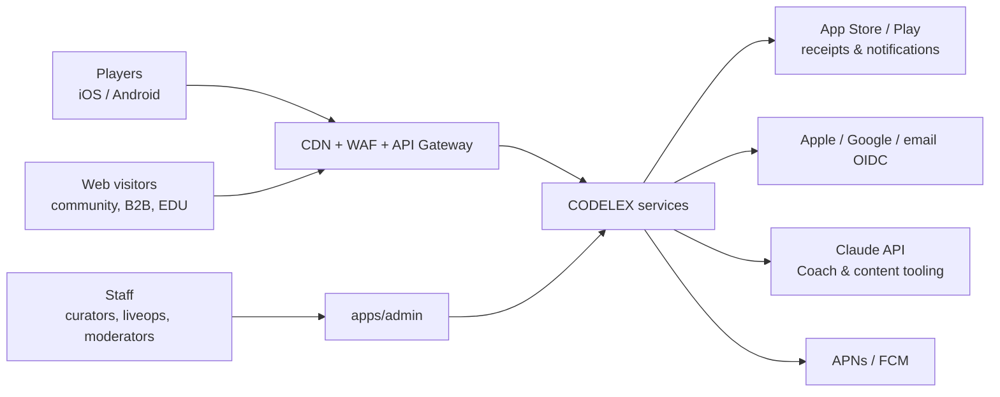
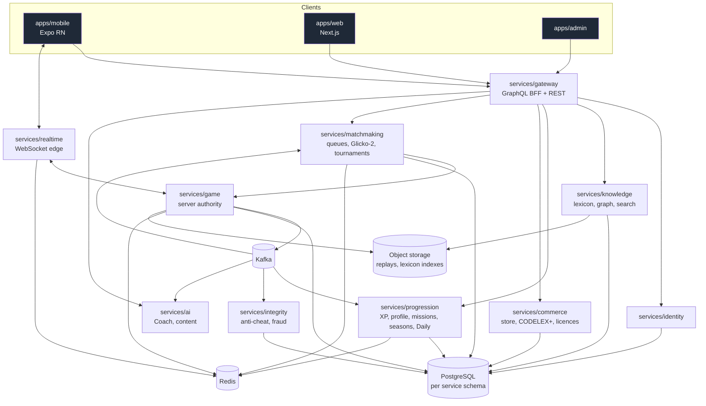
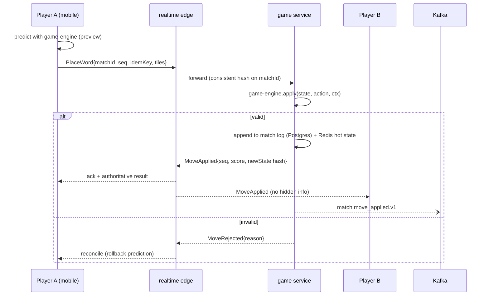

# CODELEX — Architecture

Owner: `solution-architect`. Decisions are recorded in `docs/adr/`. This document describes the **target**
architecture; the roadmap decides what exists when. Diagrams are Mermaid.

## 1. System context

## 2. Containers

Shared libraries: `packages/game-engine` (rules, used by clients for prediction and by `services/game` for
authority), `packages/protocol` (messages & event schemas), `packages/lexicon` (schema, data, index build),
`packages/bots`, `packages/observability`, `packages/design-system`, `packages/i18n`.

## 3. Key flows

### 3.1 Ranked move (server-authoritative)

### 3.2 Match end → progression, integrity, ranking
`match.finished.v1` is consumed by `progression` (XP, technology profile, missions, achievements),
`matchmaking` (Glicko-2 update), `integrity` (detectors), `ai` (coach features), analytics.
All consumers are idempotent (dedupe on `eventId`).

### 3.3 Daily CODELEX
At 00:00 UTC a scheduled job (in `progression`) materialises Daily #N from a seed + lexicon version; clients fetch
it through the CDN; submissions are scored by `game` with the engine; leaderboard in Redis sorted sets,
snapshotted to Postgres; integrity checks identical-solution timing.

### 3.4 Lexicon publish
Curator edits in `apps/admin` → draft in `knowledge` → validation (same rules as `packages/lexicon` validator) →
4-eyes approval → new `lexiconVersion` → index build (GADDAG) → object storage + CDN → flag rollout. Matches pin
a `lexiconVersion` at start; replays keep working with old versions.

## 4. Data ownership

| Context | Owns | Store |
|---|---|---|
| identity | accounts, devices, auth sessions, friends, follows, blocks, clans, orgs, memberships | Postgres (RLS for org data) |
| game | matches, match log (event-sourced), replays | Postgres + Redis hot state + object storage |
| matchmaking | queues, ratings per mode/season, tournaments, brackets | Redis (queues) + Postgres |
| knowledge | terms, aliases, translations, categories, relations, profiles, embeddings | Postgres + pgvector |
| progression | XP ledger, technology profile, missions, achievements, seasons, Daily | Postgres + Redis leaderboards |
| commerce | products, entitlements ledger, receipts, subscriptions, licences | Postgres (strict) |
| integrity | signals, cases, actions, appeals | Postgres + warehouse |
| ai | prompts versions, coach insights cache, eval results | Postgres |

No cross-context table access; integration via APIs or events only.

## 5. Non-functional requirements (defaults)

| NFR | Target |
|---|---|
| Move round-trip p95 | < 150 ms in-region, < 300 ms cross-region |
| Ranked matchmaking | p50 < 10 s, p95 < 30 s |
| Availability | game/realtime 99.95%, others 99.9% |
| RPO / RTO | ≤ 5 min / ≤ 30 min; purchases RPO 0 |
| Cold start (mid-range Android) | < 3 s to playable |
| Engine `apply` p99 | < 1 ms |
| Word validation | < 5 µs |
| Daily leaderboard burst | 50k writes/s |
| Graceful degradation | AI down → Coach hidden, game unaffected; knowledge down → cards cached, play continues |

## 6. Cross-cutting

- **Security**: OIDC, short-lived JWT, mTLS between services (mesh), zero-trust admin, secrets via secret manager.
- **Observability**: OpenTelemetry everywhere; trace IDs propagate client → gateway → services → Kafka headers.
- **Config & flags**: remote config + feature flags (OpenFeature API) for modes, powers, seasons, store items.
- **Multi-region**: matches pinned to a region; identity global (primary + regional replicas); Kafka per region
  with mirrored aggregates; CDN for static, lexicon indexes and Daily payloads.
- **Versioning**: protocol messages and events versioned; clients declare `protocolVersion`; server supports N-1.
