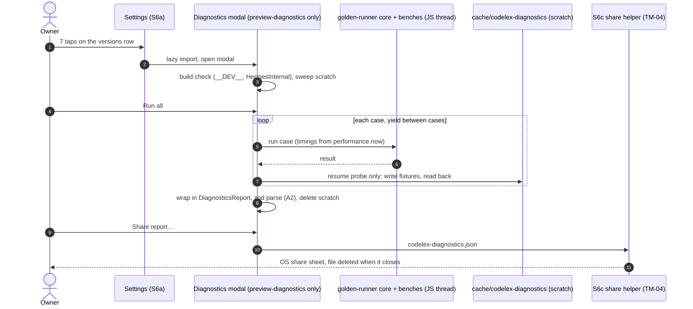

# Design note — preview-only Diagnostics screen (DG1)

- Status: Implemented by DG1 (in review, 2026-10-16; record and deviations in §13) · Date: 2026-10-07 ·
  Owner/author: solution-architect (with mobile-engineer)
- Reviewed-by: security-engineer 2026-10-07 (§10: approved with conditions SC-1..SC-6); pending mobile-engineer,
  ux-ui-designer (copy and accessibility, §8)
- Sprint: `docs/sprints/2026-10-07-phase1-dogfood-readiness.md`, task A3. Unblocks DG1, then H1.
- Inputs (normative): ADR-0016 §D1 and §D4; `bots-off-ui-thread.md` §6–§7; E-1.5 spec "Device timings (H1)", Q-17
  and OQ-SP2-1..6; E-1.5 design §5.8 (Settings) and §5.9 (share); threat model
  `docs/security/threat-models/e-1.5-s1-persistence-match-log.md` (TM-03, TM-04, I-2, I-3, I-7);
  `mobile-app-foundation.md` §6 (bundle gate).
- No new ADR: this note implements ADR-0016 §D4. Everything here is reversible (no native dependency, no data
  format other than the A2 report, which is versioned).
- Not to be confused with the **"Share diagnostics"** button of the lexicon-error screen (design D-24, §5.10.1). That
  is a production feature (versions and an error code). This note is about a developer screen that never ships.

## 1. Decisions

| ID   | Decision                                                                                                                                                                                                                                                                                                                                                     |
| ---- | ------------------------------------------------------------------------------------------------------------------------------------------------------------------------------------------------------------------------------------------------------------------------------------------------------------------------------------------------------------ |
| DS-1 | The gate is a **build constant**, `EXPO_PUBLIC_CODELEX_DIAGNOSTICS=1`, not a feature flag. Flags are parsed at runtime (`src/config/flags.ts`), so they cannot remove code.                                                                                                                                                                                  |
| DS-2 | The constant is set in **one new EAS profile, `preview-diagnostics`**, that extends `preview`. It is not set in `preview` itself, because `preview` is the profile the Stage 0/1 playtest builds come from (Stage 1 has ≥ 30 external testers). The Diagnostics build is a preview-class build (same release settings), installed on the owner's phone only. |
| DS-3 | **No route file.** The screen is a full-screen `Modal` opened from Settings. A file in `src/app/` would be bundled in production by Expo Router's `require.context`, and it would add a `codelex://` deep-link path.                                                                                                                                         |
| DS-4 | Proof of absence is a test, not a reasoning: `bundle:check` fails if a diagnostics module path or marker string is in the production export, and a **positive control** export (constant on) must contain them, so the check cannot pass by being blind.                                                                                                     |
| DS-5 | Everything runs on the **JS thread** (where bots run today, option A of `bots-off-ui-thread.md`), one case at a time, yielding between cases. Cancel is cooperative.                                                                                                                                                                                         |
| DS-6 | The screen never touches `<documents>/codelex-data` (`current.log`, `current.snap`, `last.log`, `terms.seen`, `resume.guard`). The resume probe uses a scratch directory in the cache.                                                                                                                                                                       |
| DS-7 | Output is one `DiagnosticsReport` (A2 schema, `@codelex/golden-runner`), shared through the TM-04 share and cleanup path. No analytics event, no network, no console output.                                                                                                                                                                                 |
| DS-8 | Copy lives in a **feature-local EN/FR catalog** inside the diagnostics module, checked with `checkCatalogs()`. The shared catalog would put the strings in production.                                                                                                                                                                                       |

## 2. Preview profile check (finding for H1)

**The EAS `preview` profile is a release build that runs Hermes bytecode, not a dev client.** Verified on
2026-10-07 from `apps/mobile/eas.json` and the resolution code of `@expo/build-tools` 24.11.0
(`dist/android/gradle.js`, `dist/ios/resolve.js`):

- `preview` sets no `developmentClient` (default `false`), no `gradleCommand` and no iOS `buildConfiguration`.
  Android with `buildType: "apk"` resolves to `:app:assembleRelease`; iOS resolves to `Release`. A dev client would
  resolve to `:app:assembleDebug` / `Debug`.
- `expo-dev-client` is not a dependency of `apps/mobile`, so no dev-client build can exist anyway.
- The JS engine is Hermes and cannot be switched at SDK 57 (`mobile-app-foundation.md` §2). A release Gradle build
  compiles the bundle with `hermesc`; the device VM is Hermes V1 at `hermes-v250829098.0.17` (ADR-0016 Context).
- iOS: `preview` has no iOS section. Internal distribution on iOS needs ad hoc provisioning (Apple account, human
  ask 4). H1 is Android-first.

**No change to `preview` is needed.** To keep it true, DG1 adds a `node:test` over `eas.json` (§11, DG1-a), and the
screen checks the build at runtime: it shows a warning banner and marks the report invalid for timings if
`__DEV__` is `true` or `globalThis.HermesInternal` is missing.

New profile (DG1-a). `EXPO_PUBLIC_CODELEX_FLAGS` is repeated so the profile does not depend on how `extends` merges
`env`:

```jsonc
"preview-diagnostics": {
  "extends": "preview",
  "env": {
    "EXPO_PUBLIC_CODELEX_FLAGS": "play_vs_bot.enabled=1",
    "EXPO_PUBLIC_CODELEX_DIAGNOSTICS": "1"
  }
}
```

## 3. Build-time gate and dead-code elimination

### 3.1 Why it works (verified against the pinned toolchain)

1. `babel-preset-expo` (57.0.x, `plugins/inline-env-vars.js`) replaces `process.env.EXPO_PUBLIC_*` with its literal
   value **in production transforms only**. When the variable is unset, the value is `undefined`. In dev transforms it
   becomes a reference to `expo/virtual/env`, which is not folded.
2. `metro-transform-worker` (0.84.x) runs `constantFoldingPlugin` **when `dev` is false**, before
   `collectDependencies`. A folded-away branch is removed, so its `require()` or `import()` is never collected, and
   Metro never bundles the module.
3. Folding works **inside one file only**, and it gives up on any test that contains a call. A constant exported
   from another module is not folded.

`expo export` (CI) and EAS release builds both use `dev: false`. So: production export = constant unset = no
diagnostics code.

### 3.2 Code shape (the only allowed pattern)

One gate file in production code, for example `apps/mobile/src/features/settings/diagnostics-gate.ts`:

```ts
// Metro folds this in release transforms. Without the constant the export is null and the import below is removed
// before dependency collection (docs/architecture/notes/diagnostics-screen.md §3). Keep the comparison literal and
// in this file: Metro does not fold constants across modules or through calls.
export const DiagnosticsEntry =
  process.env.EXPO_PUBLIC_CODELEX_DIAGNOSTICS === "1"
    ? lazy(() => import("../../diagnostics/entry"))
    : null;
```

- Settings renders the version label through `DiagnosticsEntry` when it is not `null`, else as plain `Text` (§4).
- If `import()` inside `lazy` does not fold as expected in the native export, a synchronous `require()` in the same
  ternary is the fallback, with a one-line justified lint disable. The export tests (§3.3) decide, not this note.
- Lint (DG1-a): `no-restricted-imports` forbids importing `src/diagnostics/**` and `@codelex/golden-runner` from
  any file except the gate. Inside `src/diagnostics/**`, `no-restricted-globals` forbids `fetch`, `XMLHttpRequest`
  and `WebSocket`, and `no-restricted-imports` forbids the analytics queue, `match-session` and `createDeviceFs`.
  `Platform.constants` is forbidden outside `src/diagnostics/**` (`no-restricted-syntax`), so the device fields
  (§7) have one source.
- Diagnostics code lives in `apps/mobile/src/diagnostics/` (UI, benches glue, report wrapper, local catalog) and
  in `@codelex/golden-runner` (core, corpus, bench helpers, `DiagnosticsReport`).

### 3.3 Proof in `bundle:check` (concrete for DG1)

New file `apps/mobile/bundle-preview-only.json` (owner mobile-engineer, reviewed by security-engineer):

```jsonc
{
  "modulePathPatterns": [
    "apps/mobile/src/diagnostics/",
    "packages/golden-runner/",
    "node_modules/@codelex/golden-runner/",
    "packages/game-engine/test/golden/",
    "packages/bots/test/golden/",
  ],
  "markers": ["CODELEX_DIAGNOSTICS_SCREEN_V1", "CODELEX_GOLDEN_RUNNER_V1"],
}
```

- **Markers.** `src/diagnostics/entry.tsx` exports `DIAGNOSTICS_MARKER = 'CODELEX_DIAGNOSTICS_SCREEN_V1'` and uses
  it at runtime (the screen's root `testID`), so the minifier keeps it. `@codelex/golden-runner` exports
  `GOLDEN_RUNNER_MARKER = 'CODELEX_GOLDEN_RUNNER_V1'` and writes it into the report wrapper (A2 field, for example
  `generator`). Hermes stores ASCII string literals verbatim in the bytecode string table, so a byte search of the
  `.hbc` finds them.
- **Absence check (production).** `check-bundle-contents.mjs` gains a second check on the same `expo export`
  output, for android and ios: (1) no source-map `sources` entry, normalised to `/`, contains a
  `modulePathPatterns` entry (workspace packages appear as relative paths, not under `node_modules/`, so the
  existing `packagesInSources` cannot catch them); (2) no marker occurs in the bundle bytes. It fails closed: a
  missing map or bundle fails, and the check fails if `EXPO_PUBLIC_CODELEX_DIAGNOSTICS` is set in its environment.
- **Positive control.** A new script `bundle:check:diagnostics` (a Node script that sets the variable and spawns
  `expo export --platform android --source-maps --output-dir dist-diagnostics`) runs the same functions on that
  export and **requires** at least one source under `apps/mobile/src/diagnostics/`, at least one golden-runner
  source (`packages/golden-runner/` or `node_modules/@codelex/golden-runner/`) and both markers. CI runs it in the existing
  "Bundle-size budget" step, after `bundle:check`, under the same affected filter. Turbo already keys `build` on
  `EXPO_PUBLIC_*`; the new task declares the same `env` and outputs `dist-diagnostics/**`. It prints the preview
  bundle delta (§9).
- Pure functions (`sourcesMatching`, `markersIn`) get `node:test` cases: a clean map passes, a map with each
  pattern fails, a bundle with each marker fails, and a missing map fails.

## 4. Entry

- **Where.** No version label exists in the app today (`home.engine_version` and `home.lexicon_version` are in the
  catalog but unused). The entry is the **"About this build" versions row** (`settings.about.versions`, design §5.8)
  of the Settings screen that S6a builds. DG1 depends on S6c, so Settings exists. ASSUMPTION (spec "Flags &
  rollout"): the versions row is not behind `analytics.upload.enabled`.
- **Gesture.** 7 taps, each within 1 s of the previous; a longer gap restarts the count. No toast, no countdown, no
  haptic. The 7th tap opens the Diagnostics modal.
- **Production.** The row is plain `Text`: not pressable, no role, no handler. The gesture code is in the
  diagnostics module, so it is removed too.
- **Procedure (H1 checklist).** Open Settings from Home, not from the match menu, so that no bot turn competes for
  the JS thread. The run also waits 3 s before the first timed suite.

## 5. What it runs

Inputs are bundled constants only: the golden corpus, the bench seeds and the app's already loaded lexicon index.
The screen reads no file and parses no external input.

| Suite (order)     | Source                                                                                                                                                                               | Output (all timings integer µs)                                                        | Est. time (owner device) |
| ----------------- | ------------------------------------------------------------------------------------------------------------------------------------------------------------------------------------ | -------------------------------------------------------------------------------------- | ------------------------ |
| 1. Goldens        | ADR-0016 §D3 `runGoldens(corpus)`, suites `rng`, `sha256`, `jcs`, `scoring/v1`, `replays/v1`, `bots/decisions-b2-r1`. **Covers §7 item 4** (decision equality, 20 positions per bot) | Runner report (§D3.1), compared on a computer with the Node report by the §D3.2 script | ≤ 3 min                  |
| 2. Micro-benches  | `has()` in batches of 1,000 calls over bundled forms and as many seeded non-words; `apply` per action over the `replays/v1` logs; index read + digest + decode once                  | `has()` p50/p99 per call; `apply` p50/p95/max; index load                              | ≤ 30 s                   |
| 3. Bot compute    | §7 items 1–2: the 200 Node §2 positions plus the two-blank set, Beginner and Strategist, frozen `BOT_VERSION` budgets                                                                | Per decision: µs, nodes, candidates, cap bound. p50/p95/max per bot and rack type      | ≤ 4 min                  |
| 4. Resume probe   | §5.2                                                                                                                                                                                 | p50/p95/max per restore path                                                           | ≤ 30 s                   |
| 5. Drift          | §7 item 6: 10 consecutive Strategist vs Beginner matches, no think delay                                                                                                             | Strategist p95 per match (drift = last vs first)                                       | ≤ 3 min                  |
| 6. Responsiveness | §7 item 3, semi-manual, separate button, never in "Run all"                                                                                                                          | UI fps, JS fps, tap-to-feedback; `manual: true`                                        | 30 s                     |

- **Bench positions.** The Node §2 position generator (`packages/bots/test/support`) moves to a bench module of
  `@codelex/golden-runner` that calls only public `@codelex/bots` and `@codelex/game-engine` APIs, so the Node
  harness and the device use one copy (ai-engineer). Per-decision samples go into the report, and `c_node`, `c_cand`
  and `T_fixed` (bots-api §6) are fitted offline by the Node comparison tooling, which also computes the Hermes
  factor against the Node table on the same positions. No floating-point fit runs on the phone.
- **Responsiveness.** The panel renders `BoardView` on a fixed mid-game position and runs the worst-case
  two-blank Strategist decision back to back for 30 s while the owner drags and zooms. UI fps comes from a
  Reanimated `useFrameCallback`, JS fps from `requestAnimationFrame`, tap-to-feedback from a test button
  (`onPressIn` timestamp to the next frame after the state commit). Drop-commit latency is observed by hand in a
  real match if `BoardView` cannot commit a drop on its own (DG1 records which).
- **Item 5 of §7** (worker runtime) is out of scope: no option B prototype exists.

### 5.1 Thread, duration, cancel

- JS thread. Cases run one at a time; between cases the runner yields (`setTimeout(0)`) so progress renders and
  Cancel is handled. A case is never split, so the cancel latency is one case (worst case a two-blank decision,
  about 1–2 s on a slow phone). Yield time is outside every measured interval.
- "Run all" runs suites 1–5 in order, target ≤ 10 min on the owner's phone (estimates above; DG1 records real
  times). Each suite can also run alone.
- **Cancel** (button, Android back, closing the modal): stops at the next case boundary, discards all results of the
  run, deletes the scratch directory and shows `diagnostics.cancelled`. There are no partial reports.
- **Interruption**: if `AppState` leaves `active`, the run is cancelled the same way (background timings are
  meaningless) and `diagnostics.interrupted` is shown on return. A crash or kill loses only memory; the scratch
  directory is swept when the screen opens.
- The screen does not keep the screen awake (that would be a new dependency). The copy asks the owner to keep it on.

### 5.2 Resume probe and data isolation

- Fixtures are built on device: 3 seeded Beginner vs Beginner matches, journals cut at 30, 60 and 90 actions, each
  with and without a snapshot.
- They are written with the production `DataStore`/`createPersistence` code to `<cache>/codelex-diagnostics/` through
  a new `createScratchFs()` in `src/persistence/` (cache directory, never `DATA_DIR`). Each timed iteration (20 per
  fixture and path) creates a fresh persistence object and measures `openSavedMatch` from the call to the restored
  model: read, parse, snapshot plus tail, or full replay. Rendering the first observation is not included, so the
  number is a lower bound of the `game-engine-api.md` Q7 budget (p95 ≤ 300 ms, reference class only).
- The scratch directory is deleted after the suite, on cancel, and when the screen opens.
- Test (DG1-d): with a `MemoryFs` standing in for `codelex-data`, a full run leaves its files and bytes unchanged,
  and the scratch factory refuses `DATA_DIR`.



## 6. Output and share

- **Report.** `DiagnosticsReport` from `@codelex/golden-runner` (A2, written in parallel; this note does not
  restate it). It wraps the runner report of ADR-0016 §D3.1 and adds the bench sections, the build check and the
  device fields of §7. It is held in memory only and zod-parsed before any write. A2's size cap applies (the runner
  report alone is ≤ 256 KB; target ≤ 512 KB for the whole report).
- **Share.** The S6c share and cleanup helper, unchanged: a fixed file name `codelex-diagnostics.json`, written to
  the S6c share directory in the cache, shared through the platform's scoped provider, deleted when the share sheet
  closes. Requirement on S6c (or DG1 if S6c is merged): the start-up sweep removes **every file in the share
  directory**, not a list of names, so the production bundle needs no diagnostics file name.
- The file is created on tap of "Share report…", not before. There is no "Did you send it?" step: nothing is
  queued, so there is nothing to clear.
- **No analytics event, no network, no logs.** Lint enforces it (§3.2), and a test asserts that a full run adds
  nothing to the S6a queue.
- **Comparison.** On a computer, the ADR-0016 §D3.2 script parses the file (untrusted input, size cap, zod) and
  compares the runner part with the Node report of the same commit and `corpus.digest`. A mismatch is an H1
  failure, triaged as in ADR-0016 §D5.

## 7. Privacy

- **Device fields** (allowed by A2 in the Diagnostics wrapper only): platform, OS version, and on Android
  `Platform.constants` `Manufacturer`, `Model`, `Release` and `Version` (API level), picked one by one. Never spread
  `Platform.constants`: `Fingerprint`, `Serial` and `ServerHost` are excluded. iOS has no model in
  `Platform.constants`; the report has none (no new dependency). RAM is not available without `expo-device`; the
  owner records it in the H1 record (spec: model, RAM and Android version).
- **Build fields:** app version and build number, `PLAY_RULES_VERSION`, `BOT_VERSION`, lexicon version, Hermes VM
  properties from `HermesInternal.getRuntimeProperties()` (at least the release version and bytecode version, if
  present; DG1 records which keys Hermes V1 exposes), `__DEV__`.
- **Never:** install id, any match data from `codelex-data`, wall-clock timestamps, file paths, stack traces (errors
  as typed codes), user names, locale beyond the UI language used.
- **"Only in preview builds"** is structural: the code that reads device fields is in `src/diagnostics/`, which
  production does not contain (§3.3), and `Platform.constants` is linted out of other code.
- **Who receives it:** the product owner, from their own phone, to themselves (for example their own mail). The
  `preview-diagnostics` build is installed on the owner's phone only; its install link is not shared with testers.
  H1 records model, RAM and Android version in the repo by the owner's choice (spec Q-17). If reference phones are
  bought later, the same rules apply to the team member who runs them.

## 8. i18n and accessibility

No exemption: CLAUDE.md §1.6 and the `no-literal-ui-strings` lint apply to this screen as to any other. The keys
live in `apps/mobile/src/diagnostics/messages/{en,fr}.json` (same key pattern, ICU subset and FR typography;
checked by `checkCatalogs({ en, fr })` in a test) and are formatted with `formatMessage` in the locale of
`I18nProvider`. Generic keys are reused: `common.*` (ships today) and `export.error.file`, `export.error.share`
(design export errors, added to the shared catalog with S6, which DG1 depends on).
Final copy: ux-ui-designer (light review; developer surface).

| Key                       | EN                                                                                                                 | FR                                                                                                                                                                |
| ------------------------- | ------------------------------------------------------------------------------------------------------------------ | ----------------------------------------------------------------------------------------------------------------------------------------------------------------- |
| diagnostics.title         | Diagnostics                                                                                                        | Diagnostic                                                                                                                                                        |
| diagnostics.intro         | Developer checks for test builds. Results stay on this phone until you share them.                                 | Contrôles pour les versions de test. Les résultats restent sur ce téléphone jusqu’à ce que tu les partages.                                                       |
| diagnostics.keep_on       | Keep the screen on and stay in the app. A full run takes up to 10 minutes.                                         | Garde l’écran allumé et reste dans l’app. Un passage complet prend jusqu’à 10 minutes.                                                                            |
| diagnostics.build.ok      | Release build · Hermes {version}                                                                                   | Version release · Hermes {version}                                                                                                                                |
| diagnostics.build.invalid | Not a release Hermes build. Timings from this build are not valid.                                                 | Ce n’est pas une version release Hermes. Ses mesures ne sont pas valables.                                                                                        |
| diagnostics.suite.goldens | Engine and bot reference results                                                                                   | Résultats de référence du moteur et des bots                                                                                                                      |
| diagnostics.suite.micro   | Index and engine timings                                                                                           | Mesures de l’index et du moteur                                                                                                                                   |
| diagnostics.suite.bots    | Bot compute                                                                                                        | Calcul des bots                                                                                                                                                   |
| diagnostics.suite.resume  | Resume                                                                                                             | Reprise de partie                                                                                                                                                 |
| diagnostics.suite.drift   | 10 matches in a row                                                                                                | 10 parties d’affilée                                                                                                                                              |
| diagnostics.suite.manual  | Responsiveness (drag and zoom by hand)                                                                             | Réactivité (glisser et zoomer à la main)                                                                                                                          |
| diagnostics.run_all       | Run all                                                                                                            | Tout lancer                                                                                                                                                       |
| diagnostics.run           | Run                                                                                                                | Lancer                                                                                                                                                            |
| diagnostics.progress      | {done} of {total}                                                                                                  | {done} sur {total}                                                                                                                                                |
| diagnostics.status.pass   | Pass                                                                                                               | Réussi                                                                                                                                                            |
| diagnostics.status.fail   | Fail                                                                                                               | Échec                                                                                                                                                             |
| diagnostics.cancelled     | Run cancelled. Nothing was kept.                                                                                   | Passage annulé. Rien n’a été conservé.                                                                                                                            |
| diagnostics.interrupted   | The app went to the background, so the run stopped. Run it again.                                                  | L’app est passée en arrière-plan, le passage s’est arrêté. Relance-le.                                                                                            |
| diagnostics.share         | Share report…                                                                                                      | Partager le rapport…                                                                                                                                              |
| diagnostics.share.notice  | The file holds test results, app versions, and your phone model and system version. No identifiers, no match data. | Le fichier contient les résultats, les versions de l’app, ainsi que le modèle et la version système de ton téléphone. Aucun identifiant, aucune donnée de partie. |
| diagnostics.a11y.done     | Diagnostics finished. {verdict}                                                                                    | Diagnostic terminé. {verdict}                                                                                                                                     |

Accessibility minimum (E-1.4, design §9): targets ≥ 48 dp; every control has a label from the catalog; pass and fail
use text and an icon, never colour alone; progress is a live region (Android `accessibilityLiveRegion="polite"`)
updated per suite, not per case; completion is announced (`diagnostics.a11y.done`); the screen scrolls and works at
200 % text; reduced motion is respected (no animation beyond the system spinner). The 7-tap row works with TalkBack
(double-tap counts as a tap) and has no hint, as it is a hidden developer affordance.

## 9. Budgets and failure modes

| Item                      | Budget                                                                                                                                                                                     | Proof                                    |
| ------------------------- | ------------------------------------------------------------------------------------------------------------------------------------------------------------------------------------------ | ---------------------------------------- |
| Production bundle delta   | **0 bytes**, android and ios                                                                                                                                                               | §3.3 absence check; size gate unchanged  |
| Preview-diagnostics delta | Estimate 250–450 KB per platform (corpus ≈ 150 KB of JSON compiled to bytecode object literals, runner, benches, UI, catalog). Not gated; reported in the DG1 PR; investigate above 600 KB | Positive-control export prints the delta |
| "Run all" duration        | ≤ 10 min on the owner's phone (estimate)                                                                                                                                                   | Recorded in H1                           |
| Report size               | ≤ 512 KB (A2 cap governs)                                                                                                                                                                  | zod parse before write                   |
| Data written              | Scratch in cache only, deleted after use; one temp share file                                                                                                                              | DG1-d test; TM-04 cleanup test           |

Failure modes: build check fails (dev or non-Hermes) → banner, report flagged, timings invalid; golden mismatch →
report `verdict: "fail"`, shown per suite, H1 fails; file or share error → `export.error.*` with Try again; out of
memory or kill → nothing persisted, scratch swept next open; positive control finds nothing → CI fails (the absence
proof is void).

## 10. Security review (security-engineer)

Checks to sign off, in this note (A3) and again on the DG1 PR:

1. **Exclusion proof.** Absence check on android and ios (module paths and markers), fail-closed on missing map or
   bundle and on the variable being set; positive control required; tests of the pure functions (§3.3).
2. **Profile scoping.** Only `preview-diagnostics` sets `EXPO_PUBLIC_CODELEX_DIAGNOSTICS`; `preview` and any future
   production profile do not; `preview-diagnostics` differs from `preview` only by that variable; no
   `developmentClient`, Debug configuration or debug Gradle command (DG1-a test).
3. **No reachable surface in production.** No route file, no deep link, `+native-intent.ts` unchanged; the
   versions row is not pressable in production.
4. **Report content.** Strict A2 schema, device fields picked one by one (no `Fingerprint`, `Serial`, `ServerHost`),
   no install id, timestamps, paths, stack traces or match data; size cap.
5. **Share path.** TM-04 rules: cache directory, scoped provider, fixed name, deleted on close and swept on start
   (whole directory); TM-03 unaffected (no new file in `codelex-data`).
6. **No egress besides the share.** No network API, no analytics, no `console.*` in `src/diagnostics/` (lint and
   test).
7. **Data isolation.** The probe cannot open `DATA_DIR`; the `MemoryFs` test proves `codelex-data` is unchanged.
8. **Input trust.** The device reads only bundled constants; the receiving script treats the report as untrusted
   (zod, size cap; threat model TB6).
9. **Distribution.** The `preview-diagnostics` build goes to the owner's phone only; the install link is not shared.

Sign-off: **security-engineer, 2026-10-07: approved with conditions.** Checks 1–9 are sound as designed. The gate
mechanism was verified against the locked toolchain: `babel-preset-expo` 57.0.13 `plugins/inline-env-vars.js` inlines
`process.env.EXPO_PUBLIC_*` only when the caller is not dev (an unset variable becomes `undefined`), and
`metro-transform-worker` 0.84.6 runs `constantFoldingPlugin` before `collectDependencies` when `dev` is false; the
plugin folds `undefined === "1"` and drops the consequent of the ternary, and treats any call in a test as not
foldable (§3.1 is accurate). The conditions below are DG1 acceptance criteria; the DG1 PR is not mergeable without
them, and the §10 review is repeated on that PR.

- **SC-1 (DG1-b, devops-sre; closes a gap in check 1).** The CI absence check proves only the CI `expo export`.
  Shipped builds are bundled on EAS, where EAS project environment variables (the `preview` environment) also reach
  `EXPO_PUBLIC_*`. So: no EAS project environment variable named `EXPO_PUBLIC_CODELEX_DIAGNOSTICS` exists in any
  environment, and a script `bundle:check:artefact <apk|ipa>` runs the same `markersIn` on the bundle embedded in
  the built artefact (`assets/index.android.bundle`, `main.jsbundle`). Every Stage 0 and Stage 1 build passes it
  before distribution, recorded with the TM-09 evidence; the H1 `preview-diagnostics` artefact must show both
  markers (inverse check). Threat model I-8 / TM-12.
- **SC-2 (DG1-a; Medium).** ESLint flat config replaces a rule's options, it does not merge them. A mobile-local
  `no-restricted-imports` on `src/**` would silently drop the shared ADR-0014 §D4 draft-rules ban
  (`draftRulesPreset`, `apps/**`), and a new `no-restricted-syntax` block would drop the existing i18n and colour
  selectors. DG1-a restates the existing entries in every new block, and a test (ESLint `calculateConfigForFile` or
  lint fixtures) shows that an `@codelex/game-engine/draft` import and literal JSX text still fail in both
  `src/features/**` and `src/diagnostics/**`.
- **SC-3 (DG1-b).** The absence check and the positive control run in the same CI step under the same filter; the
  step fails if either is skipped while the other runs. A test proves a deliberately unguarded import of
  `src/diagnostics/entry` fails the absence check (already in DG1-b, kept as a security condition).
- **SC-4 (DG1-e).** Hermes runtime properties are picked key by key from an allowlist, like `Platform.constants`
  (never spread); the A2 Diagnostics wrapper is strict (unknown keys rejected) with bounded-length ASCII strings for
  every device and build field. Test with mocked `Platform.constants` and runtime properties carrying extra keys.
- **SC-5 (DG1-a).** The `eas.json` test also asserts that `preview-diagnostics` keeps `distribution: "internal"`
  and that no `submit` profile or `channel` exists for it, so it cannot be submitted to a store or tester track.
- **SC-6 (H1, product owner).** The `preview-diagnostics` build is never uploaded to Play internal testing,
  TestFlight or any tester group, and its install link is not shared; the H1 record names its EAS build id. It
  has the same application id and signing key as the playtest build, so a leaked APK would install over a tester's
  app.

Non-blocking notes: the positive control exports android only, which is acceptable because folding does not depend
on the platform and the absence check covers ios; `createScratchFs()` may live in `src/diagnostics/` so production
carries no scratch factory (mobile-engineer's choice); a distinct application id for `preview-diagnostics` would add
OS-level data isolation and make the build visibly different, but needs an `app.config` step (with OQ-DG-2).
OQ-DG-1 is answered in §12.

## 11. Tasks

| ID    | Owner                              | Task                                     | Acceptance criteria                                                                                                                                                                                                                                        |
| ----- | ---------------------------------- | ---------------------------------------- | ---------------------------------------------------------------------------------------------------------------------------------------------------------------------------------------------------------------------------------------------------------- |
| DG1-a | mobile-engineer                    | Gate, profile, lint                      | `preview-diagnostics` profile (§2); gate file (§3.2); lint rules (§3.2); `node:test` on `eas.json` for check 2 of §10; production export has no diagnostics code; SC-2, SC-5                                                                               |
| DG1-b | mobile-engineer, devops-sre        | Bundle proof                             | `bundle-preview-only.json`; absence check in `bundle:check`; `bundle:check:diagnostics` positive control in CI; unit tests of §3.3; green on the DG1 PR; a deliberately unguarded import fails the absence check in a test; SC-1, SC-3                     |
| DG1-c | mobile-engineer, ux-ui-designer    | Entry and screen                         | 7-tap entry on the S6a versions row (§4); modal with suites, progress, cancel, interruption (§5.1); local EN/FR catalog passes `checkCatalogs`; accessibility minimum (§8); component tests in EN and FR                                                   |
| DG1-d | mobile-engineer                    | Suites and resume probe                  | Suites 1–5 wired to the runner and bench module; integer µs timings; `createScratchFs()` refuses `DATA_DIR`; `MemoryFs` test proves `codelex-data` unchanged after a run and after a cancel; scratch deleted in every exit path                            |
| DG1-e | mobile-engineer                    | Report and share                         | `DiagnosticsReport` (A2) parsed before write; device and build fields as in §7 only (test with a mocked `Platform.constants` containing `Fingerprint`/`Serial`); shared via the S6c helper; whole-directory sweep; no queue entry after a run (test); SC-4 |
| DG1-f | mobile-engineer                    | Responsiveness panel                     | Suite 6 as in §5; records whether drop-commit latency was measured or observed                                                                                                                                                                             |
| BN1   | ai-engineer (game-engine-engineer) | Bench module in `@codelex/golden-runner` | Position generator moved from `packages/bots/test/support` (Node harness uses it too); same 200 positions and seeds as P5 §2; offline fit of `c_node`, `c_cand`, `T_fixed` in the Node tooling; package marker export                                      |
| SEC   | security-engineer                  | Review                                   | §10 signed on this note (A3, done 2026-10-07 with SC-1..SC-6) and on the DG1 PR                                                                                                                                                                            |
| H1    | mobile-engineer, product owner     | Device run                               | Build `preview-diagnostics`; run from Home → Settings; share; runner part equal to Node (§D3.2); timings recorded with model, RAM, Android version and the device-class label (Q-17)                                                                       |

## 12. Open questions and assumptions

1. **OQ-DG-1 (product owner, security-engineer).** DS-2 adds a second preview-class profile instead of setting the
   constant in `preview`. If the owner prefers one build for dogfood and H1, the constant can move to `preview` for
   Stage 0 only (team testers could then open the screen); the playtest build for Stage 1 must come from a profile
   without it. Recommendation: keep DS-2. **Security-engineer (2026-10-07): keep DS-2 at every stage, Stage 0
   included.** A constant that is in `preview` for Stage 0 and must be removed for Stage 1 is a stage-dependent
   setting that can be forgotten; team members who need the screen install the `preview-diagnostics` build
   individually (SC-6 applies to them).
2. **OQ-DG-2 (mobile-engineer).** Commit SHA in the report: `EXPO_PUBLIC_*` values in `eas.json` are static, so the
   commit is not available to the bundle without an `app.config` step. Until then, H1 records the commit from the
   EAS build page and the comparison keys on `corpus.digest` and the versions.
3. **OQ-DG-3 (product owner).** RAM in the report needs `expo-device` (a native dependency). Not proposed; RAM is
   recorded by hand.
4. ASSUMPTION: `import()` inside a folded ternary is removed before dependency collection in the native export (the
   §3.3 tests check it; §3.2 gives the fallback).
5. ASSUMPTION: S6c's share helper writes to a cache subdirectory that can be swept as a whole (§6).
6. ASSUMPTION: Hermes V1 exposes `HermesInternal.getRuntimeProperties()` in release builds; if not, the build check
   uses `HermesInternal` presence and `__DEV__` only.

## 13. DG1 implementation record (2026-10-16, mobile-engineer)

Measured: the production export (`pnpm build`) has the same bytecode as `main` before DG1 (android 4,086,560 B,
ios 3,904,004 B; only Hermes' 20-byte source hash in the header and footer differs). `bundle:check:diagnostics`
(run inside `bundle:check`, same CI step, SC-3) finds 15 diagnostics and 17 golden-runner modules and both markers;
preview-diagnostics android delta +183 KB (estimate was 250–450 KB). A deliberately unguarded import was exported
once and failed the absence check on both platforms.

Deviations, each forced by a source or the toolchain and open to review:

1. **Gate in `settings-screen.tsx`, inline in JSX, with `require`** (§3.2). A separate gate file or a module-level
   constant left 8–68 B in production; the literal test inside the JSX branch folds to the original code. `require`
   is the §3.2 fallback: `import()` folds too, but Jest cannot evaluate it without VM modules.
2. **Metro `cacheVersion` keyed on every `EXPO_PUBLIC_*` variable, sorted by name** (`metro.config.cjs`, review
   S-n1): Metro's transform cache ignores `EXPO_PUBLIC_*`, so a production export could reuse a diagnostics
   transform (seen once locally), and the same holds for `EXPO_PUBLIC_CODELEX_FLAGS`. Fails closed anyway (absence
   check), but the key avoids it.
3. **No on-device zod parse** (§5, §6 "zod parse"). The app never imports zod at runtime (S6a, +555 KB) and the
   golden-runner README keeps parsing on Node. The report is built by a function typed with the A2 schema's type,
   serialised with the engine's canonical JSON (throws outside the JCS subset) and size-capped; tests parse it with
   `parseDiagnosticsReport` and compare it with the Node report (`compareReportTexts`).
4. **A2 fields the note did not provide** (A2 is strict). `build.gitSha`: `app.config.cjs` writes
   `extra.codelexDiagnostics.gitSha` only when the constant is set (EAS `EAS_BUILD_GIT_COMMIT_HASH`, else
   `git rev-parse HEAD`; fails closed), resolving OQ-DG-2. `device.ramClass` and `device.deviceClass`: the owner
   picks them on the screen (OQ-DG-3 stays: no `expo-device`); new local keys `diagnostics.ram*`,
   `diagnostics.device_class*`, `diagnostics.share.needs`, `diagnostics.build.no_commit`, `diagnostics.failed`,
   `diagnostics.status.not_run` (ux-ui-designer light review). iOS `model` is `unknown`. Build-check fields (§7:
   `__DEV__`, `PLAY_RULES_VERSION`, lexicon version) have no A2 slot: a non-release build reports every timed bench
   `not-measured` (`not-release-hermes-build`); Hermes version and bytecode version are in `runner.runtime`.
5. **Bench shapes** (A2 has one entry per `botId`, no rack-type field, no per-decision samples): `botThink` lists
   `beginner`, `strategist`, `beginner-two-blanks`, `strategist-two-blanks`; `constants` is fitted on the device
   (least squares, `fitConstants` in the runner core) instead of offline, because the report cannot carry the
   samples. **One fit per rack type** (review C-6): ordinary racks fill the A2 `constants` field, the two-blank fit
   is shown on the screen only (a two-blank rack explores far more nodes per candidate, so a mixed fit describes
   neither). This on-device fit deviates from §5 ("fitted offline by the Node comparison tooling") and from the
   bots-api §6 method; **ai-engineer confirms or replaces it at the H1 readout.** `has()` is in ns and is a **batch
   mean** (1,000 calls per sample over forms and non-words in strict alternation, review C-3): its p50/p99 are
   percentiles of batch means, not per-call percentiles, as `game-engine-api.md` §18 footnote 1 reads the `apply`
   average. `decisionEquality` is read off the runner's `bots/decisions-b2-r1` cases.
6. **Resume** (review C-M2): the full-replay and snapshot + tail paths are two distributions. Full-replay journals
   are cut at 30/60/90 clamped to the last in-progress action (Beginner matches on the shipped lexicon end after
   44–52 actions, so 30 and the last action); snapshot journals at k × 10 − 1 under the same clamp (29 and 39 or
   49), so each restore replays the longest tail, 9 actions. The A2 `resume` field carries the worst path, full
   replay; the screen shows both p95. Samples go to the path the restore actually took. Iterations re-read the same
   files, so **both numbers are warm-cache** (OS page cache); a cold restore after a kill can be slower, which H1
   notes next to the number.
7. **Not built:** suite 6 (responsiveness, DG1-f; A2 has no field for it) and the index load timing of suite 2
   (no A2 field). Follow-ups if H1 needs them.
8. **BN1 partly done here:** the position source, two-blank variant and fit live in `@codelex/golden-runner/core`
   (`src/core/bench/`); moving the Node harness onto it stays with ai-engineer. `runGoldensStepwise` (one case per
   step) was added to the core for §5.1; `runGoldens` drains it (game-engine-engineer review).

Review fixes on the DG1 PR (2026-10-16):

9. **SC-6 is enforced in `app.config.cjs`** (security review S-M1; node tests in `scripts/diagnostics-gate.test.mjs`).
   With `EXPO_PUBLIC_CODELEX_DIAGNOSTICS=1` the config throws unless `EAS_BUILD_PROFILE` is unset (a local export:
   CI's positive control, a developer) or `preview-diagnostics`; the `preview-diagnostics` profile throws when the
   variable is not exactly `1`. A diagnostics build is a separate app: `ios.bundleIdentifier` and `android.package`
   are `com.codelex.app.diagnostics` and the name is "CODELEX Diagnostics". No store listing exists for that
   identifier, so the build cannot be submitted (and `eas.json` has no `submit` entry for the profile, asserted by
   the same test file); it installs beside the playtest build instead of over it, and the OS isolates its data.
   This replaces the "same application id" caveat of SC-6 and the distinct-id remark of §10. SC-6's distribution
   rules (owner's phone only, EAS build id in the H1 record) still apply.
10. **Dirty checkouts are marked, not refused** (S-n2). A local diagnostics export from a checkout whose
    `git status --porcelain` is not empty (or cannot be read) writes `<sha>-dirty`. Failing instead would break
    `bundle:check` (its positive control is a local diagnostics export) for every developer with uncommitted work.
    `-dirty` is not a 40-hex commit, so the screen treats the build as having no comparable commit
    (`diagnostics.build.no_commit`) and "Share report…" stays disabled: a report can only come from a clean commit.
    EAS builds use `EAS_BUILD_GIT_COMMIT_HASH` and are not checked.
11. **The bundle proof reads the whole export** (S-m1, S-m2). `readExportBundles` scans every file under
    `_expo/static/js/<platform>/` (main bundle, any split bundle, every source map, so a marker in `sourcesContent`
    counts too), unions the `sources` of every map and fails closed on a missing directory, main bundle or map, or an
    unparsable map. `codelex-diagnostics.json` (the report file name) is a third marker. `bundle:check` also runs
    `expo config --json` without the variable and fails if the production config has `extra.codelexDiagnostics` or
    a `.diagnostics` identifier. The positive control now exports android **and** ios in one `expo export` call and
    requires every module group and marker on both: the extra cost is one platform's bundling inside a CI step that
    already bundles both for production, which is accepted.
12. **Clock and warm-up** (review C-4). Each timed suite first probes `performance.now()`: the smallest non-zero
    difference of 20 consecutive readings. Above 50 µs (or a clock that does not advance) every bench of that suite
    is `not-measured` with reason `clock-resolution` and the suite does no work. One discarded, untimed warm-up
    precedes the timed samples: a `has()` batch, an `apply` pass, and one decision per bot and rack type.
13. **Drift** (review C-5): all 10 matches are played from one seed, so the bots make the same decisions and a
    change of p95 between matches is the device (heat, throttling, GC). "Run all" runs drift first, right after the
    settle delay, so its first match starts on a cool phone (§5.1's order stays the display order). The first bot
    error now stops the bot compute suite. Typed reasons: a resume path without a fixture is `no-fixture`, not
    `clock`. An unknown Hermes version is a catalog string (§8), not a literal.
