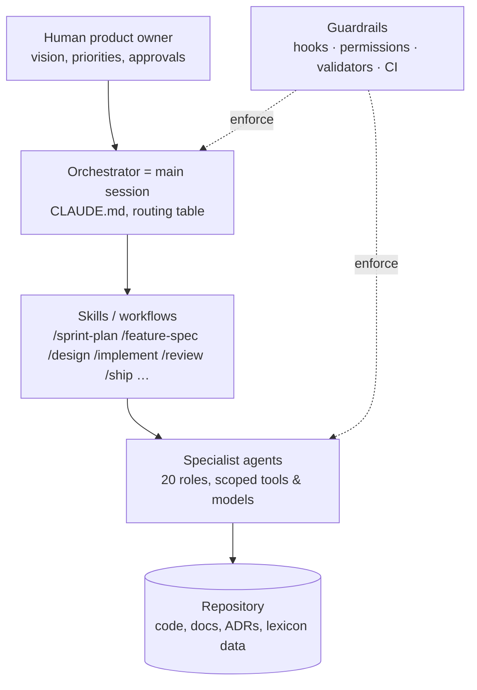

# Agentic Workflow

How the CODELEX agent team builds the product. The main Claude Code session is the **orchestrator**; specialists
live in `.claude/agents/`; repeatable workflows are skills in `.claude/skills/`; deterministic guardrails are
hooks in `.claude/hooks/`; `tools/framework/validate.mjs` keeps all of it consistent (run in CI).

## 1. Layers

## 2. Feature lifecycle

| Stage | Skill | Lead | Reviewers | Artifact | Gate |
|---|---|---|---|---|---|
| Plan | `/sprint-plan` | orchestrator | product-strategist, solution-architect | `docs/sprints/*.md` | human agrees with sprint goal |
| Specify | `/feature-spec` | product-strategist | game-designer, ux-ui-designer, data-analyst (+privacy, monetization) | `docs/specs/<epic>/<feature>.md` | status `Ready for design` |
| Design | `/design` (+ `/adr`, `/threat-model`) | solution-architect | owners, security-engineer, qa-engineer | `*.design.md`, ADRs, threat model | status `Ready for implementation` |
| Build | `/implement` | owner engineers | — | code + tests + docs | Definition of Done |
| Review | `/review` | orchestrator | code-reviewer, security-engineer, qa-engineer (+game-designer, privacy) | findings table | no Blocker/Major |
| Ship | `/ship`, `/release-mobile` | devops-sre | qa, security, data, tech-writer | readiness checklist | human GO |
| Operate | `/incident`, `/season-plan` | devops-sre / monetization-liveops | as needed | runbooks, postmortems, seasons | — |

Gameplay-affecting changes additionally pass `/balance-check`; lexicon content goes through `/lexicon-add`;
missing packages/services are created with `/scaffold`.

## 3. Orchestration rules
1. **Route, don't improvise**: use the routing table in `CLAUDE.md` §4. When unsure who owns something, ask
   `solution-architect`.
2. **Parallelise independent work** (several agents in one message); serialise dependent work
   (contracts → producers → consumers).
3. **Hand-off contract**: every agent returns (a) what it changed (paths), (b) how it verified (commands + results),
   (c) open questions/assumptions, (d) the next agent to involve. The orchestrator checks (b) itself before
   moving on.
4. **Independence of review**: the agent that implemented never reviews its own change; `code-reviewer` is
   read-only by construction (validator-enforced).
5. **Human gates**: sprint goal, ADR acceptance, balance target changes, production rollout to 100%, store
   submissions, anything flagged `LEGAL_REVIEW_REQUIRED`.
6. **Evidence over claims**: a task is done when commands prove it (tests, validators), not when an agent says so.

## 4. Guardrails (defence in depth)
| Layer | Mechanism | Examples |
|---|---|---|
| Instructions | `CLAUDE.md`, agent prompts, standards | non-negotiable principles, DoD |
| Permissions | `.claude/settings.json` allow/deny | deny reading `.env`, deny `terraform apply` |
| Hooks (PreToolUse) | `guard-bash.mjs`, `guard-files.mjs` | block force-push to main, secrets in content, lockfile edits |
| Hooks (PostToolUse) | `post-edit-validate.mjs` | lexicon & framework validation after edits, feedback loop to the agent |
| Hooks (SessionStart) | `session-context.mjs` | injects branch, sprint and workflow reminder |
| CI | `.github/workflows/ci.yml` | validators, tests, scans on every PR |
| Review | `/review` multi-agent | independent findings, verified before acting |

Hook limits: `guard-bash` matches command text with patterns (heredoc bodies ignored). It is a safety net
against mistakes, not a sandbox; cloud credentials and branch protection remain the real controls.

## 5. Extending the framework
- New agent: add `.claude/agents/<name>.md` (frontmatter `name`, `description` ≥ 40 chars, `tools`, `model`), add it
  to the routing table in `CLAUDE.md`, run `pnpm framework:validate`.
- New skill: `.claude/skills/<name>/SKILL.md` with `name` = directory; reference only existing agents/paths.
- New hook: script in `.claude/hooks/`, registered in `settings.json`, covered by `tools/framework/hooks.test.mjs`.

## 6. Model allocation
Reasoning-heavy, high-stakes roles (architecture, game design, engine, security, review, AI, lexicon) run on
`opus`; high-volume implementation/support roles (web, SRE, QA, data, liveops, docs, UX) on `sonnet`. Adjust
per role in frontmatter when quality or cost measurements justify it.
