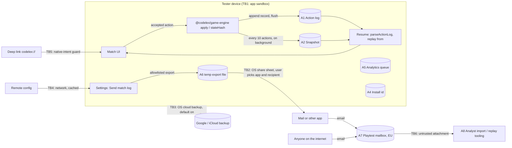

# Threat model — E-1.5 on-device match persistence, resume and "Send match log"

- Owner: security-engineer (with privacy-compliance) · Date: 2026-10-05 · Sprint 3 task P9
- Related spec/design: `docs/specs/E-1.5-play-vs-bot/classic-match-vs-bot.md` (AC-11, AC-12, AC-17, AC-20, privacy
  notes, Q-1/Q-2/Q-7/Q-10), `docs/specs/E-1.5-play-vs-bot/classic-match-vs-bot.design.md` (§3 persistence points,
  §5.8 Settings, §5.9 export, §5.10.2 corrupt state), `docs/architecture/notes/game-engine-api.md` (§13.6, §13.7,
  §14.2 `ReplayOptions`, §20 Q7), `docs/adr/0013-determinism-replay-contract.md` (§D2, §D6, §D9),
  `docs/standards/ANALYTICS_EVENTS.md`, `docs/compliance/DATA_MAP.md`.
- Consumers: slice S3 (mobile-engineer) implements the tasks in §7 marked "S3"; the others carry their own owner
  and deadline.

## 1. Scope

In scope: the Phase 1 playtest build (offline, guest only, vs bot, no backend).

- The on-device **action log** (the source of truth): header (seed, versions, profile, setup), the accepted actions,
  and one `stateHash` per action, written as one atomic record per accepted `apply`.
- The on-device **snapshot**: `serializeState(state)` every 10 actions and on `app_backgrounded`, a cache only.
- **Resume** (AC-11, Q7 steps 1–5), including the corrupt and version-mismatch paths (design §5.10.2).
- **"Send match log"** (AC-20, design §5.8): a user-initiated OS share of the in-progress match, else the last
  finished one.
- The receiving side: the playtest mailbox and the analysts' import or replay tooling.

Out of scope: "Send playtest data" (AC-17) except where it shares a control with the match log, Phase 2 online
play (only the hand-off rules in §6), and the Daily seed (ADR-0013 §D9, a separate model before E-2.3).

### 1.1 Security posture of this feature

These matches are casual and non-competitive (R-CORE-002, E-1.5 privacy notes). Principle 1 (server authority)
covers ranked, tournament, Arena and Daily results, so it does not apply here, and the engine's `stateHash` is
**error detection, not authentication**. It is an unkeyed, truncated SHA-256 (64 bits) that anyone holding the file
can recompute. This model therefore does not try to stop a player from editing their own casual match. It aims at
four outcomes:

1. no committed move is lost, and corrupt data never locks the player out (AC-11);
2. nothing leaves the device except through an explicit user share, and an export holds only allowlisted fields;
3. no on-device artefact can ever become a competitive fact (Q-10, ADR-0013 §D9);
4. the receiving side treats every attachment as hostile input.

## 2. Assets

| Asset | Where | Sensitivity | Why it matters |
|---|---|---|---|
| A1 Action log (header with seed, actions, `stateHashes`, `final`) | app sandbox | not personal; hidden information while in progress | Resume source of truth; bug reproduction (AC-20) |
| A2 Snapshot | app sandbox | same as A1 | Resume speed (p95 ≤ 300 ms target) |
| A3 Seed and `rng.bag` state | inside A1 and A2 | reveals bag order and the bot's rack (ADR-0013 §D9) | Accepted offline; must never carry over to online play |
| A4 Install id (UUID) | app sandbox | pseudonymous; personal once linked to a sender's email (DATA_MAP) | Erasure requests, analytics key |
| A5 Analytics queue | app sandbox | pseudonymous | Playtest KPIs (AC-17); shares the backup and storage controls |
| A6 Exported match-log file | temp file, then the share target | not personal by content; personal once emailed (sender address) | Bug reports |
| A7 Playtest mailbox and restricted EU storage | mail provider, EU storage | personal (email address plus attachments) | ≤ 3 named analysts (DATA_MAP) |
| A8 Analyst replay/import tooling | analyst machines, CI | integrity of the playtest readout | Phase 1 exit decision |
| A9 Remote config (`playtest.export_address`, flags) | cached on device | integrity | Decides where exports are suggested to go |

## 3. Actors

| Actor | Relevance here |
|---|---|
| Legit tester (adult, enrolled) | Plays, gets interrupted, sends logs; may send while analytics consent is off |
| Curious or cheating tester | Rooted or jailbroken device, backup editing; reads the seed or edits the log. Nothing competitive to gain; can skew the playtest KPIs |
| Scripted client or bot | Not relevant offline (no server to submit to) |
| Colluding players | Not relevant offline. Becomes relevant only if local data were imported later (§6) |
| Other apps on the device | Read world-readable files, shared storage, or a leaked share URI |
| Cloud backup provider (Google, Apple) | Receives sandbox files by default unless excluded |
| External attacker | Emails crafted attachments to the playtest alias; tampers with remote config in transit; sends crafted deep links (`codelex://`) |
| Compromised staff or analyst | Mailbox access, over-retention, linking emails to install ids |
| Minor or non-enrolled person | Obtains the build through a public link; analytics consent default-on is only valid for enrolled adults |
| Malicious org admin | Not applicable (no orgs in Phase 1) |

## 4. Trust boundaries

TB1 is the only boundary the app fully controls. TB3 is crossed silently by default today: `apps/mobile/app.json`
sets no `android.allowBackup`, and nothing excludes the sandbox from iCloud backup. The spec states that match data
stays on device, and TB3 contradicts it.

## 5. STRIDE

Likelihood (L) and impact (I) are scored 1 (low) to 3 (high); risk = L × I: 1–2 Low, 3–4 Medium, 6–9 High. Owners
are agents; the task ids refer to §7.

| # | Threat | Cat. | Component | L | I | Risk | Mitigation | Owner | Test |
|---|---|---|---|---|---|---|---|---|---|
| S-1 | Anyone emails forged event or match-log files to the playtest alias, posing as a tester (copied or invented install id), and poisons the readout | S | A7, A8 | 2 | 2 | 4 Medium | TM-08: mailbox accepts only senders on the enrollment roster (mail rule, no join of roster and event data); the import validates strictly and dedupes `event_id`; per-install volume anomalies are flagged in the readout | devops-sre, data-analyst | Mail-rule test from a non-roster address bounces; import test with a forged file is quarantined |
| S-2 | Remote config tampered or misconfigured, so `playtest.export_address` suggests an attacker's address | S | A9 | 1 | 3 | 3 Medium | TM-07: the address is a build constant; remote config may only hide it; any remote value outside the bundled allowlist is ignored | mobile-engineer | Unit: a remote value outside the allowlist is never displayed |
| S-3 | The build reaches non-enrolled people or minors (public TestFlight link, forwarded APK), for whom default-on analytics consent and the 18+ basis are invalid | S | Distribution | 2 | 3 | 6 High | TM-09: TestFlight external testing by email invitation only, no public link; Play internal track by email list; no APK sideload outside the team; the roster is the only invitation source | devops-sre, privacy-compliance | Release checklist item verified at Stage 0 and Stage 1; public link setting screenshot in the release record |
| T-1 | Snapshot edited, swapped from another match, or from another build | T | A2, resume | 2 | 1 | 2 Low | Done in E6: `replay(log, ctx, { from })` accepts a snapshot only if `stateHash(from)` equals `stateHashes[from.actionCount − 1]`, else `HASH_MISMATCH` `'from'`; the app then replays from the start (Q7 step 4). TM-02 adds the app-level test | mobile-engineer | S3: a tampered, foreign and truncated snapshot each resume to a state deep-equal to a full replay |
| T-2 | Action log edited with legal actions and recomputed hashes (unkeyed hash) | T | A1 | 1 | 1 | 1 Low | Accepted for casual play (§1.1). Every action is still re-validated by `apply` on resume, so an illegal edit gives `ACTION_REJECTED`, then the corrupt card. TM-11 makes sure no such log is ever trusted later | game-engine-engineer (existing), solution-architect | Existing `resume.test.ts`; TM-11 gate |
| T-3 | Torn write, power loss, full storage or a crash between log append and snapshot leaves a partial record, so moves are lost or the match reads as corrupt | T | A1, A2 | 3 | 2 | 6 High | TM-01: append-only records with a per-record length and checksum; the UI commits a move only after the flush returns; on read, a trailing partial record is dropped (it was never shown as committed) and any earlier bad record is corruption; snapshot via temp file, flush, rename; write failure shows `match.low_storage` and keeps the in-memory state | mobile-engineer | S3: fault-injection unit test truncating the file at every byte offset of the last record loses 0 committed moves; Maestro process kill mid-player and mid-bot turn |
| T-4 | Local results, ratings or progress later imported as competitive facts (E-2.1 account upgrade, Phase 2) | T, E | Future identity, progression | 2 | 3 | 6 High | TM-11: Q-10 restated as a hard rule; the E-2.1 spec and any importer reject client-computed results and ratings; if "terms discovered" migrates, it is cosmetic only, capped and never feeds rating, rewards with value, or leaderboards | solution-architect, backend-engineer | E-2.1 spec review checklist; contract test: the importer has no field for results or ratings |
| R-1 | A tester disputes a bug report ("my score was wrong") or analysts cannot match a file to a build | R | A6, A8 | 2 | 1 | 2 Low | Determinism makes the log self-proving: header versions plus `final.stateHash` reproduce the match. TM-04 adds the app build number to the envelope; the import records the SHA-256 of every received file | mobile-engineer, data-analyst | Import test: replaying an exported file reproduces its `final.stateHash` |
| I-1 | OS cloud backup copies the action log, snapshot, analytics queue and install id off the device without a user action, and restores the install id on another device (the spec says it resets on reinstall) | I | TB3 | 3 | 2 | 6 High | TM-03: Android `allowBackup` off (or data-extraction rules excluding all app data, both cloud backup and device transfer); iOS app data under Application Support with the exclude-from-backup attribute set on the data directory | mobile-engineer | Config test asserts the Android setting; native test or manual check that the data directory carries the exclusion; `adb` backup on the reference device contains no app data |
| I-2 | The export carries more than intended: wall-clock timestamps, install id, `local_match_id`, device model, file paths, stack traces or OS user names, which link the file to analytics or fingerprint the tester | I | A6 | 2 | 2 | 4 Medium | TM-04: the export is built from a strict allowlist schema (envelope plus `serializeActionLog` output), never by copying arbitrary state; fixed file name with no date or id; on-device records contain no wall-clock time or identifier, so the raw bytes of a corrupt log are safe by construction; size cap | mobile-engineer | S3: zod strict schema test on the export; PII lint over the export builder; property test that random matches produce only allowlisted keys |
| I-3 | The temp export file sits in shared storage, stays after sharing, or its share URI is readable by other apps | I | A6 | 2 | 1 | 2 Low | TM-04: written to the app cache directory, shared through the platform's scoped provider (no external or Downloads folder), deleted when the share sheet closes and swept on app start | mobile-engineer | S3: unit test that the file is removed after share and on startup |
| I-4 | Match logs received by email are not in DATA_MAP, so retention, legal basis and the privacy notice do not cover them; analysts keep them indefinitely | I | A7 | 2 | 2 | 4 Medium | TM-06: DATA_MAP row for on-device match data and the match-log export; same mailbox handling as Q-1 (move within 7 days, raw files deleted 6 months after the playtest); privacy notice and consent form name the match log | privacy-compliance | `pnpm validate` docs check; counsel pack updated |
| I-5 | Confirm copy says "No personal data" while the tester sends by email, which reveals their address to the controller; consent off does not stop this export | I | A6, UI copy | 3 | 1 | 3 Medium | TM-05: the confirm sheet keeps "no personal data in the file" and adds the email notice used on the export screen; privacy-compliance records the basis for a consent-off export (user-initiated support request, separate purpose from analytics) | ux-ui-designer, privacy-compliance | Component test: the confirm sheet renders the email notice in EN and FR |
| I-6 | The seed and bag state on device reveal the bot's rack and the draw order | I | A3 | 3 | 1 | 3 Medium | Accepted offline (ADR-0013 §D9). Consequence: win rate vs bot from a tampering tester can be inflated; the readout treats outliers per install. TM-11: online and Daily matches never store the seed on device before the match ends | solution-architect | ADR-0013 §D9 follow-up threat model before E-2.3 |
| I-7 | Debug logging prints the seed, state or log in release builds (logcat is readable with USB debugging) | I | App logging | 2 | 1 | 2 Low | TM-04: no `console.*` of state, log or seed in production code (lint); errors are logged as codes only | mobile-engineer | Lint rule in `apps/mobile` |
| D-1 | A corrupt, oversized or adversarial log or snapshot makes resume throw or hang at cold start: a crash loop and lockout | D | Resume | 2 | 2 | 4 Medium | TM-02: size caps checked before parsing; resume runs behind a catch-all that maps every failure to the corrupt card (never a crash); two consecutive unclean exits during resume also lead to the corrupt card; parsing never happens before the first render | mobile-engineer | S3: fast-check fuzz of log and snapshot bytes never throws out of resume; test for the resume crash counter |
| D-2 | A crafted attachment (huge JSON, deep nesting, zip, prototype keys) compromises or stalls analyst tooling | D, E | A8 | 1 | 3 | 3 Medium | TM-08: the import accepts only `.json` up to a size cap, parses with `parseActionLog` / the event zod schemas (strict, unknown keys rejected), never evaluates content, runs outside the analysts' mail client in a container without network access | data-analyst, security-engineer | Import tests with oversized, nested and `__proto__` payloads are rejected |
| D-3 | Logs accumulate and fill storage on low-end phones | D | A1 | 1 | 1 | 1 Low | TM-01: keep only the in-progress match and the last finished one; delete older logs and snapshots; "Start a new match" on the corrupt card deletes the match | mobile-engineer | S3: unit test that at most two match logs exist after N matches |
| E-1 | A crafted `codelex://` deep link opens a match-log route that exports or imports data without a tap | E | TB5 | 1 | 2 | 2 Low | TM-02: no route has a side effect on mount; export needs the confirm-sheet tap; the app has no "import a log" feature at all (logs only leave the device) | mobile-engineer | S3: route test that opening any Settings or match-log path performs no export or file read |
| E-2 | Resume trusts a snapshot's `engineRulesVersion` or a draft rules version and runs a match under unsupported rules | E | Resume | 1 | 2 | 2 Low | Existing: `parseActionLog` returns `RULES_VERSION_UNSUPPORTED` for unknown or draft versions (ADR-0014 §D3); `parseState` checks the version first. TM-02 asserts the app maps both to the version-mismatch card | mobile-engineer | S3: draft and unknown version logs show `resume.version_mismatch` |

## 6. Game-integrity abuse cases

| Abuse case | Outcome in Phase 1 | Rule that keeps it harmless |
|---|---|---|
| Read the seed to see the bot's rack and the bag | Possible on a rooted device; the tester only beats a casual bot | No stakes; the readout treats per-install outliers; observations never contain the seed (ADR-0013 §D9) |
| Edit the log to grant a win | Possible with recomputed hashes | Local results are never importable (Q-10, TM-11) |
| Replay a "perfect" log as a bug report to inflate KPIs | Possible through the mailbox | Sender allowlist, `event_id` dedupe, per-install anomaly review (TM-08) |
| Share an exported in-progress log to spoil a match | Only the sender's own casual match | Exports exist only for that tester's own match; there is no import |
| Reuse the client log format for ranked or Daily in Phase 2 | Would break principle 1 | TM-11: online logs are written by `services/game`; the client never holds the seed before the end; the client-side log is a display cache only |

## 7. Mitigation tasks

S3 cannot close its "Send match log per P9" criterion until TM-01 to TM-05 are done. TM-06 and TM-09 must be done
before Stage 1 (external testers); TM-11 is a gate on E-2.1 and E-2.3.

| ID | Task | Owner | When | Acceptance criteria |
|---|---|---|---|---|
| TM-01 | Crash-consistent log store and on-device retention | mobile-engineer | S3 | One record per accepted action: `{action, stateHash}` with a length prefix and checksum, no wall-clock time, no identifiers. The move shows as committed only after the flush returns. A trailing partial record is dropped; a bad record before the tail means corrupt. Snapshot write: temp file, flush, rename, after the log append. A write failure shows `match.low_storage`, and play continues from memory. Only the in-progress match and the last finished one are kept. Tests: truncation at every byte offset of the last record loses 0 committed moves; Maestro process kill mid-player and mid-bot turn |
| TM-02 | Resume hardening | mobile-engineer | S3 | Size caps before parsing (log ≤ 256 KB, snapshot ≤ 64 KB; a 1v1 log is about 5 KB). Resume only calls `parseActionLog` and `replay(log, ctx, { from, verify: 'final' })`, then `verify: 'all'` only on a mismatch (Q7). Every failure maps to `version_mismatch` or `state_corrupt`, never an exception at startup. Two consecutive unclean exits during resume show the corrupt card. Tests: tampered, foreign and truncated snapshots resume deep-equal to a full replay; fast-check fuzz of log and snapshot bytes never throws; draft and unknown rules versions show the version-mismatch card; no route performs an export or file read on mount |
| TM-03 | Keep app data out of OS backups | mobile-engineer | S3; before Stage 0 if S3 slips | Android: `android.allowBackup: false` in `apps/mobile/app.json` (or data-extraction rules that exclude all app data from cloud backup and device transfer). iOS: match data, the analytics queue and the install id live under Application Support, with the exclude-from-backup attribute on that directory. Tests: a config test asserts the Android setting; a native or manual check on the reference devices shows no app data in a backup; after a reinstall the install id is new |
| TM-04 | Match-log export by allowlist | mobile-engineer | S3 | The export file is `{ exportFormat: 1, app: { version, build, platform: 'ios' or 'android' }, log: <serializeActionLog output>, divergence?: { index, expected, actual } }`, checked against a strict zod schema before writing. For an unreadable log: `{ exportFormat: 1, app, raw: <base64 of the record file> }`, capped at 256 KB. No install id, `local_match_id`, timestamps, device model, OS version below major, paths or stack traces. Fixed file name `codelex-match-log.json`. Written to the cache directory, shared through the platform's scoped provider, deleted when the share sheet closes and on app start. No `console.*` of state, seed or log in production code (lint). Tests: schema test; property test that the keys are allowlisted for random matches; file cleanup test |
| TM-05 | Honest confirm copy | ux-ui-designer, privacy-compliance | S3 | `matchlog.confirm.body` keeps "no personal data in the file" and the sheet adds the `export.email_notice` text (or a `matchlog.email_notice` key) in EN and FR. Export stays allowed with analytics consent off, as a user-initiated bug report. Component test renders the notice in both locales |
| TM-06 | DATA_MAP and notices cover match data | privacy-compliance | Before Stage 1 | New DATA_MAP row: on-device match data (log, snapshot) for resume (strictly necessary, ePrivacy Art. 5(3) exemption) and the match-log export (purpose: bug fixing; basis: user-initiated request, confirmed by counsel; same mailbox handling and retention as Q-1). The privacy notice and consent form name the match log. The match log is added to the `LEGAL_REVIEW_REQUIRED` counsel pack |
| TM-07 | Export address cannot be redirected | mobile-engineer | S6 (export screen), S3 if the match log shows an address | The suggested address is a build constant; remote config can only hide it. A remote value outside the bundled allowlist is ignored. Unit test |
| TM-08 | Hostile-input handling on the receiving side | data-analyst (import), devops-sre (mailbox), security-engineer (review) | Before Stage 0 exports are read | Mail rule accepts only roster senders, without joining the roster to event data. The import accepts `.json` ≤ 1 MB, parses with `parseActionLog` and the zod event schemas (strict), dedupes `event_id`, records each file's SHA-256, never evaluates content, and runs in a container without network access. Per-install volume and win-rate outliers are flagged in the readout. Tests with forged, oversized, deeply nested and `__proto__` payloads |
| TM-09 | Build distribution limited to the roster | devops-sre, privacy-compliance | Before Stage 1 | TestFlight external group by email invitation only, public link disabled; Play internal track by email list; no APK outside the team. A release checklist item with evidence is recorded for Stage 0 and Stage 1 |
| TM-10 | Remove "Sentry" from the Phase 1 resume path | solution-architect, data-analyst | Before S3 | `game-engine-api.md` §20 Q7 step 4 and the ADR-0013 observability line are amended: in the playtest build the divergence goes to the match-log export (`divergence`, TM-04) and to analytics through a new `bot_match_resumed.restore_path` (`snapshot` / `full_replay` / `failed`), added to the catalogue with PII class none. No crash SDK is introduced (Q-1/Q-7) |
| TM-11 | Local data is never a competitive fact | solution-architect, backend-engineer | Gate on the E-2.1 spec and the E-2.3 threat model | The E-2.1 spec states that local results, ratings and match logs are never imported; any terms-discovered migration is cosmetic, capped, and never feeds rating, leaderboards or rewards with value. Online and Daily matches never hold the seed on device before the match ends (ADR-0013 §D9). Contract test: the importer has no result or rating field |

### 7.1 Status after slice S3 (mobile-engineer, 2026-10-06)

| ID | Status | Where |
|---|---|---|
| TM-01 | Done. Framed records (u32 length, CRC-32, ASCII JSON), append before commit, snapshot by temp file, delete, rename (`recover()` closes the gap at start), torn tail dropped, bad record before it = corrupt, low storage keeps play in memory and rewrites the log at the next write, retention = current + last finished | `apps/mobile/src/persistence/{records,data-store,match-journal}.ts`; tests `records.test.ts` (every byte offset of the last record), `saved-match.test.ts` (kill at every write boundary of a full match, with and without torn bytes); Maestro `e2e/s3-process-kill-resume.yaml` (not run in CI: needs a device build) |
| TM-02 | Done. Caps before parsing (log 256 KB, snapshot 64 KB), `parseActionLog` then `replay(..., { from, verify: 'final' })`, full replay on failure, `verify: 'all'` only to locate the divergence; catch-all; crash counter (2); read after the first render; no route reads or writes on mount except the guard | `persistence/{resume,saved-match}.ts`; tests `resume.test.ts` (tampered, foreign, out-of-range, truncated snapshots; draft 2 and unknown 99; fast-check fuzz), `match-s3.test.tsx` |
| TM-03 | Done in config; device check pending (H1). Data lives under `<Documents>/codelex-data`, not Application Support (expo-file-system has no such path), with `isExcludedFromBackup` set at launch | `app.json`, `plugins/with-backup-exclusion.cjs`, `backup-exclusion.test.ts`; mobile-app-foundation note §6 |
| TM-04 | Partly. The export itself is out of S3: the E-1.5 spec puts "Send match log" in slice S6. S3 keeps the on-device records free of time, identifiers and paths, and adds `no-console` to app code. The allowlisted export, its schema and cleanup tests land with S6 | `apps/mobile/eslint.config.js` |
| TM-05 | Copy done, sheet in S6. `matchlog.confirm.body` says "No personal data in the file"; new `matchlog.email_notice` (EN/FR) says email reveals the sender's address. It does not mention a tester ID, because the match log carries none | `packages/i18n` catalogs; design §10.5 |

## 8. Privacy and compliance review (privacy-compliance perspective)

- **What leaves the device.** Only two things, and only on a tap: the match-log file (TM-04 allowlist) and, through
  AC-17, the analytics file. OS backup is the hidden third channel, closed by TM-03. Nothing is uploaded
  automatically; there is no backend and no crash SDK.
- **Personal data.** The match-log content is not personal: moves, seed, versions and hashes. It becomes personal
  once emailed, because the sender address is visible. The copy must say so (TM-05), and the mailbox handling of Q-1
  applies (TM-06). Excluding the install id keeps the match log from being linked to the analytics dataset by
  design. Erasure works per email (the analyst deletes the files from that sender).
- **Consent.** On-device match data is strictly necessary for the service the player asked for (resume), so it
  needs no consent under ePrivacy Art. 5(3). The match-log export is a user-initiated bug report, separate from
  analytics, so it stays available with analytics consent off. Counsel confirms the basis as part of the existing
  `LEGAL_REVIEW_REQUIRED` items (TM-06).
- **Minors.** The cohort is 18+ by enrollment (Q-2), and the build has no age gate. That only holds if distribution
  is limited to the roster (TM-09). No public release before the E-2.1 age gate. Nothing in the match log would be
  more sensitive for a minor, but the default-on analytics consent would be invalid.
- **Retention.** On device: the in-progress match plus the last finished one (TM-01); all of it is removed on
  uninstall. Received files: moved to restricted EU storage within 7 days, raw files deleted 6 months after the
  playtest ends (Q-1, TM-06).

## 9. Top risks

1. I-1 OS cloud backup takes match data, the analytics queue and the install id off the device (High).
2. S-3 The build reaches non-enrolled people or minors, which voids the consent model (High).
3. T-3 Torn writes lose committed moves or produce false corruption (High; also AC-11).
4. T-4 Local results are later imported as competitive facts (High, Phase 2 gate).
5. I-2 / I-5 The export carries linkable fields, or the copy hides that email reveals the sender (Medium).

## 10. Residual risk and follow-ups

- A tester with root access can still edit their own casual match and seed (T-2, I-6). Accepted: no stakes, and
  KPI outliers are reviewed (TM-08).
- The analytics file (AC-17) and "Share diagnostics" (design §5.10.1) use the same share channel. TM-03 and the
  TM-04 cleanup rules apply to them too; S6 confirms when it implements the export screen.
- The Daily seed and online seed secrecy are out of scope here. They are covered by the ADR-0013 §D9 follow-up
  threat model before E-2.3.
- Re-review this model if any of these appear: a backend endpoint for exports (Q-1 fallback), cloud save, accounts
  (E-2.1), or a log import feature.
