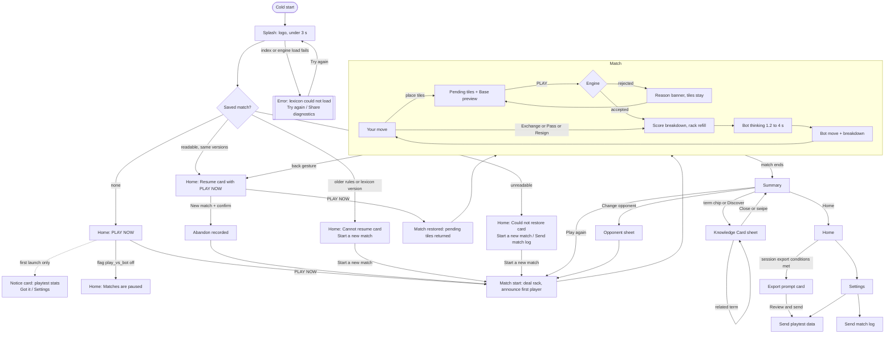
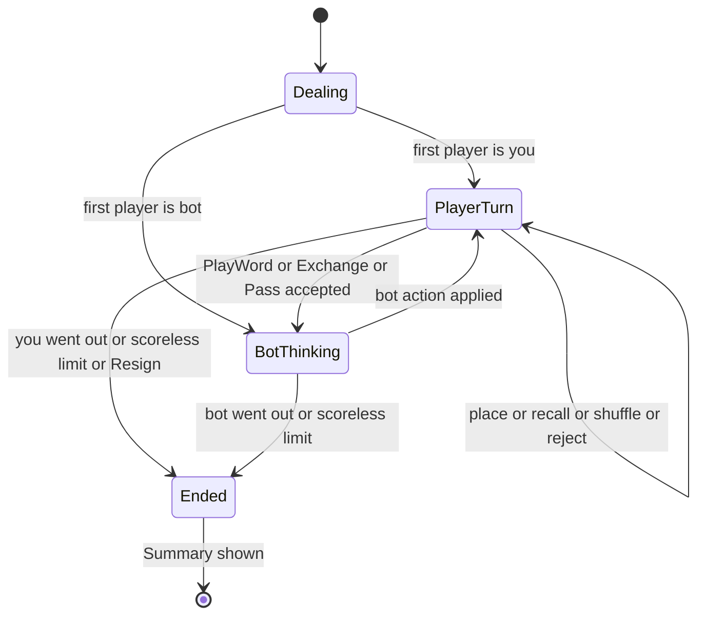

# Classic match vs bot — UX/UI design spec (E-1.5, sprint task U1)

- Epic: E-1.5 · Spec of record: `docs/specs/E-1.5-play-vs-bot/classic-match-vs-bot.md` (Ready for design) ·
  Status: **Decided — ready for `mobile-engineer`** · Owner: `ux-ui-designer` · Last update: 2026-10-02
- Decided under the product owner's delegation ("decide and record"). Every decision in section 2 is reversible and
  lists its reversal trigger. Reviews wanted (non-blocking for implementation start): `mobile-engineer` (feasibility
  of section 5.5.2 and 9.4), `game-designer` (decisions D-5, D-14, D-27), `data-analyst` (section 11),
  `privacy-compliance` (sections 5.4, 5.9), `product-strategist` (D-9, D-17).
- Rules sources: `docs/game/GAME_RULES.md` v0.3 (`engineRulesVersion` 1, layout `classic-v1`, table `letters-v1`),
  `docs/game/RULE_PROPERTIES.md`, `docs/specs/E-1.7-playtest-lexicon/playtest-lexicon.md` (AC-12 surfaces),
  `docs/adr/0013-determinism-replay-contract.md` (§D6 resume policy), `docs/vision/PRODUCT_VISION.md` (voice),
  `docs/game/LEXICON_SPEC.md` (categories, definitions).
- Reference device and canvas: **360 × 800 dp portrait**; minimum supported **360 × 640 dp**; low-end Android
  (Android 10+, 2–3 GB RAM). Portrait only (landscape and tablets are non-goals).

## 0. Summary

The playtest build is five surfaces and two utility screens: **Home**, **Match**, **Summary**, **Knowledge Card**
(bottom sheet), **Settings**, plus **Send playtest data** and the error/resume states. The product sells a game:
Home is the logo, the tagline and one dominant button. Nothing blocks the first match (no tutorial, no consent
wall, no account); knowledge appears only after play, on request. The 15 × 15 board is the hard problem at 360 dp
(23.5 dp per square): the design uses an always-visible full board plus a **smart camera** that zooms to a 2.1×
"focus" level (49 dp squares) when the player starts placing, with two input paths (tap rack tile then tap square,
or drag with a lifted tile). Premium squares are encoded three ways (colour, shape, text label). Every string is a
message key (section 10, EN + FR); every animation has a reduced-motion twin (section 8).

## 1. Principles applied (and where they bite)

| Principle (CLAUDE.md / vision) | Consequence in this spec |
|---|---|
| Home sells a game; first match ≤ 60 s | One primary action; Beginner Bot auto-selected; no picker before match 1 (spec Decisions) |
| Knowledge after play, skippable, never blocking | Cards only from Summary chips; no in-match card (Q-6); one swipe closes |
| One-hand, thumb zones | Rack, PLAY and actions in the bottom 40 %; handedness mirror (D-10); all sheets bottom-anchored |
| Readable at arm's length | Letters in bold mono; values on every tile; premium labels in text; zoom (D-1) |
| Mid-range Android, 3G, offline | Bundled assets only; no network affordance anywhere; effects budget (D-27) |
| No dark patterns | No timers shown, no streaks, no "come back" copy, no auto-dismissing information, one-time prompts with a real "Not now" |
| i18n EN/FR, RTL-ready | Keys only; logical start/end spacing; the board and rack are **not** mirrored (A–Z, rows left→right; the layout is a game constant), chrome is mirrored |
| Voice: intelligent not academic, competitive not aggressive | Short verbs, no jargon about "lexicon" in happy paths (only in rejections, as the spec fixes), no taunts on defeat |

## 2. Decisions (UX points left open by the spec)

| # | Decision | Rejected alternative | Why / reversal trigger |
|---|---|---|---|
| D-1 | **Board zoom model.** Two named levels plus free pinch: *Overview* (1.0×, whole board, 23.5 dp squares) and *Focus* (2.1×, 49.3 dp squares, ≈ 7 × 7 squares visible, so squares meet the 48 dp target). Pinch 1.0×–2.5× clamped; double-tap toggles Overview ↔ Focus at the tapped point. A **smart camera** (5.5.2) moves between them automatically, user-overridable, off via Settings "Auto-zoom". | Always-zoomed scrolling board; fixed overview only | Overview keeps the game readable at a glance (premium geometry is the strategy); Focus gives precision. Reverse if playtest shows > 25 % of placements need a correction (recall right after place) or auto-zoom is turned off by > 30 % |
| D-2 | **Two placement paths, equal citizens.** (a) Tap a rack tile (selected), tap a square: places it. In Overview the first board tap with a selected tile **arms and zooms** to Focus around that point, the next tap places (an Overview square is a 23 dp target, never a primary target). (b) Drag: the tile lifts 56 dp above the finger, the target square is outlined, haptic tick per square; dropping on an occupied/invalid spot returns the tile to its origin. | Drop snaps to nearest legal square | No hidden magic; the player decides every square |
| D-3 | Tap a **pending** tile = return it to the rack (undo). Drag a pending tile = move it. Committed tiles are inert (drag on them pans the board). Tapping anywhere on a pending tile run does not recall the whole run; "Recall" button does. | Long-press to recall | One-hand: tap is faster; mis-taps are cheap (re-place) |
| D-4 | **Input during the bot's turn is allowed** (AC-8: only PLAY is blocked): rearrange the rack, place pending tiles, zoom, read the log. If the bot's move lands on a pending tile's square, that tile returns to the rack with a one-line notice. Pending tiles are UI-only state and are never persisted (AC-11). | Lock the board while the bot thinks | Pre-planning makes the 1.2–4 s wait feel short; no information leaks (bot sees only its observation) |
| D-5 | **PLAY is enabled whenever ≥ 1 tile is pending and it is the player's turn**, even if the geometry is illegal; the engine's rejection teaches the rule (AC-6). The **preview badge** shows only for geometrically legal placements and reads "Base N" (never "score N"), with a tip that bonuses are added on play; it contains letter/word premiums and Full Stack only (R-SCORE-009). No "valid word" indicator, no green/red before commit. | Disable PLAY on illegal geometry | Disabled buttons hide *why*; the rejection copy explains |
| D-6 | **Rejection feedback is persistent, not timed**: banner in the status strip stays until the placement changes or PLAY is pressed again; offending words are outlined (dashed + icon, not colour only); tiles shake once (reduced motion: outline flash only) with an error haptic. | Toast that disappears after 3 s | Honest timers; screen-reader users need time; AC-6 says tiles stay for editing |
| D-7 | **Home = logo, tagline, PLAY NOW, settings gear.** Modes other than Classic are **not rendered** (Q-11). The opponent chip appears only after the first completed match (AC-9) and only if ≥ 2 personalities are enabled. With a match in progress, a **resume card is the primary action and contains the PLAY NOW button** (AC-12); "New match…" is a quiet text button inside the card. | Locked/"Coming soon" tiles | Dead ends damage the first-run feel |
| D-8 | **First-run analytics notice (Q-7) is a non-blocking card at the bottom of Home**, never a modal. It counts as seen once Home has been left (PLAY NOW included) or "Got it"/"Settings" is tapped, and is never shown again; the same text lives in Settings. Default recording is on (Q-7). | Modal consent dialog before PLAY NOW | AC-1 forbids any gate; consent was collected at enrollment |
| D-9 | **Sound effects are OFF by default, haptics ON.** Playtesters are in offices, trains, classrooms; silent-by-default avoids a first-impression irritation and costs nothing to enable (Settings, and a speaker icon in the match menu). The sound set (8.3) is specified but may ship after slice S2 behind `audio.sfx.available` (assets ≤ 150 KB). Debrief question: "did you miss sound?". | Sound on by default | Reverse if > 50 % of testers turn it on in week 1 (not measurable offline except via the `settings_changed` proposal in 11) or debrief says it is missed |
| D-10 | **Handedness setting** ("Controls layout": Right hand default / Left hand) mirrors the action row (PLAY on the thumb side). The rack is never reordered by it. | No setting | One-hand principle at near-zero cost; cut to a later slice if capacity is short (not a blocker) |
| D-11 | **System back / back gesture in a match goes Home** with no confirmation: state is persisted after every action, so nothing is lost; Home then shows the resume card. Resign is only reachable through the match menu. | "Leave match?" dialog | A dialog implies loss that does not exist |
| D-12 | **Exchange and Pass with tiles pending**: allowed; tiles are recalled first (animated), then the sheet/dialog opens. The Pass dialog says so. | Disable both while tiles are pending | Fewer dead states |
| D-13 | **Scoreless-turn counter** is surfaced from 3 consecutive scoreless turns ("Scoreless turns: 3 of 6", emphasised from 4 with the end warning) so the R-TURN-004 ending never surprises. | Silent end | Fairness; match ends are a KPI |
| D-14 | **Every committed move is explained**, the bot's too: the status strip shows "+N" with chips (premiums, Term, Full Stack, Chain with linked terms); tap expands the full breakdown. The strip does not auto-dismiss: it stays until the player picks up a tile or the next move lands. The breakdown renders the engine's `ScoreBreakdown` verbatim in R-SCORE-008 order. | Auto-hiding toast | The score explanation is the learning surface (user story 2) |
| D-15 | **Summary order**: result → scores → (survey, if due) → best word → terms played chips → bot rack. Actions are a **sticky bottom bar** (Play again, Change opponent, Home) so they are one tap from anywhere in the scroll. Chips are **deduplicated by canonical term** (E-1.7 AC-12); "New to you" counts canonical terms. Best word = highest turn score; ties: longer main word, then earlier turn. | Actions at the end of the scroll | Play again must always be one tap away (AC-13) |
| D-16 | **Knowledge Card = bottom sheet** (≤ 85 % height, grabber, always-visible Close ×; Back arrow appears after the first related-term hop). Content is a synchronous local lookup; no skeleton by design, but a skeleton is specified if it exceeds 300 ms. | Full-screen page | Keeps the Summary visible behind it (context, not a course) |
| D-17 | **End-of-session export prompt (AC-17)**: a dismissible card on Home (never a dialog, never on Match or Summary), shown at most once per session (session = foreground time, closed after 30 min in background, Q-12), only when: ≥ 1 match completed this session, ≥ 1 unsent event, and (≥ 2 matches completed this session **or** ≥ 8 min foreground). Additional cool-down: not again within 24 h of the last time it was shown. | Dialog on app exit | We cannot detect "exit"; Home after a match is the natural pause |
| D-18 | **Export confirmation is explicit**: after the OS share sheet closes, ask "Did you send the file?" Only "Yes, I sent it" clears the sent events. The queue keeps its 30-day / 5,000-event rules (AC-17). | Assume success after the share sheet | The OS cannot report delivery |
| D-19 | **Locale**: follows the device (EN, FR; anything else = EN); no in-app override. FR uses informal *tu*. FR typography is applied in the catalogue (narrow no-break space U+202F before `; ! ?`, no-break space U+00A0 before `:` and inside « »). The copy table below uses plain spaces for readability. | In-app language switch | Spec AC-15 says device locale; revisit if testers on an EN phone want FR |
| D-20 | **Text scaling**: all text scales up to 200 %. Tile and board glyphs are graphics and scale to at most 130 %. At font scale ≥ 1.5 the secondary actions (Shuffle, Exchange, Pass) collapse into one **More** button (bottom sheet of large list rows) so PLAY stays reachable. | Truncate labels | AC-16 / AC-15 |
| D-21 | **Screen-reader model**: when a screen reader is active, the board exposes 15 row groups × 15 accessible squares (row, column are **1-based**, "row 8 column 8"); blank letters read "blank as O" and are rendered in lowercase in plain-text logs. | One opaque canvas | AC-16 |
| D-22 | **Reduced motion** follows the OS setting; Settings offers Follow system / Reduce / Full. Every animation has an alternative (8.2). | OS only | Testers on low-end phones may want it without changing the OS |
| D-23 | **Portrait lock**, 360 × 640 dp minimum; vertical budgets in 4.2. | Responsive landscape | Non-goal |
| D-24 | **Lexicon/engine load failure** is a full-screen state with **Try again** and **Share diagnostics** (the "crash report" of the spec: versions + error code, no PII, via the OS share sheet; there is no crash SDK in this build). | Auto-close | Spec states |
| D-25 | **Bots are geometric avatars** (Beginner: round, soft; Strategist: angular, sharp) with names; no human faces or gendered characters; thinking = three pulsing dots on the avatar (reduced motion: static "…"). | Character art | Production cost; international tone |
| D-26 | **Coach marks**: at most 3, tooltip bubbles anchored to the element, **no scrim**, touch passes through; interacting with the target dismisses the mark; each shows once ever. | Spotlight tutorial overlay | AC-1: no tutorial wall |
| D-27 | **Effects budget**: particles only for Full Stack and Victory (≤ 16 particles, ≤ 800 ms); disabled by default when RAM < 3 GB ⚙ or reduced motion; 60 fps target for drag, never below 30 fps. | Rich effects everywhere | Spec: low-end Android |
| D-28 | **Fonts**: UI text = system font (SF / Roboto) for zero download and native feel. **Playtest (decided at S2 review, 2026-10-06): system mono** (Menlo / monospace) for tiles, scores, term names and tech accents. Post-playtest option: bundle **JetBrains Mono, one weight (700)**, Latin subset, if testers ask for it; it needs an asset-budget decision first (iOS assets are at 23,136 of 27,000 B). | Bundle a UI face too; bundle JetBrains Mono 500 + 700 now | Size and first paint; the iOS asset budget has no room for two weights |
| D-29 | **Perceived bot pace** (AC-8): bot move is revealed at `max(compute_time, delay)` where `delay` is drawn by the app from the per-personality distribution inside the `bots.think_delay_ms` range (1200–4000 ms ⚙); the delay is presentation only and never enters the engine or the log. | Fixed delay | Variable pace reads as human (game-designer F-8) |
| D-30 | **Blank tile glyph is `_`** (underscore) on the rack, in a dotted-outline tile; once placed the tile shows the designated letter in a lighter weight with value "0" and a dotted underline. | Star or question mark | On-brand (code), unambiguous, not a colour cue |

## 3. Flow

### 3.1 Main flow



### 3.2 Entry points

| Entry | Target | Notes |
|---|---|---|
| App icon (cold) | Splash → Home or error | Never straight into a match (a resume is one tap on the card; this keeps PLAY NOW the single decision) |
| App icon (warm, from background) | Last screen, restored | In a match: board, rack and status exactly as left; pending tiles returned (AC-11) |
| OS process kill / reboot | Cold start path | Resume card (AC-12) |
| Settings gear (Home) | Settings | Also reachable from the match menu |
| Export prompt card / Settings row | Send playtest data | |

No deep links, notifications or share links exist in this build.

### 3.3 Match state machine (UI level)



Persistence points: after every **applied** action (never on pending tiles). Kill during `BotThinking` → on restore the
UI re-enters `BotThinking`; the bot recomputes the same deterministic move (AC-11); the presentation delay restarts.

## 4. Layout system

### 4.1 Grid

- 4 dp base unit; side margins **8 dp** on Match (board is 344 + 8 margin each side = full 360), **16 dp** on all
  other screens. Content max width 480 dp centred (tablets are not designed, but nothing breaks).
- Board: 344 dp wide square in Overview (side margins 8 dp) → **cell = 22.9 dp**. (Rounded to integer pixels per
  density by the renderer; the layout never uses a cell below 22 dp.) Focus at 2.1× → 48.1 dp ≥ 48 dp.
  Constant `FOCUS_ZOOM = 2.15` is used to guarantee ≥ 49 dp.
- Rack tile 48 × 56 dp, 7 tiles + 6 gaps of 2 dp = 348 dp (fits 360 − 2 × 6 dp).
- Minimum touch target 48 × 48 dp everywhere except the Overview board squares (see D-2: primary placement
  targets are Focus squares; Overview squares are drag-drop targets and tap-to-arm regions only). Targets closer
  than 8 dp are separated by padding inside the hit slop.

### 4.2 Vertical budget (Match screen, no scrolling)

| Block | 800 dp | 640 dp (compact) |
|---|---|---|
| System status bar (inset) | 24 | 24 |
| Top bar: menu, scores, bag | 64 | 48 |
| Board (Overview) | 344 | 344 |
| Status strip (turn, preview, reason, breakdown) | 48 (grows to 96 at large text) | 32 |
| Rack zone (tile 56 + padding) | 72 | 60 |
| Action row (PLAY + secondary) | 64 | 52 |
| Gaps | 32 | 12 |
| Bottom inset (gesture bar) | 24 | 24 |
| **Sum** | **672** | **599** |
| Slack | 128 (used for the move-log peek, 5.5.1) | 41 |

Below 700 dp height the move-log peek row is removed (the log stays reachable from the menu).

### 4.3 Components used (from E-1.4 design system; ✱ = not yet in E-1.4, request to `ux-ui-designer` scope)

`Board`, `Square`, `Tile`, `Rack`, `Button` (primary, secondary, destructive, icon, text), `Chip` (term chip with
category icon), `CategoryBadge`, `BottomSheet`, `Dialog`, `Banner` (status strip), `Toast`, `Toggle`, `ListRow`,
`ScoreBlock`, `BotAvatar` ✱, `CoachMark` ✱, `Segmented` (3 options) ✱, `ResultHeader` ✱, `BreakdownList` ✱,
`ZoomButton` ✱, `Skeleton`.

## 5. Screens

Wireframe conventions: one text row ≈ 20 dp vertically unless annotated; 40 characters ≈ 360 dp horizontally (not to
scale). `[ ]` = button, `( )` = chip/tag, `▓` = tile, `░` = disabled, `★` = start square, `▲` = affordance.

### 5.1 Splash and loading

```
┌────────────────────────────────────────┐ 0
│                                        │
│                                        │
│              ⟨CODELEX⟩                 │  logo mark + wordmark, centred at 38 %
│     Play the language of technology.   │  home.tagline (fades in at 400 ms)
│                                        │
│                                        │
│     ──────────────────── (after 3 s)  │  thin determinate-less bar, accent
│        Preparing the lexicon…          │  splash.loading (only after 3 s)
└────────────────────────────────────────┘ 800
```

| State | Behaviour |
|---|---|
| Loading ≤ 3 s | Logo only (never a blank screen; branded background colour is set natively so there is no white flash) |
| Loading > 3 s | Indeterminate progress bar + "Preparing the lexicon…"; still no network wording |
| Error: lexicon index missing/corrupt, or engine init failure | Full-screen error (5.10.1); no partial play |
| Offline | Not a state. Nothing about connectivity is displayed |

Motion: logo fade-in 200 ms; reduced motion: no fade. Screen reader: announces "CODELEX is loading" once.

### 5.2 Home

**First launch (empty):**

```
┌────────────────────────────────────────┐
│                                   ⚙ 48 │  top bar 56: gear (home.settings.a11y), end-aligned
│                                        │
│              ⟨CODELEX⟩                 │  logo 72 dp tall, at y ≈ 190
│     Play the language of technology.   │  body-l, muted
│                                        │
│                                        │
│  ┌──────────────────────────────────┐  │  y 520–592, thumb zone
│  │            PLAY NOW              │  │  primary button 72 dp tall, full width − 32
│  └──────────────────────────────────┘  │
│                                        │
│ ┌────────────────────────────────────┐ │  y 640–760 first-run notice (D-8), dismissible
│ │ Playtest build                   ✕ │ │
│ │ This build saves play stats on     │ │
│ │ your phone … [Settings] [Got it]   │ │
│ └────────────────────────────────────┘ │
└────────────────────────────────────────┘
```

**Later launches, no match in progress, after ≥ 1 completed match** (opponent chip visible only if ≥ 2 personalities
are enabled):

```
│              ⟨CODELEX⟩                 │
│     Play the language of technology.   │
│  ┌──────────────────────────────────┐  │
│  │            PLAY NOW              │  │
│  └──────────────────────────────────┘  │
│     ( Opponent: Strategist ▾ )         │  chip 48 dp tall, opens 5.3
```

**Match in progress (AC-12):**

```
│  ┌──────────────────────────────────┐  │
│  │ vs Strategist · Your turn · 142–128│ │  home.resume.detail, mono for scores
│  │ [mini board thumbnail 96 dp]       │ │  static render of the board, no animation
│  │ ┌──────────────────────────────┐   │ │
│  │ │          PLAY NOW            │   │ │  home.play_now → resumes (secondary label: "Resume vs …")
│  │ └──────────────────────────────┘   │ │
│  └──────────────────────────────────┘  │
│        New match…                      │  text button 48 dp, → confirm dialog
```

The card title line is the `home.resume` string ("Resume vs Strategist"); the detail line is `home.resume.detail`.
Confirm dialog (`home.new_match.confirm.*`): destructive style "Abandon and start", Cancel default-focused.

**Matches paused (`play_vs_bot.enabled` off, AC-19):** the PLAY NOW button is replaced by an inert card with a
pause icon and `home.paused`; no button, no spinner. A resume card (if any) still works.

**Cannot resume** (5.10.2) replaces the resume card in the same slot.

| State | Behaviour |
|---|---|
| Empty | PLAY NOW only; no stats, no lists (spec) |
| Loading | Home renders immediately from bundled defaults; flags from cache; the saved-match check finishes before first paint (≤ 100 ms budget; if slower, PLAY NOW is shown disabled with the `Skeleton` card for ≤ 300 ms) |
| Error | Lexicon failure never reaches Home (5.10.1) |
| Offline | No indicator, no degraded copy |
| Resumed | Resume card |
| One personality disabled | Opponent chip hidden; PLAY NOW uses the remaining one; if none enabled: treated as paused |

Thumb zone: the primary action sits in the lower-middle third, reachable with the right or left thumb; the gear is the
only top-corner target.

### 5.3 Opponent selector

Bottom sheet from Home chip or Summary "Change opponent". Two radio cards (≥ 72 dp tall, full width):

```
┌────────────────────────────────────────┐
│ ▬▬▬ (grabber)                          │
│ Choose your opponent                   │  home.opponent.sheet.title
│ ┌────────────────────────────────────┐ │
│ │ ◉ (round avatar) Beginner Bot      │ │  bot.beginner.name + bot.beginner.style
│ │   Friendly. Plays short words…     │ │
│ └────────────────────────────────────┘ │
│ ┌────────────────────────────────────┐ │
│ │ ○ (angular avatar) Strategist      │ │
│ │   Plans ahead, hunts bonuses…      │ │
│ └────────────────────────────────────┘ │
└────────────────────────────────────────┘
```

Selecting stores the choice (remembered, AC-9), closes the sheet. From Summary it also starts the match
immediately (the action was "Change opponent → play"); from Home it only changes the chip. A personality whose flag is
off is not rendered; a match already in progress against it can be finished and resumed. First launch: no selector,
Beginner Bot is auto-selected (AC-1).

### 5.4 First-run notice and consent surface (Q-7)

- Content: title `notice.analytics.title`, body `notice.analytics.body` (states: stored on the phone, random ID not
  name, leaves only via "Send playtest data", can be turned off in Settings), actions `notice.analytics.settings`
  (opens Settings scrolled to Playtest data) and `notice.analytics.ok`.
- It is a card, not a modal: PLAY NOW stays tappable and focus order puts PLAY NOW first. Once the player leaves Home
  (any navigation) the notice is marked seen. It does not reappear after a reinstall that keeps no data (a fresh
  install is a fresh enrollment moment).
- Settings contains the permanent equivalent (5.8). Consent default is **on** (Q-7: consent precedes install).
- Events are recorded from first launch only when the toggle is on; `onboarding_step_completed(first_launch)` is the
  first possible event.

### 5.5 Match

#### 5.5.1 Anatomy (360 × 800, Overview, player's move, a match in progress)

```
 y(dp)
   0 ┌────────────────────────────────────────┐ status bar inset 24
  24 │ ⋯   You 142        ● Strategist 128  ▤58│ top bar 64: menu(48) | ScoreBlock x2 | bag chip
     │      ▔▔▔▔▔ (turn underline)             │ turn indicator: underline + dot + text, not colour only
  88 ├────────────────────────────────────────┤ board 344 x 344, margins 8
     │3W· · 3W· · · 2L· · · 3W· · · │
     │· · 2L· 2W· · · · · 2W· 2L· · │
     │· 2L2W· · · · 2L· · · · 2W2L· │
     │3W· · 3L· 2L· · · 2L· 3L· · 3W│
     │· 2W· · 2L· 3L· 3L· 2L· · 2W· │
     │· · · 2L· · · · · · · 2L· · · │
     │· · · · 3L· · · · · 3L· · · · │
     │2L· 2L· · C L O U D · · 2L· 2L│  ← CLOUD: committed tiles; ★ start square under "O"
     │· · · · 3L· · · · N 3L· · · · │  ← N and S: bot's DNS (last move ring)
     │· · · 2L· · · · · S · 2L· · · │
     │· 2W· · 2L· 3L· 3L· 2L· · 2W· │
     │3W· · 3L· 2L· · · 2L· 3L· · 3W│
     │· 2L2W· · · · 2L· · · · 2W2L· │
     │· · 2L· 2W· · · · · 2W· 2L· · │
     │· · · 3W· · · 2L· · · 3W· · · │
     │  [↩ Recall] (only if pending)  [⤢ Zoom]│ board overlay buttons 48 dp, bottom corners
 432 ├────────────────────────────────────────┤
     │ Your move  ·  Last: DNS +11 ▲           │ status strip 48: tap = move log sheet (peek)
 488 ├────────────────────────────────────────┤
     │ Last move  Strategist: DNS  +11         │ log peek row 40 (≥ 700 dp height only)
 536 ├────────────────────────────────────────┤
     │ ▓K1 ▓A1 ▓P2 ▓D3 ▓E1 ▓_0 ▓S1             │ rack 7 × (48 x 56), centred
 612 ├────────────────────────────────────────┤
     │ [⇄][⟲][⏭]                 [   PLAY   ] │ action row 64: Shuffle, Exchange, Pass | PLAY 128 x 56
     │ Shuf Exch Pass                          │ labels under icons, 12 sp
 800 └────────────────────────────────────────┘ bottom inset 24
```

- Premium squares are drawn with the **labels shown** (3W 2W 3L 2L); the start square shows ★ and 2W.
- Top bar: **menu** (⋯) opens the sheet of 5.5.8. **ScoreBlock**: name (You / bot name), score in mono 24 sp, turn
  marker. **Bag chip**: bag icon + count (`match.bag`), mono, with a11y label `match.bag.a11y`.
- Handedness (D-10): the action row mirrors (PLAY at the start edge for left-handed). In RTL locales the chrome
  mirrors by default and the handedness setting inverts that default.
- Scoreless counter chip (D-13) appears in the strip at ≥ 3 of 6.

**Move log**: tap the strip or swipe up from the peek row → bottom sheet listing moves newest first
(`match.log.*`): "12 · Strategist · DNS +11", passes ("Strategist passed"), exchanges ("You exchanged 3 tiles"; the
tiles are never named), resign. Words are shown **as played** (PODS, not POD), blank letters lowercase. Rejected
attempts are not logged. Tapping an entry makes the camera frame that move and ring it (a reduced-motion cut).
Empty: "No moves yet". The sheet is usable while the bot thinks.

#### 5.5.2 Board interactions and zoom (decision D-1, D-2, D-3)

**Camera model.** `camera = { zoom, centre }`. States: *Overview* (zoom 1.0, centred), *Focus* (zoom 2.15, centred on
a point of interest). The user can override at any time with pinch (1.0–2.5), two-finger or one-finger pan (pan
only when no tile is held and the touch starts on a committed tile or empty square), or double-tap.

Smart camera events (all disabled by Settings "Auto-zoom"; all instant under reduced motion; all 240 ms
`motion.ease.standard` otherwise; **a manual gesture cancels the animation in flight and suppresses the next
automatic move for 2 s**):

| Trigger | Camera moves to | Why |
|---|---|---|
| Player taps a board square with a rack tile selected, in Overview | Focus around that point; the tile stays armed; second tap places it | Precision without a mode switch |
| First pending tile placed in a turn, if zoom < 1.6 | Focus around the tile, biased so the placement line has room for 6 more squares | Typing a word needs room |
| Pending tiles span > 5 squares (the span would leave the Focus viewport) | Zoom out just enough to fit all pending tiles plus 1 square margin (min 1.0) | Keep the word visible |
| PLAY accepted | Stays | No jump while reading the player's own score |
| Bot move applied | Frame the bot's tiles (bounding box + 1 square margin, zoom ≥ the current level but never above 2.15); if the box does not fit at the current level, zoom out to fit | Show what the bot did, in context |
| Turn passes to the player and nothing is pending | No change | The player decides |
| Recall / all pending removed | Stays | |
| "Zoom" button (board corner, 48 dp) | Toggles Overview ↔ Focus on the last move (or board centre) | Explicit escape hatch; label `match.action.zoom_in` / `match.action.zoom_out` |

**Drag.** Touch-down on a rack tile or a pending tile starts a drag after 8 dp of movement. The tile scales to 1.15,
lifts 56 dp above the finger (so it is never hidden under the thumb), and the **target square gets a 2 dp accent outline
plus a corner chevron** (not colour only). Light haptic tick each time the target square changes (rate-limited to
20/s). Edge auto-pan: within 48 dp of a board edge in Focus, pan at 240 dp/s. Drop on a legal empty square: the
tile settles (`motion.spring.tile`). Drop elsewhere (occupied, outside the board, on the status strip): the tile returns
to its origin (rack slot or previous square) with the same spring. Drop on the rack: inserts at that index (reorder)
or returns a pending tile to the rack.

**Tap-square path.** Tap rack tile → selected (raised 8 dp, accent border, `selected` a11y state); tap a board square
→ place; the selection clears. Tap the selected tile again → deselect. In Focus the squares are ≥ 48 dp. In Overview the
first tap arms + zooms (above). Tapping a pending tile returns it to the rack.

**Rack.** Reorder by dragging within the rack; Shuffle animates a short permutation (`motion.base`; reduced motion:
instant) and is a local, non-turn action (AC-7). Tiles in the rack show letter (mono 700, 24 sp) and value (mono 500,
11 sp) bottom-end; blank shows `_` and "0".

**Pending tiles** are visually distinct from committed tiles by **three cues**: 2 dp accent border, 4 dp lift
shadow, and a small "pencil" corner mark (shape cue). Committed tiles: flat ivory. Last-move tiles (either side):
2 dp white ring + a notch on the first tile of the word.

**Tiles at Overview** (22.9 dp): letter mono 700 14 sp, value mono 500 8 sp (the minimum legible value size; values
are fully legible in Focus, 11 sp). Premium squares under tiles are hidden once covered (premium applies once, R-SCORE-001).

**Blanks.** Placing the blank (selected, then square, or dragged) opens the **blank picker** (bottom sheet, 26 letter
buttons in a 7-column grid, 48 × 48 dp, A–Z, `match.blank.title` + `match.blank.note`); the tile is placed pending
once a letter is chosen; cancel returns it to the rack. Re-tapping a pending blank offers "Change letter" in the picker.

```
 Blank picker (sheet)
 ┌────────────────────────────────────────┐
 │ Choose a letter for the blank          │
 │ A  B  C  D  E  F  G                    │  7 x 4 grid (last row 5 letters)
 │ H  I  J  K  L  M  N                    │
 │ O  P  Q  R  S  T  U                    │
 │ V  W  X  Y  Z                          │
 │ A blank scores 0 and stays that letter │
 │ for the whole match.        [Cancel]   │
 └────────────────────────────────────────┘
```

#### 5.5.3 Focus view with pending tiles and preview (AC-5)

```
 y(dp)  Focus 2.15x: ≈ 7 x 7 squares of 48 dp visible, board clipped to 344 x 344 window
  88 ┌────────────────────────────────────────┐
     │ · · 3L· · ·│ ← column labels hidden; row/col only for screen readers
     │ ░░ ░░ ░░ ░░ ░░ ░░ ░░ (squares, 48 dp) │
     │  ...  C  L  O  U  D                    │ committed
     │  ...  ·  ·  ·  ▓K ▓A  (pending, accent border + lift)
     │ ┌─────────────┐                         │
     │ │ Base 14  ⓘ  │ preview badge anchored above the last pending tile
     │ └─────────────┘                         │
 432 ├────────────────────────────────────────┤
     │ Base 14 · Bonuses are added when you play │ strip (preview text for screen readers, aria-live off)
```

Preview rules (R-SCORE-009, Q-5):

1. Shown **only** if the engine's geometry check passes (one line, no gaps, contiguous with existing tiles after the
   first move, covers the start square and ≥ 2 tiles on the first move, empty squares, tiles from the rack).
2. Value = the engine's preview function (letter/word premiums + Full Stack when exactly 7 tiles are placed). Never
   term, chain or tech bonus, never lexicon access. Label "Base N" (7 tiles: "Base N (Full Stack included)").
3. Never colour-coded; no check mark; no "valid" language anywhere before PLAY.
4. Flag `match.live_score_preview` off: the badge and strip text are not rendered.
5. Badge position: above the last pending tile in the placement direction, clamped inside the board window; it never
   covers the tile row. The info icon opens a tooltip with `match.preview.hint`.
6. Illegal geometry: no badge, strip shows the generic prompt; PLAY stays enabled (D-5).

#### 5.5.4 Committing a move and score explanation (AC-4)

On PLAY (engine accepted):

1. Pending tiles settle to committed style (`motion.fast`); the main word gets a 1-frame highlight.
2. A **score pop-up** "+N" rises 24 dp from the last tile of the main word (`motion.score_pop`, 600 ms) and the
   header score counts up from old to new over 400 ms (mono digits, tabular). Reduced motion: the pop-up appears
   static for 1.2 s next to the word and the score changes instantly.
3. The status strip becomes the **breakdown line**: "You scored 34" + chips: `2W`, `Term +8`, `Full Stack +50`,
   `Chain +10` (chips only for components that exist; icon + text, never colour only). Tap the strip: a sheet lists, per
   formed word (main first, then cross-words): played form, `base` with the premiums that applied (e.g. "P2 O1 D3 S1 =
   7 × 2 (double word) = 14"), `Term bonus +8 (Advanced)`, then Full Stack and `Chain +10: KUBERNETES → POD` (previous
   main term → this term, canonical names), then Total. The list is the engine breakdown verbatim (R-SCORE-008 order).
   Tech-square lines are never rendered in this build (feature off).
4. Rack refills with a deal animation (40 ms stagger; reduced motion: instant). Bag count updates.
5. Haptics and optional sound per section 8.
6. **FULL STACK** (7 tiles): a banner over the board top ("FULL STACK +50", 1.2 s, static under reduced motion) and
   a stronger haptic; particles only if the effects budget allows (D-27).
7. The bot's moves use the same breakdown line ("Strategist scored 38") and sheet.

The breakdown stays until the player picks up a tile or the next move lands (D-14). A "big play" is ≥ 40 points ⚙: the
pop-up is 1.3× larger and uses the stronger haptic; no extra wording.

#### 5.5.5 Rejection without penalty (AC-6)

```
 ┌────────────────────────────────────────┐
 │ ... board: offending word outlined ┈┈┈ │  dashed outline + "!" glyph at the word start
 ├────────────────────────────────────────┤
 │ ⚠ Not in the CODELEX lexicon: KUBECTL   │  banner (feedback.error container, icon + text), 48 dp, 2 lines max
 └────────────────────────────────────────┘
```

- Triggers: PLAY with an illegal placement (`placement` sub-reasons) or non-playable words (`not_in_lexicon`).
- State is unchanged, tiles stay, still the player's turn, no timer, nothing is lost, no counter is shown.
- Copy by reason: `match.reject.not_in_lexicon` (one word) or `match.reject.not_in_lexicon_many` (several, the list
  truncated to 3 + "…"), `match.reject.not_in_line`, `.gap`, `.not_connected`, `.must_cover_start`,
  `.first_two_tiles`, generic `match.reject.placement`, last-resort `match.reject.generic`.
- Offending words are outlined using the positions the engine returns; the main word is outlined first.
- The banner clears when the placement changes (tile moved, placed or recalled) or PLAY is pressed again (it
  re-evaluates). Screen readers get an assertive announcement of the same text.
- Motion: pending tiles shake 6 dp × 3 cycles in 240 ms; reduced motion: no shake, the outline flashes once.
- The attempted word text is shown to the player (local screen) but is never put in analytics (Q-8).

#### 5.5.6 Rack actions (AC-7)

| Action | Enabled when | Behaviour |
|---|---|---|
| Shuffle | Always on the player's turn and during the bot's turn | Local reorder, no turn used |
| Exchange | Player's turn and `bag ≥ 7` | Opens the exchange sheet: all 7 rack tiles selectable (multi-select, 1–7), confirm "Exchange N tiles", copy states it uses the turn and scores 0. Tiles pending on the board are recalled first (D-12) |
| Exchange (disabled) | `bag < 7` | Stays focusable, looks disabled, and a tap shows a snackbar `match.exchange.disabled` with the live count (the "why" is never hidden) |
| Pass | Player's turn | One confirmation dialog (`match.pass.*`); pending tiles return (D-12) |
| Recall | ≥ 1 pending | Board-corner button; returns all pending tiles with a short fly-back |
| PLAY | Player's turn and ≥ 1 pending | Commits |
| Resign | Menu → dialog | `match.resign.*`; destructive; counts as a loss (R-END-002); no rack adjustment |

First move (R-BOARD-004): the strip's idle text on the first move of the match is `match.first_move_hint`
("Cover the ★ with at least 2 tiles"). After 6 consecutive scoreless turns the match ends (R-TURN-004); the counter
chip and warning (D-13) appear from 3.

#### 5.5.7 Bot turn (AC-8) and match start (AC-3)

- **Start.** Tapping PLAY NOW navigates immediately: the board is drawn from the `classic-v1` constants (no engine
  needed), the 7 rack tiles deal in (40 ms stagger; reduced motion: instant), and the first player is announced in
  the strip and by an announcement ("You start" / "Strategist starts"). Inputs are enabled when the engine reports
  ready (target ≤ 5 s after the tap on the reference device; typically < 1 s). If not ready after 1.5 s the strip shows
  `match.start.loading`; if not ready after 5 s, `match.start.error` with a "Try again" action (nothing is created).
- **Thinking.** Strip text `match.bot_thinking`, the bot avatar's three dots pulse; no board overlay, no input
  locked except PLAY (D-4). Reveal at `max(compute, delay)` (D-29). Bot tiles drop in with a 60 ms stagger; the last move
  gets the ring; the breakdown line shows the bot's score.
- **Never-instant promise.** If the bot is ready before the minimum delay (1.2 s), the dots keep animating until it.
- **Slow device.** If compute exceeds 4 s the dots continue; no timeout text appears (the guardrail is measured, not
  shown).

#### 5.5.8 Match menu, legend, settings access

Menu sheet rows (≥ 56 dp): Move log, Board legend, Sound effects toggle (speaker icon), Settings, Resign
(destructive, separated). Legend sheet:

```
 Board squares
 [2L] Double letter · 28 squares        (sky, ring shape)
 [3L] Triple letter · 12 squares        (cobalt, double-ring shape)
 [2W] Double word · 13 squares (incl. ★ start)  (amber, diamond shape)
 [3W] Triple word · 8 squares           (vermillion, double-diamond shape)
 [★ ] Start square: double word, first word must cover it
```

Counts are read from the layout data (`classic-v1`: TW 8, DW 13 including the start, TL 12, DL 28; 61 of 225), never
hard-coded in strings (ICU plural with `{count}`).

#### 5.5.9 Interruption and resume (AC-11, AC-12)

- Persist after every applied action; restore on foreground/cold start with board, both racks, scores, bag, turn
  and log. Pending tiles return to the rack; if there were any, the strip shows `match.tiles_returned` for the
  next 4 s (non-critical, screen-reader polite).
- If the bot was thinking, the UI is in `BotThinking` again and the same move is replayed after the delay.
- A screen reader hears a single announcement `match.resume.restored` including whose turn it is and the score.
- No "you were away" text, penalty or timer exists.
- Low storage: persistent but dismissible banner `match.low_storage` until a write succeeds (D-24 family).
- *(S3 implementation note)* Pending tiles are never stored (D-4), so after a cold start the app cannot know whether
  any were on the board: `match.tiles_returned` is not shown after a process kill, only the rack comes back whole.
  A warm return from the background keeps the screen as it was.

#### 5.5.10 Match end

When the engine reports the end (R-END-001 going out, R-TURN-004, R-END-002 resign), a 600 ms hold on the final
board with the last breakdown, then the Summary replaces the screen (reduced motion: immediate). Android back from the
Summary goes Home.

### 5.6 Summary (AC-10, AC-13, AC-14, AC-18)

```
 y(dp)
   0 ┌────────────────────────────────────────┐
  24 │                                    ⚙   │ top bar 56 (Settings gear only)
  80 │      ┌───────┐                          │
     │      │ trophy│  Victory                 │ ResultHeader: icon + word (display), icon differs per result
     │      └───────┘  Well played.            │ (trophy / flag / handshake)
 180 │      You 142 – 128 Strategist            │ mono 40 sp, count-up 600 ms
     │      Rack: You −3 · Strategist +3        │ summary.rack_adjust (hidden on resign)
     │      You played all your tiles. (Margin 14)│ summary.end.*, summary.margin
 300 │ ┌ Would you play CODELEX again?        ✕┐│ survey card (AC-18), only on completed match 1 and 3
     │ │ [ Yes ]  [ Maybe ]  [ No ]            ││ 3 chips 48 dp
     │ └───────────────────────────────────────┘│
 380 │ Best word                                 │
     │ ┌ KUBERNETES   · 62 pts · You          › ┐│ tap → card (if term has a definition)
     │ └───────────────────────────────────────┘│
 470 │ Terms played        3 new to you          │ summary.terms.title + summary.new_to_you
     │ You                                       │
     │ (☁ Kubernetes NEW ›) (⌘ Pod ›) (⌁ DNS ›)  │ chips wrap; category icon + name; NEW badge text
     │ Strategist                                │
     │ (</> API ›) (⛨ Firewall ›)                │
     │ [ Discover the terms you played ]         │ secondary button, opens first chip's card
 650 │ Left on Strategist's rack                 │
     │ ▓Q8 ▓J8                                   │ static small tiles with values
     │                                            │ (scroll)
 700 ├───────────────────────────────────────────┤ sticky bar 100 dp
     │ [        Play again        ]              │ primary, full width, same opponent
     │ [ Change opponent ]  [   Home   ]         │ secondary x2
 800 └───────────────────────────────────────────┘
```

Rules:

- **Result** = Victory / Defeat / Draw (equal scores, R-END-003). Header icons differ by shape (trophy, flag,
  handshake) in addition to word and colour. Sub-line: `summary.sub.*`. No taunting.
- **Scores**: final scores after R-SCORE-006/007 (negative allowed); rack adjustment line shown for endings by
  going out or scoreless turns, hidden on resign. Result icon and numbers are announced by the screen reader
  in this order: result, scores, end reason.
- **Best word**: highest turn score of either side, shown as played (inflections as played: "PODS"), with the actor.
  Tap opens the canonical card. Ties: longer main word, then earlier turn. If nobody scored a word: `summary.best_word.none`.
- **Term chips**: canonical terms, deduplicated (POD and PODS played = one chip "Pod"), two groups (You / bot).
  Each chip: category icon (shape) + display form + trailing chevron when tappable + `NEW` text tag when first
  played by the player on this device (count `summary.new_to_you`, canonical). Chips are inert (no chevron, no ripple,
  not buttons) when the card kill switch is off or the term has no definition at all (AC-13, AC-14).
- **Discover** button (`summary.discover`) is hidden when the kill switch is off or no chip is tappable; it opens the
  card of the first tappable chip of the player's group, then related terms hop from there. It never opens
  automatically, and never appears before or during the player's first match (the first Summary is after the first
  match: it is allowed from there).
- **Bot rack**: remaining tiles with values; "Rack empty" when it went out.
- **Survey (flag `playtest.survey.enabled`)**: appears below the result on the 1st and 3rd completed match, max two
  times per install; ✕ dismisses (counts as shown); answering shows "Thanks!" for 1.5 s then collapses; never
  blocks the sticky bar; screen reader reads it as a labelled group, not a modal.
- **Actions**: Play again (primary, same opponent), Change opponent (opens 5.3, hidden if < 2 personalities are
  enabled), Home. When `play_vs_bot.enabled` is off the Play again button is replaced by `home.paused` text.
- **States**: empty chips (all passes) shows `summary.terms.empty`, hides Discover and New to you; resigned match
  hides rack adjustment and bot rack; large text (200 %) wraps chips and moves the result number to two lines; the
  sticky bar is exempt from scrolling and the scroll area gets bottom padding equal to its height; the title row
  never truncates the actions.
- Back (Android) = Home; there is no way to "lose" the Summary: the finished match is stored until the next match
  starts (so a killed app returns to Home with a resume-less state; the Summary is not reconstructed, but terms and
  stats are already recorded).

### 5.7 Knowledge Card (AC-13, AC-14, E-1.7 AC-12)

```
 ┌────────────────────────────────────────┐ (Summary dimmed behind, scrim 60 %)
 │ ▬▬▬                                  ✕ │ grabber; Close 48 dp always visible; ← Back after a hop
 │ (☁) Cloud            ●●○ Intermediate  │ category badge: icon + name; difficulty: 3 pips + label
 │                                        │
 │ Kubernetes                             │ term display (mono 700, title)
 │ Played as PODS            (if inflection)│ card.played_as — secondary line
 │                                        │
 │ An open-source system that runs and    │ definition, locale (≤ 160 chars), body-l
 │ scales containers across many machines.│ (EN fallback shows tag "Definition in English")
 │                                        │
 │ Related terms                          │
 │ (🐳 Docker ›) (⌘ Pod ›) (☁ Cluster ›)  │ ≤ 5 chips, category icon + name
 └────────────────────────────────────────┘
```

- Opens ≤ 300 ms from local data (synchronous index lookup; transition `motion.base` 200 ms; reduced motion: fade
  150 ms, no slide). Never opens automatically; never during a match; never blocks Play again (the Summary's sticky
  bar is not visible while the sheet is open, but the sheet is one swipe or one tap away from closing).
- Tapping a related term pushes its card (slide; reduced motion: crossfade), shows the Back arrow, keeps Close. Back
  returns to the previous card; Close/swipe/Android back from the first card returns to the Summary at the same scroll
  position. Android back pops one card, then closes.
- Definition: app locale; if missing, the EN definition plus the tag; term with no definition at all is not tappable
  upstream (so no empty card exists). Category is always icon + name (never colour alone).
- "Played as {form}" is shown only when the played form differs from the canonical form (E-1.7 AC-12).
- Related terms: up to 5, ordered by the lexicon (request in section 13). Each is a button 48 dp tall.
- Error: if a term id cannot be resolved (should not happen), the sheet does not open and a toast
  `card.error.open` appears; the Summary is unaffected. No error screen.
- States: loading (> 300 ms) = skeleton for title and definition lines; empty related list = the section is hidden
  (no "no related terms" copy); offline = not a state.
- Events: `knowledge_card_opened` (`source` = `post_match`, or `graph` for a related-term open),
  `knowledge_graph_navigated` on each hop, `knowledge_card_closed` with dwell and related taps.

### 5.8 Settings (Q-7, AC-17, AC-20)

```
 ┌────────────────────────────────────────┐
 │ ←  Settings                            │ top bar 56
 │ PLAYTEST DATA                          │ section label (caption, muted)
 │ Record playtest stats            [ ON ]│ Toggle row 64 dp
 │ Stats are stored on this phone and …   │
 │ Your tester ID                          │
 │ 8f3a1c2e-… (mono, wraps)     [ Copy ]  │ install id (selectable text + copy button)
 │ Share this ID if you ask us to delete… │
 │ Send playtest data           12 waiting ›│ → 5.9
 │ Send match log                         ›│ → share sheet after a confirm sheet
 │ For bug reports. Contains moves, …     │
 │ PLAY                                    │
 │ Sound effects                    [ OFF ]│
 │ Vibration                        [ ON  ]│
 │ Reduce motion      ( System | Reduce | Full )│
 │ Auto-zoom the board              [ ON  ]│
 │ Controls layout    ( Right hand | Left hand )│
 │ ABOUT THIS BUILD                        │
 │ App 0.1.0 · Rules 1 · Lexicon 2026.10-… │ settings.about.versions
 │ Language follows your phone.            │
 └────────────────────────────────────────┘
```

- **Consent toggle off** → confirm sheet (`settings.analytics.off.*`) with the count of unsent events; confirming
  purges the queue, stops recording (including the setting change itself) and disables the export rows ("Recording is
  off").
- **Install id**: read-only, selectable, with Copy (toast `common.copied`). It is the same id displayed on the export
  screen.
- **Slices (spec amendment SP2, 2026-10-07).** The screen, the consent toggle, the notice and the install id ship in
  S6a; "Send playtest data" (5.9) in S6c; the "Send match log" row in S6d. Rows of a slice not yet shipped are not
  rendered (no disabled placeholders).
- **Send match log**: sheet with `matchlog.scope.*` (in-progress match, else the last finished one, else
  `matchlog.empty`), then the OS share sheet with the file (moves, seed, versions, final hash; no PII). Works with
  consent off (it is user-initiated debugging data, not telemetry).
- Row heights ≥ 56 dp; the screen scrolls; at 200 % text, toggle rows wrap their description below the label.

### 5.9 Send playtest data (Q-1, AC-17)

```
 ┌────────────────────────────────────────┐
 │ ←  Send playtest data                  │
 │ This sends one file to the CODELEX     │ export.intro
 │ playtest team through the share sheet… │
 │ Send it to: playtest@example.eu   [Copy]│ only if `playtest.export_address` is configured
 │                                        │
 │ WHAT IS IN THE FILE                    │ export.summary.title
 │ 412 events · 9 matches · 3 Oct–14 Oct  │ real counts from the queue
 │ ✓ App starts and session length        │ one row per event family (icon + text)
 │ ✓ Match start, end and result …        │
 │ ✓ Words played: term, category, points │
 │ ✓ Rejected attempts: reason, length    │
 │ ✓ Knowledge Cards opened, time spent   │
 │ ✓ Your answers to “play again”         │
 │ ✓ Technical counters                   │
 │ ✕ NEVER INCLUDED: name, email, contacts,│ export.excluded.*
 │   location, advertising ID, device IDs │
 │ Your tester ID: 8f3a1c2e-…             │
 │ ⓘ If you send it by email, the team can│ export.email_notice (Q-1 decision, honest)
 │   see your email address …             │
 │ ⚠ 37 older events were dropped (limit  │ only when drop count > 0
 │   5,000).                              │
 │ ▸ See an example event                 │ collapsed; shows the oldest event, monospace, read-only
 │ [        Share file…        ]          │ primary
 └────────────────────────────────────────┘
```

After the OS share sheet closes (any outcome): bottom sheet "Did you send the file?" — `Yes, I sent it` (clears the
events included in the file, confirmation toast with the count; emits `analytics_buffer_flushed` with `transport`
= `share`) or `Not yet` (nothing changes; the Share button stays).

| State | Behaviour |
|---|---|
| Empty queue | `export.empty`; Share disabled (explains why) |
| Consent off | `export.off` + "Turn on in Settings"; Share disabled |
| File error (low storage, write failure) | `export.error.file` + Try again |
| Share sheet unavailable | `export.error.share` + Try again |
| Offline | Works as normal; the helper line says the mail app will send when connected (`export.offline_hint`) |
| Many events | Summary counts only; the file is generated on tap (not on screen open) to keep the screen instant on low-end devices |
| 30-day expiry | Events older than 30 days are purged silently on app start; the "oldest event" date in the summary tells the truth |

**End-of-session prompt (D-17):** Home card with `export.prompt.*`: [Review and send] opens this screen; [Not now]
dismisses. Shown at most once per session and not within 24 h of its last display; never on Match or Summary; never a
dialog; never blocks PLAY NOW. Dismissal is not recorded when consent is off (nothing is).

### 5.10 Error and special states

#### 5.10.1 Lexicon index missing or corrupt (and engine init failure)

```
 ┌────────────────────────────────────────┐
 │                                        │
 │              ⚠ (icon 64)               │
 │  We could not load the CODELEX lexicon │ title
 │  Restart the app. If it keeps          │ body
 │  happening, reinstall the app.         │
 │  Error code: LEXICON_INDEX_CORRUPT     │ mono, selectable
 │ [        Try again        ]            │ primary: re-run the load once
 │ [   Share diagnostics   ]              │ secondary: versions + code (no PII)
 └────────────────────────────────────────┘
```

No partial play; no Home content behind it. Settings is not reachable from this screen (the consent toggle is only
needed when the app works).

#### 5.10.2 Saved match cannot be resumed (ADR-0013 §D6) and corrupt state

The card replaces the resume card on Home and is shown on every launch until the player acts.

```
 │ ┌──────────────────────────────────┐ │
 │ │ ⓘ This match was saved with an   │ │ resume.version_mismatch
 │ │ older version and can't be resumed.│ │
 │ │ [   Start a new match   ]        │ │ primary = same action as PLAY NOW
 │ └──────────────────────────────────┘ │
```

- Triggers: `RULES_VERSION_UNSUPPORTED`, `LEXICON_MISMATCH` (→ `version_mismatch`), or hash/decoding failure
  (→ `state_corrupt`, copy `resume.corrupt` plus a secondary text button **Send match log**; the button ships with
  slice S6d behind `playtest.match_log.enabled`, and until then the card offers "Start a new match" only).
- `bot_match_abandoned` (`reason`) is emitted once per `local_match_id` when the state is first detected as
  unusable; the stored match is deleted when "Start a new match" is tapped. There is no "discard" separate action and no
  punishment copy.
- PLAY NOW is not shown separately while the card is displayed (one primary action).

#### 5.10.3 Other states

| State | Where | Design |
|---|---|---|
| Matches paused (flag) | Home, Summary | `home.paused` (5.2); in-progress match still resumable |
| Low storage | Match | Dismissible banner, play continues |
| Match start failure | Match start | `match.start.error` + Try again |
| Settings write failure (toggle) | Settings | Toggle reverts, toast `common.retry` text "Couldn't save. Try again." (`settings.save_error`) |
| Offline | Everywhere | No indicator, no copy (AC-2) |

## 6. States matrix

| Screen | Empty | Loading | Error | Offline | Resumed | Other |
|---|---|---|---|---|---|---|
| Splash | – | logo; bar after 3 s | lexicon/engine failure → 5.10.1 | none | – | |
| Home | PLAY NOW only | skeleton ≤ 300 ms | – | none | resume card | paused, cannot-resume, notice, export prompt |
| Opponent sheet | – | – | – | none | – | single personality → not shown |
| Match | idle board, 7 tiles | start loading / error | rejection banners, low storage | none | restored + tiles returned | bot thinking, scoreless warning |
| Summary | no terms / no best word | – | – | none | – | resign, draw, survey, kill-switch chips |
| Knowledge Card | hidden related | skeleton > 300 ms | toast, no sheet | none | – | EN fallback tag |
| Settings | – | – | save error toast | none | – | consent off confirm |
| Export | empty / consent off | file generation on tap | file / share errors | none (helper text) | – | dropped events notice |

## 7. Design tokens needed (proposal for `packages/design-system/tokens/*.json`, E-1.4)

None of these files exist yet; names below are the contract (W3C-DTCG style `{ "$value", "$type" }`, dot paths). All
values are starting points for E-1.4; **contrast must be verified by a script in E-1.4** (target ≥ 4.5:1 for text,
≥ 3:1 for UI shapes, on the surface they sit on; colour-blind simulation (protanopia, deuteranopia, tritanopia) is part
of the E-1.4 acceptance, and no meaning ever relies on hue alone).

### 7.1 Colour (dark-first)

| Token | Value | Use |
|---|---|---|
| `color.bg.base` | #0B0F14 | App background |
| `color.bg.surface` | #121923 | Cards, sheets |
| `color.bg.raised` | #1A2330 | Raised surface, selected row |
| `color.border.subtle` | #2A3646 | 1 dp borders |
| `color.text.primary` | #E6EDF3 | Text |
| `color.text.muted` | #9AA7B4 | Secondary text (verify ≥ 4.5:1 on `bg.surface`) |
| `color.accent.primary` | #22D3A6 | Primary button, selection, pending tile border |
| `color.accent.onPrimary` | #04130F | Text on primary |
| `color.feedback.error` | #FF7A7A | Rejection banner border/icon (always with icon + text) |
| `color.feedback.warning` | #FFC857 | Scoreless warning, low storage |
| `color.feedback.info` | #6CB6FF | Notices |
| `color.board.bg` | #0F151D | Board background |
| `color.board.grid` | #1E2937 | Square borders |
| `color.tile.face` | #F1E9D2 | Tile face (committed, rack, pending) |
| `color.tile.ink` | #121821 | Tile letter (≥ 12:1 on face) |
| `color.tile.value` | #4A4F57 | Tile value (≥ 6:1 on face) |
| `color.tile.blankOutline` | #8C8570 | Blank tile dotted outline |
| `color.tile.pendingBorder` | = `accent.primary` | 2 dp |
| `color.board.lastMove` | #FFFFFF | 2 dp ring on last-move tiles |
| `color.premium.dl` | #56B4E9 | Double letter (sky) |
| `color.premium.tl` | #3D7DD9 | Triple letter (cobalt) |
| `color.premium.dw` | #E69F00 | Double word (amber) |
| `color.premium.tw` | #E8590C | Triple word (vermillion) |
| `color.premium.*.tint` | each at 22 % over `board.bg` | Square fill (labels stay near-white on tint) |
| `color.premium.label` | #E6EDF3 | Premium text label |

Category tokens (names from `packages/lexicon/data/categories.json`; icons and `colorToken` are the registry's):

| Token | Value | Icon | Shape badge outline |
|---|---|---|---|
| `color.category.programming` | #6EA8FE | code | rounded rect |
| `color.category.systems` | #B79CFF | cpu-chip | hexagon |
| `color.category.networking` | #2DD4BF | network | circle |
| `color.category.cloud` | #9FD0F5 | cloud | cloud pill |
| `color.category.devops` | #F2A65A | infinity | stadium |
| `color.category.data` | #7BD88F | database | cylinder |
| `color.category.ai` | #F277C6 | sparkles | star |
| `color.category.cybersecurity` | #F25F5C | shield | shield |
| `color.category.hardware` | #C2B280 | memory | square |

The icon (shape) **always** accompanies the colour (chips, cards, legends); the 9 hues are not claimed to be pairwise
distinguishable for colour-blind users, which is exactly why the icon and the text name are mandatory.

**Premium squares: three redundant cues** (colour, shape, text), never colour alone:

| Square | Label EN / FR | Shape motif (drawn in the square) | Colour token | Count `classic-v1` |
|---|---|---|---|---|
| Double letter | 2L / L2 | single ring (circle) | `premium.dl` | 28 |
| Triple letter | 3L / L3 | double ring | `premium.tl` | 12 |
| Double word | 2W / M2 | single diamond | `premium.dw` | 13 (incl. start) |
| Triple word | 3W / M3 | double diamond | `premium.tw` | 8 |
| Start | ★ + 2W | star over diamond | `premium.dw` | 1 (counted in DW) |

Tech squares (R-BOARD-003) are not rendered in this build; the token namespace `color.tech.*` is reserved.

### 7.2 Typography

| Token | Family | Size / line | Weight | Use |
|---|---|---|---|---|
| `type.display` | system | 32 / 40 | 700 | Result word |
| `type.title` | system | 24 / 32 | 700 | Sheet titles, Knowledge term name uses mono |
| `type.heading` | system | 20 / 28 | 600 | Section titles |
| `type.body.l` | system | 18 / 26 | 400 | Definitions |
| `type.body` | system | 16 / 24 | 400 | Default |
| `type.body.s` | system | 14 / 20 | 400 | Secondary |
| `type.caption` | system | 12 / 16 | 500 | Action labels, section labels |
| `type.mono.score` | JetBrains Mono | 40 / 48 (Summary), 24 / 32 (top bar) | 700 | Scores, tabular digits |
| `type.mono.term` | JetBrains Mono | 24 / 32 | 700 | Term display, tile glyph in rack |
| `type.tile.letter.rack` | JetBrains Mono | 24 | 700 | |
| `type.tile.letter.overview` | JetBrains Mono | 14 | 700 | |
| `type.tile.letter.focus` | JetBrains Mono | 28 | 700 | |
| `type.tile.value.rack` / `.focus` / `.overview` | JetBrains Mono | 11 / 11 / 8 | 500 | |
| `type.premium.label` | JetBrains Mono | 9 (Overview) / 12 (Focus) | 700 | |

Scaling: text tokens honour the OS font scale up to 2.0; `type.tile.*`, `type.premium.label` cap at 1.3 (they sit
inside fixed squares). Layouts must be verified at 1.0, 1.3, 1.5 and 2.0 (EN and FR, +30 % pseudo-locale).

### 7.3 Spacing, radii, elevation

| Group | Tokens |
|---|---|
| `space` (4 dp grid) | `0` 0 · `1` 2 · `2` 4 · `3` 8 · `4` 12 · `5` 16 · `6` 24 · `7` 32 · `8` 48 |
| Layout | `layout.margin.match` 8 · `layout.margin.screen` 16 · `layout.touch.min` 48 · `layout.board.overview` 344 · `layout.tile.rack` 48 × 56 · `layout.focus.zoom` 2.15 · `layout.rack.gap` 2 |
| `radius` | `tile` 6 · `square` 3 · `button` 14 · `card` 16 · `sheet` 20 · `chip` 999 |
| `elevation` | `0` flat · `1` raised surface + 1 dp border (no shadow in dark) · `2` pending tile (4 dp lift, shadow rgba 0,0,0,0.5) · `3` dragged tile (8 dp lift) · `sheet` scrim 60 % |

### 7.4 Motion tokens

| Token | Value |
|---|---|
| `motion.duration.instant` | 0 ms |
| `motion.duration.fast` | 120 ms |
| `motion.duration.base` | 200 ms |
| `motion.duration.camera` | 240 ms |
| `motion.duration.slow` | 320 ms |
| `motion.duration.scoreCount` | 400 ms (header) / 600 ms (Summary) |
| `motion.duration.scorePop` | 600 ms |
| `motion.duration.toast` | no auto-dismiss for information; confirmations 1.5 s |
| `motion.ease.standard` | cubic-bezier(0.2, 0, 0, 1) |
| `motion.ease.decelerate` | cubic-bezier(0.05, 0.7, 0.1, 1) |
| `motion.ease.accelerate` | cubic-bezier(0.3, 0, 1, 1) |
| `motion.spring.tile` | damping 18, stiffness 220, mass 1 |
| `motion.reduced.factor` | durations → 0 or 150 ms crossfade (see 8.2) |

## 8. Motion, haptics, sound, game feel

### 8.1 Game-feel specification

| Moment | Visual | Haptic | Sound (if on) |
|---|---|---|---|
| Rack tile pick up | Scale 1.15, lift 8 dp, accent border | Light impact | `sfx.tile_pick` |
| Drag over a new square | Target outline + chevron | Selection tick (≤ 20/s) | – |
| Drop / tap-place | Spring settle `motion.spring.tile` | Light impact | `sfx.tile_drop` |
| Return to rack / recall | Fly-back 200 ms | – | `sfx.tile_pick` (soft) |
| Preview appears | Badge fades in 120 ms | – | – |
| Rejection | Shake 6 dp × 3 (240 ms) + outline + banner | Error notification | `sfx.reject` |
| Accepted move (player) | Settle, "+N" pop-up, header count-up 400 ms, breakdown line | Success (≥ 40: strong) | `sfx.score` (small/large) |
| Full Stack | Banner 1.2 s, 16 particles ≤ 800 ms if budget allows | Strong success | `sfx.full_stack` |
| Chain bonus | Chip pulses once in the breakdown | – | – |
| Bot thinking | Avatar dots pulse | – | – |
| Bot move lands | Tiles drop 60 ms stagger, ring, breakdown line | Very light impact | `sfx.bot_move` |
| Victory | Header icon scale-in 320 ms, ≤ 16 confetti 800 ms, score count-up 600 ms | Success | `sfx.victory` |
| Defeat | Header icon fade 200 ms, no particles, no red flood | None (no punishing feedback) | `sfx.defeat` (soft, short) |
| Draw | Handshake icon fade | Light impact | `sfx.draw` |
| Knowledge Card open | Sheet slide 200 ms | – | – |

Tone: celebratory on skill, never mocking on loss ("Good game."). No streak, no "almost!" teasing, no urgency
cues.

### 8.2 Reduced-motion alternatives (every animation)

| Animation | Reduced-motion alternative |
|---|---|
| Logo fade-in | None (instant) |
| Tile pick-up scale / lift | State change only: accent border + static lift shadow |
| Tile settle spring | Instant placement |
| Fly-back / recall | Instant return |
| Shake on rejection | Outline flashes once (opacity 0→1, 150 ms) + banner |
| Score pop-up rising | Static "+N" next to the word for 1.2 s |
| Header score count-up | Instant value |
| Rack deal / refill | Instant |
| Shuffle | Instant reorder |
| Bot thinking dots | Static "…" glyph |
| Bot tiles drop | Instant, ring shown |
| Camera moves | Cut (0 ms) |
| Full Stack banner / particles | Static banner 1.2 s, no particles |
| Victory confetti and icon scale-in | Static icon, no confetti |
| Summary count-up | Instant |
| Sheet slide | 150 ms crossfade |
| Related-term push | Crossfade 150 ms |
| Coach mark pulse | No pulse |

### 8.3 Sound set (off by default, D-9)

Eight short assets, mono, ≤ 150 KB total, bundled: `sfx.tile_pick`, `sfx.tile_drop`, `sfx.reject`, `sfx.score`
(small and large variants), `sfx.full_stack`, `sfx.bot_move`, `sfx.victory`, `sfx.defeat`, `sfx.draw`. Mixes with
other audio (does not interrupt music or podcasts), respects the ring switch on iOS and the system volume, and no
background music exists. Setting: Settings → Sound effects; quick toggle in the match menu.

### 8.4 Low-end performance rules

Board in Skia on its own layer; the drag tile is a separate layer; Overview ↔ Focus is a transform, not a re-layout;
text glyphs are cached atlases; bot compute off the UI thread; particles and shadows off under the RAM threshold ⚙;
the status strip animates opacity and translate only. Target 60 fps drag, floor 30 fps.

## 9. Accessibility

### 9.1 Targets and contrast

- All interactive controls ≥ 48 × 48 dp with ≥ 8 dp spacing; Overview board squares are the documented exception
  (drag-drop and arm-to-zoom regions only; Focus squares are ≥ 48 dp). The rack tiles are 48 × 56.
- Text ≥ 4.5:1, UI shapes ≥ 3:1; premium and category cues are redundant (shape + text). Focus rings 2 dp accent,
  visible on every focusable element (hardware keyboard and switch access).
- Tile value digits are never the only carrier of a number: the screen reader reads them, the breakdown lists them.

### 9.2 Screen reader (TalkBack and VoiceOver)

- Reading order on Match: top bar (scores, turn, bag) → board (grid, see below) → status strip → rack → actions. A
  heading rotor exists for Board, Rack, Actions.
- **Board** (D-21): when a screen reader is active, render 15 row groups ("Row 8") of 15 squares, row-major, each with
  a label from `a11y.square.*`: "Triple word square, row 8 column 8, empty" or "Letter K, 5 points, row 4 column 7, played
  by you, last move". Custom actions on the board container: "Jump to last move", "Read board summary" (`a11y.board.summary`).
  Empty squares hint `a11y.square.place_hint` only while a tile is selected.
- **Rack**: "Rack, tile 3 of 7: Letter P, 2 points"; selected state announced; reordering via custom actions
  ("Move left", "Move right").
- **Tile placement without sight**: select rack tile → move to a square → double tap places it; announcement
  `a11y.announce.placed`; the preview text is a polite live region; rejection is assertive; the bot's move is
  announced (`a11y.announce.bot_move`) with the score, politely, after the animation (immediately under reduced motion).
- **Live regions**: status strip (polite), rejection banner (assertive), score changes (polite, on commit only, not
  per frame of the count-up), result at the Summary (assertive once).
- Buttons have role, state (disabled, selected) and, for disabled Exchange, a hint with the reason.
- Summary chips: `a11y.chip.term` ("Kubernetes, Cloud, new to you, double tap to open") and "not tappable" chips are
  plain text.
- Dialogs and sheets trap focus, restore it to the invoking control on close, and close with the system escape/back.

### 9.3 Text size and layout

200 % system text: no truncation of actions; Summary and Knowledge Card scroll; the match action row collapses to
PLAY + More at ≥ 1.5 (D-20); the status strip grows to 96 dp and may use two lines, never overlapping the rack; Settings
rows wrap. FR strings run ≈ +30 %: buttons are min-width, multi-line capable, never fixed-width.

### 9.4 Other

Reduced motion (8.2); no flashing > 3 Hz anywhere; haptics switchable; colour is never the sole signal for: premium
type, category, pending vs committed, last move, preview vs committed score, rejection, new term, result.
Touch alternatives for drag (tap path) exist for every drag (AC-16). Switch Access / keyboard: the Overview board is
operable through the accessible grid when a screen reader or switch tool is active.

## 10. Copy (EN / FR) and message keys

Keys added by `mobile-engineer` in slice S1 (PR #73), pending translation review: `match.score.a11y`, `match.error`,
`a11y.rack.label`, `a11y.blank.letter`, `a11y.thinking`. `coach.*` keys stay out of the catalogues until drag-to-place
exists (coach.1 mentions dragging; S1 and S2 ship the tap path only).

Keys added by `mobile-engineer` in slice S2, pending translation review: `match.breakdown.calc` (the engine's
`letterSum × wordMult = base`, shown verbatim per word instead of per-letter premiums, which the breakdown does not
carry) and the strip chips `match.breakdown.chip.word_mult`, `match.breakdown.chip.term`,
`match.breakdown.chip.chain` (§5.5.4 step 3). S2 also moved into the catalogues the §10 keys it renders (match menu,
Resign, Shuffle, Exchange, preview, breakdown sheet, move log, legend, `card.difficulty.*` for the term line, and the
Summary keys except `summary.new_to_you`/`summary.new_badge`, which wait for the on-device history of slice S3).

Keys added by `mobile-engineer` in slice S3, pending translation review: the §10.2 resume and cannot-resume keys,
`match.resume.restored`, `match.low_storage`, `summary.new_to_you`, `summary.new_badge`, and the §10.5 `matchlog.*`
keys for slice S6d. Threat model TM-05 changed two of them: `matchlog.confirm.body` now says "No personal data in the
file" (the file holds none; an email does reveal the sender), and the new `matchlog.email_notice` is shown under it.
It differs from `export.email_notice` because the match log carries no tester ID. The confirm sheet that renders
both ships with "Send match log" in S6d (spec amendment SP2, 2026-10-07: S6 is split into S6a–S6d).

Keys added by `mobile-engineer` in slice S6a, pending translation review: `common.back`, `common.dismiss`,
`home.settings.a11y`, the §10.2 `notice.analytics.*` keys, and the §10.5 Settings keys the slice renders
(`settings.title`, `settings.section.playtest|play|about`, `settings.analytics.*`, `settings.install_id.*`,
`settings.motion*`, `settings.about.versions`, `settings.language.note`, `settings.save_error`). Not added yet:
`common.copy`/`common.copied` (the tester ID is selectable text; a Copy button needs a clipboard module, not a
dependency today), sound/haptics/auto-zoom/handedness rows (features not built), and the S6c/S6d export keys.

All user-facing strings live in `packages/i18n` catalogues, ICU MessageFormat. `{…}` = argument. French uses *tu*.
Typography rule D-19 applies to FR. Board letters are always A–Z. `{bot}` resolves to `bot.<id>.name`.

### 10.1 Common and bots

| Key | EN | FR |
|---|---|---|
| common.ok | OK | OK |
| common.cancel | Cancel | Annuler |
| common.close | Close | Fermer |
| common.back | Back | Retour |
| common.retry | Try again | Réessayer |
| common.done | Done | Terminé |
| common.copy | Copy | Copier |
| common.copied | Copied | Copié |
| common.dismiss | Dismiss | Ignorer |
| bot.beginner.name | Beginner Bot | Bot Débutant |
| bot.beginner.style | Friendly. Plays short words and misses some bonuses. | Sympa. Joue des mots courts et rate parfois des bonus. |
| bot.strategist.name | Strategist | Stratège |
| bot.strategist.style | Plans ahead, hunts bonuses and blocks big lanes. | Voit loin, chasse les bonus et bloque les grosses lignes. |
| splash.loading | Preparing the lexicon… | Préparation du lexique… |
| splash.a11y | CODELEX is loading | CODELEX se charge |

### 10.2 Home, notice, opponent, resume

| Key | EN | FR |
|---|---|---|
| home.tagline | Play the language of technology. | Joue le langage de la technologie. |
| home.play_now | PLAY NOW | JOUER |
| home.settings.a11y | Settings | Réglages |
| home.resume | Resume vs {bot} | Reprendre contre {bot} |
| home.resume.status.your_turn | Your turn | À toi de jouer |
| home.resume.status.bot_turn | {bot}'s turn | Au tour de {bot} |
| home.resume.detail | vs {bot} · {status} · {you}–{them} | contre {bot} · {status} · {you}–{them} |
| home.new_match | New match… | Nouvelle partie… |
| home.new_match.confirm.title | Start a new match? | Lancer une nouvelle partie ? |
| home.new_match.confirm.body | Your current match against {bot} will be abandoned. | Ta partie en cours contre {bot} sera abandonnée. |
| home.new_match.confirm.action | Abandon and start | Abandonner et lancer |
| home.opponent.label | Opponent: {bot} | Adversaire : {bot} |
| home.opponent.change | Change opponent | Changer d'adversaire |
| home.opponent.sheet.title | Choose your opponent | Choisis ton adversaire |
| home.paused | Matches are paused for an update — back soon | Les parties sont en pause pour une mise à jour — de retour bientôt |
| notice.analytics.title | Playtest build | Version de test |
| notice.analytics.body | This build saves play stats on your phone, tied to a random ID, not your name. They leave your phone only if you tap Send playtest data. You can turn this off in Settings. | Cette version enregistre des statistiques de jeu sur ton téléphone, liées à un identifiant aléatoire et non à ton nom. Elles ne le quittent que si tu touches « Envoyer les données de test ». Tu peux désactiver cela dans les Réglages. |
| notice.analytics.settings | Settings | Réglages |
| notice.analytics.ok | Got it | Compris |
| resume.version_mismatch | This match was saved with an older version and can't be resumed. | Cette partie a été sauvegardée avec une ancienne version et ne peut pas être reprise. |
| resume.corrupt | We couldn't restore this match. | Nous n'avons pas pu restaurer cette partie. |
| resume.start_new | Start a new match | Lancer une nouvelle partie |
| error.lexicon.title | We could not load the CODELEX lexicon | Impossible de charger le lexique CODELEX |
| error.lexicon.body | Restart the app. If it keeps happening, reinstall the app. | Redémarre l'application. Si le problème persiste, réinstalle-la. |
| error.lexicon.code | Error code: {code} | Code d'erreur : {code} |
| error.lexicon.retry | Try again | Réessayer |
| error.lexicon.diagnostics | Share diagnostics | Partager le diagnostic |
| error.generic.title | Something went wrong | Un problème est survenu |

### 10.3 Match

| Key | EN | FR |
|---|---|---|
| match.you | You | Toi |
| match.you_start | You start | Tu commences |
| match.bot_starts | {bot} starts | {bot} commence |
| match.your_turn | Your move | À toi de jouer |
| match.bot_thinking | {bot} is thinking… | {bot} réfléchit… |
| match.first_move_hint | Cover the ★ with at least 2 tiles | Couvre l'étoile ★ avec au moins 2 lettres |
| match.start.loading | Shuffling the bag… | On mélange le sac… |
| match.start.error | Couldn't start the match. Try again. | Impossible de lancer la partie. Réessaie. |
| match.bag | Bag {count} | Sac {count} |
| match.bag.a11y | {count, plural, one {Bag: # tile left} other {Bag: # tiles left}} | {count, plural, one {Sac : # lettre restante} other {Sac : # lettres restantes}} |
| match.menu.a11y | Match menu | Menu de la partie |
| match.menu.log | Move log | Historique des coups |
| match.menu.legend | Board legend | Légende du plateau |
| match.menu.sound | Sound effects | Effets sonores |
| match.menu.settings | Settings | Réglages |
| match.menu.resign | Resign | Déclarer forfait |
| match.resign.title | Resign this match? | Déclarer forfait ? |
| match.resign.body | It counts as a defeat. | Cela compte comme une défaite. |
| match.resign.confirm | Resign | Déclarer forfait |
| match.resign.cancel | Keep playing | Continuer |
| match.action.play | PLAY | JOUER |
| match.action.play.a11y | Play word | Jouer le mot |
| match.action.shuffle | Shuffle | Mélanger |
| match.action.exchange | Exchange | Échanger |
| match.action.pass | Pass | Passer |
| match.action.recall | Recall | Récupérer |
| match.action.more | More | Plus |
| match.action.zoom_in | Zoom in | Zoomer |
| match.action.zoom_out | Show full board | Voir tout le plateau |
| match.exchange.disabled | Exchange needs at least {min} tiles in the bag (now {count}). | Il faut au moins {min} lettres dans le sac pour échanger (actuellement {count}). |
| match.exchange.title | Exchange tiles | Échanger des lettres |
| match.exchange.body | Pick the tiles to swap. This uses your turn and scores 0. | Choisis les lettres à échanger. Cela prend ton tour et rapporte 0. |
| match.exchange.select_hint | Select 1 to 7 tiles | Choisis de 1 à 7 lettres |
| match.exchange.confirm | {count, plural, one {Exchange # tile} other {Exchange # tiles}} | {count, plural, one {Échanger # lettre} other {Échanger # lettres}} |
| match.pass.title | Pass your turn? | Passer ton tour ? |
| match.pass.body | You score 0. Tiles on the board go back to your rack. | Tu marques 0. Les lettres posées sur le plateau retournent sur ton chevalet. |
| match.pass.confirm | Pass | Passer |
| match.blank.title | Choose a letter for the blank | Choisis une lettre pour le joker |
| match.blank.note | A blank scores 0 and stays that letter for the whole match. | Le joker vaut 0 et garde cette lettre pendant toute la partie. |
| match.blank.change | Change letter | Changer de lettre |
| match.preview.base | Base {points} | Base {points} |
| match.preview.base_full_stack | Base {points} (Full Stack included) | Base {points} (Full Stack inclus) |
| match.preview.hint | Term, chain and other bonuses are added when you play. | Les bonus de terme, de chaîne et autres s'ajoutent quand tu joues. |
| match.reject.not_in_lexicon | Not in the CODELEX lexicon: {word} | Absent du lexique CODELEX : {word} |
| match.reject.not_in_lexicon_many | {count} words aren't in the CODELEX lexicon: {words} | {count} mots absents du lexique CODELEX : {words} |
| match.reject.placement | Tiles must be in one line and connected | Les lettres doivent être alignées et reliées |
| match.reject.not_in_line | Tiles must be in one line | Les lettres doivent être alignées |
| match.reject.gap | Tiles can't have gaps | Il ne doit pas y avoir de trou entre les lettres |
| match.reject.not_connected | Your word must touch tiles already on the board | Ton mot doit toucher des lettres déjà posées |
| match.reject.must_cover_start | The first word must cover the ★ | Le premier mot doit couvrir l'étoile ★ |
| match.reject.first_two_tiles | The first word needs at least 2 tiles | Le premier mot doit compter au moins 2 lettres |
| match.reject.generic | That move isn't allowed | Ce coup n'est pas autorisé |
| match.scoreless | Scoreless turns: {count} of {max} | Tours sans points : {count} sur {max} |
| match.scoreless.warning | The match ends after {max} scoreless turns in a row. | La partie se termine après {max} tours sans points d'affilée. |
| match.breakdown.title | Score breakdown | Détail du score |
| match.breakdown.you_scored | You scored {points} | Tu marques {points} |
| match.breakdown.bot_scored | {bot} scored {points} | {bot} marque {points} |
| match.breakdown.tap_hint | Tap for details | Touche pour le détail |
| match.breakdown.word | {form}: {base} | {form} : {base} |
| match.breakdown.cross_word | Cross-word {form} | Mot croisé {form} |
| match.breakdown.multiplier | {label} ×{n} | {label} ×{n} |
| match.breakdown.premium.dl | Double letter | Lettre compte double |
| match.breakdown.premium.tl | Triple letter | Lettre compte triple |
| match.breakdown.premium.dw | Double word | Mot compte double |
| match.breakdown.premium.tw | Triple word | Mot compte triple |
| match.breakdown.term | Term bonus +{points} ({difficulty}) | Bonus de terme +{points} ({difficulty}) |
| match.breakdown.full_stack | Full Stack +{points} | Full Stack +{points} |
| match.breakdown.chain | Chain +{points}: {from} → {to} | Chaîne +{points} : {from} → {to} |
| match.breakdown.total | Total {points} | Total {points} |
| match.breakdown.calc | Letters {letters} × {mult} = {base} | Lettres {letters} × {mult} = {base} |
| match.breakdown.chip.word_mult | Word ×{n} | Mot ×{n} |
| match.breakdown.chip.term | Term +{points} | Terme +{points} |
| match.breakdown.chip.chain | Chain +{points} | Chaîne +{points} |
| match.full_stack.banner | FULL STACK +{points} | FULL STACK +{points} |
| match.log.title | Move log | Historique des coups |
| match.log.empty | No moves yet | Aucun coup pour l'instant |
| match.log.entry.word | {actor}: {form} +{points} | {actor} : {form} +{points} |
| match.log.entry.pass | {actor} passed | {actor} a passé |
| match.log.entry.exchange | {count, plural, one {{actor} exchanged # tile} other {{actor} exchanged # tiles}} | {count, plural, one {{actor} a échangé # lettre} other {{actor} a échangé # lettres}} |
| match.log.entry.resign | {actor} resigned | {actor} a déclaré forfait |
| match.last_move | Last move | Dernier coup |
| match.tiles_returned | Tiles returned to your rack | Lettres remises sur ton chevalet |
| match.tile_conflict | A tile went back to your rack: that square was taken. | Une lettre est revenue sur ton chevalet : la case a été prise. |
| match.resume.restored | Match restored. {status} {you} to {them}. | Partie restaurée. {status} {you} à {them}. |
| match.score.a11y | {name}: {points, plural, one {# point} other {# points}} | {name} : {points, plural, one {# point} other {# points}} |
| match.error | Something went wrong in this match. | Un problème est survenu dans cette partie. |
| match.low_storage | Low storage: your match may not be saved | Espace faible : ta partie risque de ne pas être sauvegardée |
| legend.title | Board squares | Cases du plateau |
| legend.dl | Double letter | Lettre compte double |
| legend.tl | Triple letter | Lettre compte triple |
| legend.dw | Double word | Mot compte double |
| legend.tw | Triple word | Mot compte triple |
| legend.start | Start square: double word, the first word must cover it | Case de départ : mot compte double, le premier mot doit la couvrir |
| legend.count | {count, plural, one {# square} other {# squares}} | {count, plural, one {# case} other {# cases}} |
| board.premium.dl.label | 2L | L2 |
| board.premium.tl.label | 3L | L3 |
| board.premium.dw.label | 2W | M2 |
| board.premium.tw.label | 3W | M3 |
| coach.1 | Tap a tile, then a square — or drag it onto the board. | Touche une lettre puis une case — ou fais-la glisser sur le plateau. |
| coach.2 | Happy with your word? Tap PLAY. | Ton mot te convient ? Touche JOUER. |
| coach.3 | Here's how your score adds up. | Voici comment ton score se calcule. |
| coach.gotit | Got it | Compris |

### 10.4 Summary, survey, Knowledge Card

| Key | EN | FR |
|---|---|---|
| summary.victory | Victory | Victoire |
| summary.defeat | Defeat | Défaite |
| summary.draw | Draw | Égalité |
| summary.sub.victory | Well played. | Bien joué. |
| summary.sub.defeat | Good game. | Belle partie. |
| summary.sub.draw | Evenly matched. | À égalité. |
| summary.score_line | {you} – {them} | {you} – {them} |
| summary.rack_adjust | Racks: you {you}, {bot} {them} | Chevalets : toi {you}, {bot} {them} |
| summary.end.out_you | You played all your tiles. | Tu as posé toutes tes lettres. |
| summary.end.out_bot | {bot} played all its tiles. | {bot} a posé toutes ses lettres. |
| summary.end.scoreless | {count} scoreless turns in a row. | {count} tours sans points d'affilée. |
| summary.end.resign | You resigned. | Tu as déclaré forfait. |
| summary.margin | Margin: {margin} | Écart : {margin} |
| summary.best_word | Best word | Meilleur mot |
| summary.best_word.detail | {form} · {points, plural, one {# pt} other {# pts}} · {actor} | {form} · {points, plural, one {# pt} other {# pts}} · {actor} |
| summary.best_word.none | No scoring word this match. | Aucun mot marqué dans cette partie. |
| summary.terms.title | Terms played | Termes joués |
| summary.terms.you | You | Toi |
| summary.terms.empty | No terms played. | Aucun terme joué. |
| summary.new_badge | NEW | NOUVEAU |
| summary.new_to_you | {count, plural, one {# new to you} other {# new to you}} | {count, plural, one {# nouveau pour toi} other {# nouveaux pour toi}} |
| summary.discover | Discover the terms you played | Découvre les termes joués |
| summary.bot_rack | Left on {bot}'s rack | Restées sur le chevalet de {bot} |
| summary.bot_rack.empty | Rack empty | Chevalet vide |
| summary.play_again | Play again | Rejouer |
| summary.change_opponent | Change opponent | Changer d'adversaire |
| summary.home | Home | Accueil |
| survey.play_again | Would you play CODELEX again? | Rejouerais-tu à CODELEX ? |
| survey.yes | Yes | Oui |
| survey.maybe | Maybe | Peut-être |
| survey.no | No | Non |
| survey.dismiss.a11y | Dismiss question | Ignorer la question |
| survey.thanks | Thanks! | Merci ! |
| card.close.a11y | Close | Fermer |
| card.back.a11y | Back to the previous term | Retour au terme précédent |
| card.title.a11y | Knowledge Card: {term} | Fiche de connaissance : {term} |
| card.difficulty.label | Difficulty: {level} | Difficulté : {level} |
| card.difficulty.novice | Novice | Débutant |
| card.difficulty.intermediate | Intermediate | Intermédiaire |
| card.difficulty.advanced | Advanced | Avancé |
| card.difficulty.expert | Expert | Expert |
| card.played_as | Played as {form} | Joué sous la forme {form} |
| card.definition.fallback_tag | Definition in English | Définition en anglais |
| card.related.title | Related terms | Termes liés |
| card.error.open | Couldn't open this card. | Impossible d'ouvrir cette fiche. |

Category names come from `categories.json` (`name.en` / `name.fr`); difficulty strings above are the card's own.

### 10.5 Settings, export, match log

| Key | EN | FR |
|---|---|---|
| settings.title | Settings | Réglages |
| settings.section.playtest | Playtest data | Données de test |
| settings.analytics.toggle | Record playtest stats | Enregistrer les statistiques de test |
| settings.analytics.desc | Stats are stored on this phone and leave it only when you send them. | Les statistiques restent sur ce téléphone et ne le quittent que si tu les envoies. |
| settings.analytics.off.title | Turn off recording? | Désactiver l'enregistrement ? |
| settings.analytics.off.body | {count, plural, one {# unsent event will be deleted.} other {# unsent events will be deleted.}} Nothing new will be recorded. | {count, plural, one {# événement non envoyé sera supprimé.} other {# événements non envoyés seront supprimés.}} Plus rien ne sera enregistré. |
| settings.analytics.off.confirm | Turn off and delete | Désactiver et supprimer |
| settings.install_id.label | Your tester ID | Ton identifiant testeur |
| settings.install_id.help | Share this ID if you ask us to delete data you already sent. | Donne-nous cet identifiant si tu demandes la suppression de données déjà envoyées. |
| settings.send_data | Send playtest data | Envoyer les données de test |
| settings.send_data.pending | {count, plural, one {# event waiting} other {# events waiting}} | {count, plural, one {# événement en attente} other {# événements en attente}} |
| settings.send_match_log | Send match log | Envoyer le journal de partie |
| settings.send_match_log.desc | For bug reports. Contains moves, no personal data. | Pour signaler un bug. Contient les coups, aucune donnée personnelle. |
| settings.section.play | Play | Jeu |
| settings.sound | Sound effects | Effets sonores |
| settings.haptics | Vibration | Vibrations |
| settings.motion | Animations | Animations |
| settings.motion.system | Follow system | Suivre le système |
| settings.motion.reduce | Reduced | Réduites |
| settings.motion.full | Full | Complètes |
| settings.autozoom | Auto-zoom the board | Zoom automatique du plateau |
| settings.hand.label | Controls layout | Disposition des commandes |
| settings.hand.right | Right hand | Main droite |
| settings.hand.left | Left hand | Main gauche |
| settings.section.about | About this build | À propos de cette version |
| settings.about.versions | App {app} · Rules {rules} · Lexicon {lexicon} | App {app} · Règles {rules} · Lexique {lexicon} |
| settings.language.note | Language follows your phone. | La langue suit celle de ton téléphone. |
| settings.save_error | Couldn't save. Try again. | Enregistrement impossible. Réessaie. |
| export.title | Send playtest data | Envoyer les données de test |
| export.intro | This sends one file to the CODELEX playtest team through the share sheet. You choose the app and the recipient. | Ceci envoie un fichier à l'équipe de test CODELEX via le menu de partage. Tu choisis l'application et le destinataire. |
| export.recipient | Send it to: {address} | Envoie-le à : {address} |
| export.summary.title | What is in the file | Contenu du fichier |
| export.summary.counts | {events, plural, one {# event} other {# events}} · {matches, plural, one {# match} other {# matches}} · {from} to {to} | {events, plural, one {# événement} other {# événements}} · {matches, plural, one {# partie} other {# parties}} · du {from} au {to} |
| export.summary.item.sessions | App starts and session length | Lancements et durée des sessions |
| export.summary.item.matches | Match start, end and result: scores, length, opponent | Début, fin et résultat des parties : scores, durée, adversaire |
| export.summary.item.words | Words you and the bot played: term, category, points — not what you typed | Mots joués par toi et par le bot : terme, catégorie, points — pas ce que tu as saisi |
| export.summary.item.rejections | Rejected attempts: reason and word length only, never the word | Essais refusés : motif et longueur du mot seulement, jamais le mot |
| export.summary.item.cards | Knowledge Cards you opened and for how long | Fiches ouvertes et temps passé |
| export.summary.item.survey | Your answers to the “play again” question | Tes réponses à la question « rejouer ? » |
| export.summary.item.technical | Technical counters: dropped events, file version | Compteurs techniques : événements supprimés, version du fichier |
| export.excluded.title | Never included | Jamais inclus |
| export.excluded.body | Your name, email address, contacts, location, advertising ID, device identifiers. | Ton nom, ton adresse e-mail, tes contacts, ta position, ton identifiant publicitaire, les identifiants de ton appareil. |
| export.id_line | Your tester ID: {id} | Ton identifiant testeur : {id} |
| export.email_notice | If you send it by email, the team can see your email address and link it to your tester ID. Files are kept in restricted EU storage and the emails are deleted within 7 days. | Si tu l'envoies par e-mail, l'équipe voit ton adresse et peut la relier à ton identifiant testeur. Les fichiers sont conservés dans un stockage UE restreint et les e-mails sont supprimés sous 7 jours. |
| export.dropped | {count, plural, one {# older event was dropped because the buffer is full (limit {max}).} other {# older events were dropped because the buffer is full (limit {max}).}} | {count, plural, one {# ancien événement a été supprimé car la mémoire est pleine (limite {max}).} other {# anciens événements ont été supprimés car la mémoire est pleine (limite {max}).}} |
| export.sample.toggle | See an example event | Voir un exemple d'événement |
| export.share | Share file… | Partager le fichier… |
| export.offline_hint | Works offline: your mail app sends the file when you are connected. | Fonctionne hors ligne : ton application de messagerie enverra le fichier dès que tu seras connecté. |
| export.empty | Nothing to send yet. Play a match first. | Rien à envoyer pour l'instant. Joue d'abord une partie. |
| export.off | Recording is off, so there is nothing to send. | L'enregistrement est désactivé : il n'y a rien à envoyer. |
| export.off.action | Turn on in Settings | Activer dans les Réglages |
| export.error.file | Couldn't prepare the file. Check your free storage and try again. | Impossible de préparer le fichier. Vérifie ton espace libre et réessaie. |
| export.error.share | The share sheet isn't available right now. Try again. | Le menu de partage n'est pas disponible pour le moment. Réessaie. |
| export.confirm.title | Did you send the file? | As-tu envoyé le fichier ? |
| export.confirm.body | If yes, we clear these events from your phone. If not, they stay. | Si oui, nous effaçons ces événements de ton téléphone. Sinon, ils restent. |
| export.confirm.yes | Yes, I sent it | Oui, je l'ai envoyé |
| export.confirm.no | Not yet | Pas encore |
| export.done | {count, plural, one {Thanks! # event cleared.} other {Thanks! # events cleared.}} | {count, plural, one {Merci ! # événement effacé.} other {Merci ! # événements effacés.}} |
| export.prompt.title | Send your playtest data? | Envoyer tes données de test ? |
| export.prompt.body | You've played {matches, plural, one {# match} other {# matches}}. Sending the file helps us improve CODELEX. It takes a minute. | Tu as joué {matches, plural, one {# partie} other {# parties}}. Envoyer le fichier nous aide à améliorer CODELEX. Ça prend une minute. |
| export.prompt.send | Review and send | Voir et envoyer |
| export.prompt.later | Not now | Plus tard |
| matchlog.confirm.title | Send match log? | Envoyer le journal de partie ? |
| matchlog.confirm.body | The file holds the moves, seed and versions of {scope}. No personal data in the file. | Le fichier contient les coups, la graine et les versions de {scope}. Aucune donnée personnelle dans le fichier. |
| matchlog.email_notice | If you send it by email, the team can see your email address. Files are kept in restricted EU storage and the emails are deleted within 7 days. | Si tu l'envoies par e-mail, l'équipe voit ton adresse. Les fichiers sont conservés dans un stockage UE restreint et les e-mails sont supprimés sous 7 jours. |
| matchlog.scope.current | your current match | ta partie en cours |
| matchlog.scope.last | your last finished match | ta dernière partie terminée |
| matchlog.empty | No match to export yet. | Aucune partie à exporter pour l'instant. |
| matchlog.share | Share log… | Partager le journal… |

### 10.6 Accessibility labels and announcements

| Key | EN | FR |
|---|---|---|
| a11y.tile.letter | Letter {letter}, {points, plural, one {# point} other {# points}} | Lettre {letter}, {points, plural, one {# point} other {# points}} |
| a11y.tile.blank_rack | Blank tile, 0 points | Joker, 0 point |
| a11y.tile.blank_placed | Blank as {letter}, 0 points | Joker en {letter}, 0 point |
| a11y.rack.item | Rack, tile {index} of {total}: {tile} | Chevalet, lettre {index} sur {total} : {tile} |
| a11y.rack.selected | Selected | Sélectionnée |
| a11y.rack.hint | Double tap to select, then choose a square on the board | Touche deux fois pour sélectionner, puis choisis une case du plateau |
| a11y.rack.move_left | Move left | Déplacer à gauche |
| a11y.rack.move_right | Move right | Déplacer à droite |
| a11y.board.label | Board, 15 by 15 | Plateau, 15 sur 15 |
| a11y.board.row | Row {row} | Ligne {row} |
| a11y.board.summary | Board: {count, plural, one {# tile} other {# tiles}} placed. {last} | Plateau : {count, plural, one {# lettre posée} other {# lettres posées}}. {last} |
| a11y.board.last | Last move: {actor} played {form} for {points, plural, one {# point} other {# points}} | Dernier coup : {actor} a joué {form} pour {points, plural, one {# point} other {# points}} |
| a11y.board.action.last_move | Jump to last move | Aller au dernier coup |
| a11y.board.action.summary | Read board summary | Lire le résumé du plateau |
| a11y.square.empty | {premium}, row {row} column {col}, empty | {premium}, ligne {row} colonne {col}, vide |
| a11y.square.occupied | {tile}, row {row} column {col}, {state} | {tile}, ligne {row} colonne {col}, {state} |
| a11y.square.state.you | played by you | jouée par toi |
| a11y.square.state.bot | played by {bot} | jouée par {bot} |
| a11y.square.state.pending | pending, not played yet | en attente, pas encore jouée |
| a11y.square.state.last | last move | dernier coup |
| a11y.square.place_hint | Double tap to place the selected tile here | Touche deux fois pour poser la lettre sélectionnée ici |
| a11y.square.pending_hint | Double tap to return this tile to your rack | Touche deux fois pour remettre cette lettre sur ton chevalet |
| a11y.square.plain | Square | Case |
| a11y.square.start | Start square, double word | Case de départ, mot compte double |
| a11y.premium.dl | Double letter square | Case lettre compte double |
| a11y.premium.tl | Triple letter square | Case lettre compte triple |
| a11y.premium.dw | Double word square | Case mot compte double |
| a11y.premium.tw | Triple word square | Case mot compte triple |
| a11y.announce.placed | Tile placed at row {row} column {col} | Lettre posée ligne {row} colonne {col} |
| a11y.announce.recalled | Tile returned to your rack | Lettre remise sur ton chevalet |
| a11y.announce.score | You scored {points, plural, one {# point} other {# points}}. Total {total}. | Tu marques {points, plural, one {# point} other {# points}}. Total : {total}. |
| a11y.announce.bot_move | {bot} played {form} for {points, plural, one {# point} other {# points}} | {bot} a joué {form} pour {points, plural, one {# point} other {# points}} |
| a11y.announce.result | {result}. {you} to {them}. | {result}. {you} à {them}. |
| a11y.chip.term | {term}, {category}, {state} | {term}, {category}, {state} |
| a11y.chip.state.new | new to you, double tap to open | nouveau pour toi, touche deux fois pour ouvrir |
| a11y.chip.state.known | double tap to open | touche deux fois pour ouvrir |
| a11y.chip.state.inert | no card available | aucune fiche disponible |
| a11y.rack.label | Rack | Chevalet |
| a11y.blank.letter | Letter {letter} | Lettre {letter} |
| a11y.thinking | {bot} is thinking | {bot} réfléchit |
| a11y.coach.dismiss | Dismiss tip | Fermer l'astuce |
| a11y.zoom.level | Zoom {percent} percent | Zoom {percent} pour cent |

## 11. Analytics map (events from the spec; proposals go to `data-analyst`, the catalogue is not edited here)

| Moment | Event | Notes |
|---|---|---|
| Splash shown on the first ever launch | `onboarding_step_completed` `first_launch` | First event, recorded only if consent is on |
| Home first rendered | `app_opened` (cold start, `cold_start_ms`), `onboarding_step_completed` `home_seen` | |
| PLAY NOW tap | `onboarding_step_completed` `play_now_tapped`; `bot_match_started` | |
| First applied action of the first match (player's or bot's) | `onboarding_step_completed` `first_move` | |
| Coach marks 1–3 shown/dismissed | `onboarding_step_completed` `coach_mark_<n>` | |
| Valid move applied (either side) | `bot_word_played` (`form_kind` per E-1.7) | `think_ms` = presentation delay excluded |
| PLAY rejected | `word_rejected` | reason sub-codes aggregated to the spec's three values; no attempted form |
| Exchange / Pass / Resign | counters in `bot_match_finished` | |
| Background → foreground, cold-start restore | `bot_match_resumed` | |
| New match replaces current / cannot resume | `bot_match_abandoned` (`replaced_by_new`, `version_mismatch`, `state_corrupt`) | once per `local_match_id` |
| Match end | `bot_match_finished`; `onboarding_step_completed` `first_match_completed` | |
| Summary action | `match_summary_action` | |
| Card open / hop / close | `knowledge_card_opened`, `knowledge_graph_navigated`, `knowledge_card_closed` | |
| Survey answered or dismissed | `playtest_survey_answered` | |
| Export confirmed "sent" | `analytics_buffer_flushed` (`transport` = share) | |

Proposed properties and events (to `data-analyst`, schema owner):

1. `bot_match_finished`: add `drag_placements`, `tap_placements`, `corrections` (a pending tile recalled within 3 s of
   placement), `zoom_manual_gestures`, `auto_zoom_enabled`, `max_font_scale_bucket` (≤1.0, ≤1.3, ≤2.0), `reduced_motion` (bool): these
   validate D-1/D-2/D-20/D-22 reversal triggers. No coordinates, no free text.
2. New `playtest_export_prompt` (`action`: shown / opened / dismissed, `matches_this_session`), and
   `playtest_export_screen` (`action`: opened / shared / confirmed_sent / confirmed_not_sent, `events_in_file`): to verify
   the Q-1 completeness target (< 80 % triggers the first-party endpoint proposal).
3. New `settings_changed` (`key`: sound / haptics / motion / autozoom / hand, `value` category only). The consent
   toggle going **off** is never recorded (nothing is recorded when off); going **on** is.
4. `knowledge_card_closed.dwell_ms` below 1 s triggers the UX review guardrail of the spec (accidental opens).

## 12. Coverage of the spec

### 12.1 Acceptance criteria

| AC | Where |
|---|---|
| AC-1 First match ≤ 60 s, no gate | D-7, D-8, 3.1, 5.2, 5.4, 5.5.7 (immediate navigation, board from constants), coach marks D-26; no tutorial/consent/age gate in the path |
| AC-2 Fully offline | 5.1, 5.2, 5.9 (state table), 6: "Offline = not a state"; no network copy anywhere |
| AC-3 Match setup | 5.5.7 (start, announce first player), 5.5.1 (layout and counts), 5.5.8 (legend counts), 7.1; engine owns rules |
| AC-4 Valid move and score explanation | 5.5.4, D-14, 10.3 `match.breakdown.*` (verbatim R-SCORE-008 order, chain with linked terms) |
| AC-5 Live preview | D-5, 5.5.3 (geometry-only, "Base N", no validity cue, flag) |
| AC-6 Rejection without penalty | D-6, 5.5.5, 10.3 `match.reject.*` |
| AC-7 Rack actions | 5.5.6 (Shuffle, Exchange ≥ 7 with disabled reason, Pass confirm, blank picker 5.5.2, scoreless end D-13), D-12 |
| AC-8 Bot turn | 5.5.7, D-4, D-29, 3.3 (UI stays responsive, only PLAY blocked) |
| AC-9 Bot personalities | 5.3, 5.2 (chip rules), 10.1 (one-line styles), flags behaviour |
| AC-10 End and summary | 5.5.10, 5.6, D-15 |
| AC-11 Interruption and resume | 3.3, 5.5.9, 5.10.2 |
| AC-12 One match at a time | 5.2 (resume card with PLAY NOW, new match confirm, `bot_match_abandoned`) |
| AC-13 Knowledge Card | 5.7, 5.6 (chips, Discover), D-16, E-1.7 AC-12 "Played as" |
| AC-14 Card kill switch | 5.6 (inert chips, hidden Discover), 5.7 |
| AC-15 Localisation | 10 (all keys EN/FR), D-19, 9.3 (+30 %), numbers via ICU/locale formatting |
| AC-16 Accessibility, one-hand | 5.5.2 (tap path), 9, D-10, D-20, D-21, 8.2 |
| AC-17 Analytics, consent, no PII | 5.4, 5.8, 5.9, D-17, D-18, 11 |
| AC-18 Survey | 5.6 survey card |
| AC-19 Remote config offline / kill switch | 5.2 (paused card), 5.6 (Play again replaced), D-7; flag resolution is engineering (cached then bundled) |
| AC-20 Determinism, bug reports | 5.8 (Send match log), 5.10.2 (corrupt: Send match log), section 13 (hash) |

### 12.2 Decisions section of the spec

| Decision | Where |
|---|---|
| Q-1 "Send playtest data" screen with content summary; end-of-session prompt ≤ 1 per session | 5.9, D-17, D-18, 10.5 |
| Q-3, Q-4, Q-5 (rejections free, coin flip, preview geometry only) | 5.5.5, 5.5.7, 5.5.3 |
| Q-6 No in-match Knowledge Card | 5.7, 1 |
| Q-7 Consent notice + Settings toggle + install id display | 5.4, 5.8, D-8 |
| Q-8 No attempted form in events | 5.5.5, 11 |
| Q-11 Hide unavailable modes | D-7, 5.2 |
| Q-12 Session definition | D-17 |
| ADR-0013 §D6 "cannot resume" | 5.10.2, 10.2 |
| GAME_RULES v0.3 layout, values, blanks, exchange/pass/resign, R-CORE-006 | 5.5.1 (layout and counts), 5.5.2 (values on tiles, blanks), 5.5.6, 5.7 and 5.6 (canonical term, "Played as") |
| E-1.7 AC-12 (log as played, chips by canonical term, "Played as") | 5.5.1 move log, 5.6, 5.7 |

## 13. Needs from engine, lexicon and app (for `mobile-engineer`, `game-engine-engineer`, `lexicon-engineer`)

### 13.1 `packages/game-engine` (E-1.1 and next)

1. **Layout export**: `layout('classic-v1')` returning the 15 × 15 premium kinds, the start square and counts per
   kind (UI reads, never hard-codes; snapshot equals GAME_RULES §2.1).
2. **Letter table export** (`letters-v1` values) for tile rendering and the exchange/blank pickers.
3. **Geometry check, lexicon-free**: `checkPlacementGeometry(state, placement)` returning ok or a typed sub-reason:
   `not_in_line`, `gap`, `not_connected`, `must_cover_start`, `first_two_tiles`, `occupied`, `not_on_rack`
   (R-TURN-002, R-BOARD-004). Needed for preview gating and rejection copy; `apply` must return the same sub-reasons
   inside `placement`.
4. **Preview**: `previewScore(state, placement)` per R-SCORE-009: letter/word premiums + Full Stack only, `null`
   when geometry is illegal, never touches the lexicon (component test asserts that).
5. **Rejection payload**: for `not_in_lexicon`, the **list of offending forms with their squares** (start, direction,
   length), main word first (to outline them and to fill `match.reject.not_in_lexicon_many`).
6. **ScoreBreakdown** verbatim in R-SCORE-008 order, per formed word: played form, canonical term id, tiles with value,
   premiums used (kind, square), base, term bonus + difficulty, then Full Stack and chain `{ k, fromTermId, toTermId,
   points }`; plus the turn total. The UI never recomputes.
7. **Observation additions**: `bagCount`, `scorelessTurns` and the limit (3 × nSeats), own rack, opponent rack
   **count** only, first seat, whose turn, move log (kind, seat, played form, score, tile count for exchange; blank
   positions marked), last move tiles with squares, and per-turn timestamps are **not** needed.
8. **End-of-match report**: reason (`out` / `scoreless_turns` / `resign`), final scores, per-seat rack adjustment
   (R-SCORE-006), the remaining rack of the other seat (revealed only after the end), winner/draw, and a pure helper
   to derive best word (rule: highest turn score, then longer main word, then earlier turn).
9. **Predicates**: `canExchange(state)` (`bag ≥ 7`), `canPlay(state, seat)`.
10. **Serialisation/restore**: header (`engineRulesVersion`, `lexiconVersion`, profile id and `definitionHash`, seed),
    action log, `stateHash`; typed load errors mapped by the UI: `RULES_VERSION_UNSUPPORTED` and `LEXICON_MISMATCH`
    → "can't resume (version)"; any decode/hash failure → "couldn't restore (corrupt)". Pending tiles are not engine
    state.
11. **Blank**: a placement carries the designated letter; the observation exposes it so the UI can render "blank as O".
12. **Replay hash** for the "Send match log" file (AC-20) and a deterministic bot-replay path after a kill during bot
    thinking (AC-11), as in ADR-0013.

### 13.2 `packages/lexicon` (index and data)

1. `lookupForm(form)` → `{ termId, formKind }` (canonical / plural / verb_*), enabling "Played as {form}" and
   chip deduplication.
2. `getTerm(id)` → `display`, `categories` (primary first), `difficulty`, `definition` (EN, FR, with a flag telling
   which one was returned), `relations` (typed, treated as undirected) and a `hasDefinition` boolean.
3. **Deterministic related-terms order** (UI shows the first 5): proposal: same primary category first, then by
   `display` alphabetically in the app locale, so the card is stable across sessions. Terms ids must be immutable
   across `lexiconVersion`s ("New to you" persists by id).
4. `getCategory(id)` → names (EN/FR), icon, `colorToken`.
5. Typed load errors `LEXICON_INDEX_MISSING`, `LEXICON_INDEX_CORRUPT` for 5.10.1; `lexiconVersion` and profile id for
   Settings → About.
6. Synchronous lookup after load (cards open in ≤ 300 ms) and a load ≤ 500 ms on the reference device.

### 13.3 App layer (`apps/mobile`, no engine/lexicon change)

Persistent stores: saved match, "terms seen" by canonical id, flags cache, analytics queue, UI preferences (opponent,
sound, haptics, motion, autozoom, hand, notice-seen, survey counters, last export-prompt time). Smart camera,
accessible-grid overlay and Skia layering are app work. The "Send match log" file keeps the last 5 finished matches plus the
current one (ASSUMPTION, small files).

## 14. Open items and assumptions

| # | Item | Owner |
|---|---|---|
| O-1 | Final colour values and the contrast/colour-blind script belong to E-1.4; the hexes here are starting points | `ux-ui-designer` |
| O-2 | `FOCUS_ZOOM` 2.15 and the 56 dp drag offset need a thumb test on the reference device in week 1 of the build | `mobile-engineer` |
| O-3 | Whether sound ships in S2 or later (D-9) | `product-strategist` |
| O-4 | The export address (`playtest.export_address`) is set by the playtest operator at enrollment; if absent the line is hidden | `privacy-compliance` |
| O-5 | FR copy to be read by a native FR speaker from Senegal and one from France before the playtest | `ux-ui-designer` |
| O-6 | Test IDs for Maestro follow `screen.element` (`home.playNow`, `match.rack.tile.3`, `match.action.play`, `summary.playAgain`, `card.close`) | `qa-engineer` |
| O-7 | The one-hand "Left hand" layout may be cut from S1 without breaking any AC | `mobile-engineer` |

ASSUMPTIONS recorded: playtesters are adults (spec Q-2); the OS share sheet is available on every target device; the
reference device has ≥ 360 dp width; the Summary is not reconstructed after a kill (the finished match only feeds
stats); Beginner Bot and Strategist avatars are produced by the design system, not licensed art.
